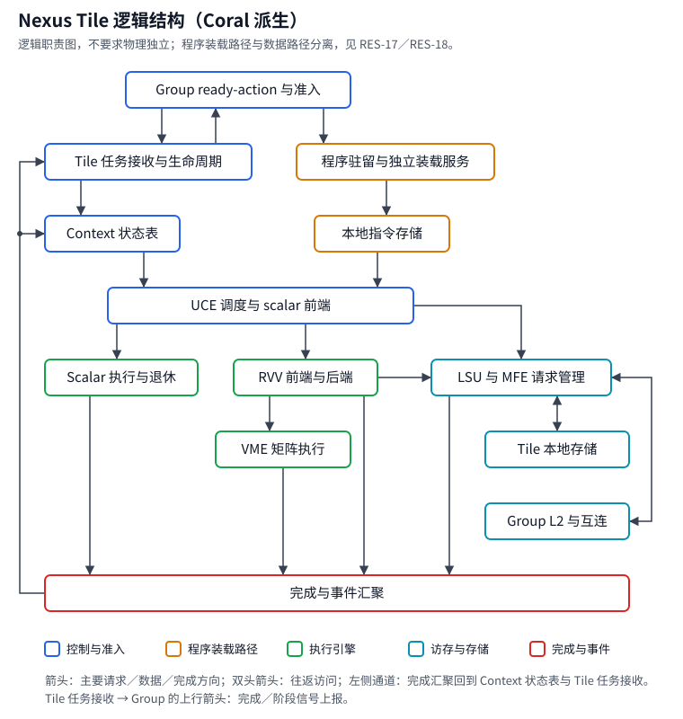
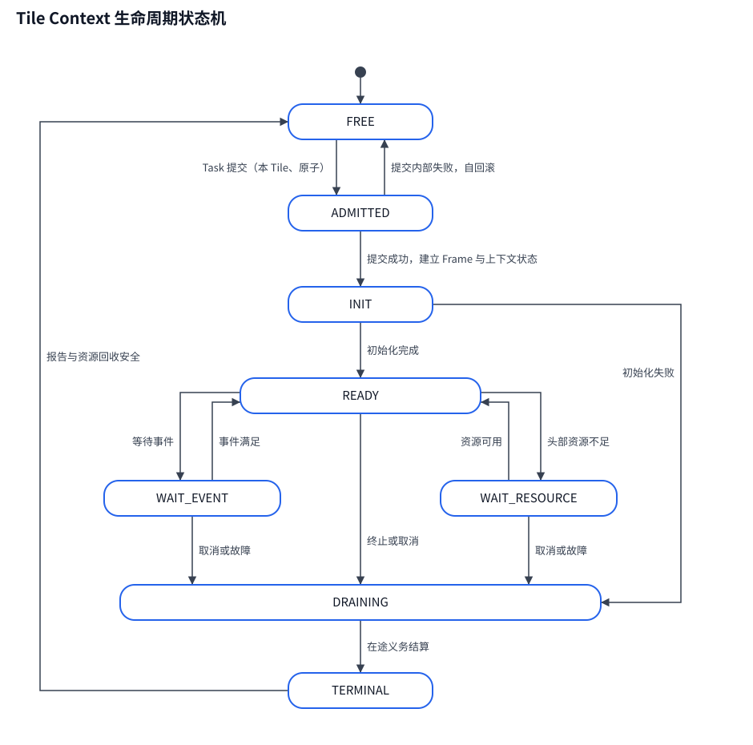

# 基于 Coral NPU 的 Nexus Tile 改造需求规格书

> 文档版本：v0.1（修订 r5）· 设计评审草案  
> 整理日期：2026-11-01（Asia/Shanghai）；r3～r5 修订于 2026-11-03；输入释放勘误于 2026-11-05  
> 适用对象：架构、RTL、编译器、运行时、Python 模拟器与验证  
> 目标：以 Coral NPU 的 scalar、RVV、VME 为实现基础，构建符合既有 Nexus 体系的硬件多 Context Tile。  
> 修订说明：r1 核对本仓库 validator 与 design 合同；r2 增加冷／热程序装载和分级联仿；r3 按七项实现 review 反馈修订：计算绑定与映像先做简版，后续 RVV 程序 dialect 及 Coral compiler／LLVM 支持；参考当前 Nexus 的生命周期选择原生 VME 区域 lease；采用消息边界与唯一状态 owner、设备页授权、程序／数据分离取装、小 FIFO 与 debug-only HBM 日志；r4 按用户确认的方向把 Tile 内多 VME 执行实例作为设计维度（MAT-18～MAT-24）：硬件在区域开始时自动选择空闲实例，区域起止与累加链位置显式声明，并行只来自不同 Context；r5 按实现可行性评审补齐 store 完成／故障的 PC 匹配问题、L1 存储子系统归属、L1 issue gate 与准入、配置转移的硬件可检查表示及若干一致性修正。范围与裁决见 §1.4、§9.4、§23.7。
>
> r5 勘误：明确 `input_released` 的 Group 聚合、纯读 pin 早解除、按 buffer release 与 backing final-free；Task 退休只清理剩余 pin，不新增按 buffer／范围分批通知能力，不改变需求 ID 或 ABI。

## 文档定位

本文把已经确认的体系结构方向转化为可拆分、可实现、可验收的需求。它既说明 Coral 可以复用的部分，也规定必须改变的执行、调度、存储和生命周期语义。

**目标 Tile 由改造后的 Coral scalar/UCE、RVV、VME 与访存和事件设施组成。VME 承担原 BOA 的矩阵计算职责；UCE 成为真正管理多个驻留 Context 的硬件控制前端。Device/Group/Tile 分层、Group ready-action、L2 admission、Context 内有序发射、等待时补位以及 memory profile 合同继续保留。**

阵列组与共享 AM 池的组织、分配和优化仍延期。原生 VME 状态不能延期：本版借鉴 `/home/yongxiy/Desktop/nexus` 的链 owner、挂起／唤醒及最终释放顺序，采用 §9.4 的单矩阵区域 state lease；不迁入其共享 AM 槽、配额、engine affinity 或旧 BOA 阵列拓扑。Tile 内多个 VME 执行实例（MAT-18～MAT-23）是设计阶段必须考虑的维度，N>1 的实现可以后延；它不是共享 AM，也不是给单个 VME 增加多份 mt 状态。

本轮只更新需求文档，未执行 RTL 修改、RTL 仿真、综合、布局布线或功耗测量。Python 参考运行仅用于核对模型事实（§23.5）；“必须”是目标验收要求，“已有”只用于有来源支持的实现事实，不能把本轮新增合同写成已交付能力。

**证据与决策优先级**：用户本轮反馈优先；本仓库既有实现事实以 pipeline_validator 代码为准，其文档次之，再参考重设计考量清单与其他 design 规格。r3 目标改造允许超出当前模型，但须明确差异、后续同步合同与验证。另一个 Nexus 工作树只为第 2 项的状态生命周期提供设计参考 [N01][N02]，不自动覆盖本仓库 ABI／数值／范围；裁决见 §23.7。

---

## 目录

1. [需求等级与决策边界](#sec-01)
2. [目标、范围与交付定义](#sec-02)
3. [参考版本与 Coral 现状](#sec-03)
4. [目标 Tile 结构与职责](#sec-04)
5. [执行语义与全局不变量](#sec-05)
6. [Context 身份、状态与生命周期](#sec-06)
7. [UCE、取指与硬件调度](#sec-07)
8. [寄存器、配置、依赖与退休](#sec-08)
9. [RVV 与 VME 改造](#sec-09)
10. [LSU、MFE 与动态访存](#sec-10)
11. [L1/L2、memory profile 与准入](#sec-11)
12. [事件、可见性与资源释放](#sec-12)
13. [Group—Tile 接口与任务 ABI](#sec-13)
14. [指令、CSR、编译器与运行时](#sec-14)
15. [异常、取消、复位与调试](#sec-15)
16. [参数扩展、性能与功耗](#sec-16)
17. [可观测性与性能计数器](#sec-17)
18. [模拟器与验证计划](#sec-18)
19. [定向验收用例与追踪](#sec-19)
20. [模块改造清单与实施阶段](#sec-20)
21. [风险、待定项与冻结门槛](#sec-21)
22. [交付清单与最终验收](#sec-22)
23. [术语与参考资料](#sec-23)

<a id="sec-01"></a>

## 1. 需求等级与决策边界

### 1.1 状态与规范用语

| 标记         | 含义                               | 使用规则                         |
| ------------ | ---------------------------------- | -------------------------------- |
| 已确认基线   | 用户已经明确的设计方向或保留约束   | 后续实现不得自行改变             |
| MUST／必须   | 为满足目标，本规格要求实现的行为   | 实现可以不同，但必须给出验收证据 |
| SHOULD／建议 | 推荐的实现或阶段策略               | 可以用有证据的等价方案替换       |
| TBD／待定    | 需要设计评审或实验冻结的参数和机制 | 不得当作已经确认的用户决定       |
| 延期         | 本阶段不设计、不作为首版交付门槛   | 未来需求到来时另立规格           |

需求编号保持稳定。条款发生实质变化时，应保留变更记录，更新关联测试和 ABI 版本；不能只修改文字而继续沿用旧验证结论。

### 1.2 已确认的体系结构基线

| 编号 | 已确认要求                                                             | 本次改造的含义                                                                                                                                                                                                                                                           |
| ---- | ---------------------------------------------------------------------- | ------------------------------------------------------------------------------------------------------------------------------------------------------------------------------------------------------------------------------------------------------------------------ |
| B-01 | 保留 Device、Group、Tile 分层                                          | Coral 被改造成 Tile 内部实现，不改变外层职责                                                                                                                                                                                                                             |
| B-02 | 保留 Group ready-action、L2 admission 和任务完成机制                   | Tile 对接既有合同，不能绕过准入自行占用外层资源                                                                                                                                                                                                                          |
| B-03 | Tile 间以 SPMD 为主，具有独立程序进度，非指令锁步                      | 同一程序可以在不同 Tile 上处于不同 PC                                                                                                                                                                                                                                    |
| B-04 | Tile 内支持多个硬件驻留 Context                                        | 每个 Context 有独立 PC、执行状态和生命周期                                                                                                                                                                                                                               |
| B-05 | Context 内按程序顺序发射                                               | 未满足的等待不能被本 Context 的后续指令越过                                                                                                                                                                                                                              |
| B-06 | 等待时由其他就绪 Context 补位                                          | 切换由硬件就绪和资源条件驱动                                                                                                                                                                                                                                             |
| B-07 | 完成后补位                                                             | 不要求各 Context 固定轮次完成，也不固定任务完成顺序                                                                                                                                                                                                                      |
| B-08 | Coral scalar frontend 改造成真正 UCE                                   | 不再另设一个外部 UCE 把完整 Coral 当单 Context 黑盒                                                                                                                                                                                                                      |
| B-09 | RVV 承担向量计算，VME 承担矩阵计算                                     | VME 替代原 BOA 的矩阵职责                                                                                                                                                                                                                                                |
| B-10 | 一个 Context 在一次驻留中绑定一个 memory profile                       | 发射切换不改变该 Context 的存储合同                                                                                                                                                                                                                                      |
| B-11 | 同一级 SRAM 的各 bank 采用一致 SPM/Cache 分区比例，L1 与 L2 可独立设置 | 同时驻留 Context 必须与实际物理分区兼容                                                                                                                                                                                                                                  |
| B-12 | 保留真实的动态 gather/scatter 需求                                     | 需要运行时地址、准入、在途状态、回包匹配与冲突语义                                                                                                                                                                                                                       |
| B-13 | 区分 input_released、output_ready、store_done 和最终完成               | 不用一个 done 位替代所有数据与资源状态                                                                                                                                                                                                                                   |
| B-14 | 保留 Python 模拟器，逐步接入 RTL                                       | 功能、协议、周期性能与 PPA 分别验证                                                                                                                                                                                                                                      |
| B-15 | 阵列组与共享 AM 以后再考虑                                             | 不继承旧 BOA 数量、共享 AM 双槽／配额或 affinity；原生 VME 必需状态以 §9.4 区域 lease 解决，不属于延期范围                                                                                                                                                               |
| B-16 | 继续控制面积、带宽、存储利用率与实现复杂度                             | 不因复用 Coral 自动增加大型 cache、GPU 式调度或复杂虚拟存储                                                                                                                                                                                                              |
| B-17 | 冷启动从 Tile 外部取码；热启动不重新装载指令                           | 热启动 Tile 外部程序文本流量为 0、本地取指照常；取装与数据流分离，安装完成先于首次执行（RES-09～RES-19）                                                                                                                                                                 |
| B-18 | 联合仿真分三级推进：先 Tile 级，再考虑 L2 的 Group 级，最后整颗芯片    | 逐级扩大 RTL 范围，每级有明确边界、时间权威与出口判据；Group 级是否启动在 Tile 级出口后评审决定（§18.4、D-24、D-25）                                                                                                                                                     |
| B-19 | 计算与编译链当前先按简版设计，后续增加 RVV 程序 dialect                | 固定 kernel＋显式绑定＋真实映像／资源 manifest；后端后续可复用 Google Coral compiler 或自建 LLVM，不预先锁定完整编译器架构                                                                                                                                               |
| B-20 | 程序读取尽量与 data flow 分开，避免相互影响                            | 程序与数据独立逻辑队列／credit／保留存储，优先物理分离；共享 HBM／NoC 时保证公平进展并如实计量争用，不借用户数据 Arena 装代码                                                                                                                                            |
| B-21 | 片上内存优先给数据；日志采用小 FIFO，HBM 留存仅 debug                  | 正常模式不留 trace 历史、不写 HBM 日志；debug 显式开启并限额，溢出不影响功能事件与完成；完整重放主要由 Host 捕获承担                                                                                                                                                     |
| B-22 | Tile 内可有多个 VME 执行实例；实现可后延，设计阶段必须考虑             | 实例由硬件在区域开始时自动选择空闲者，软件不指定；区域起止和 matmul 的累加链位置（FIRST／CONTINUE／FINAL）显式声明；同一 Context 的区域不重叠，并行只来自不同 Context；实例同构（MAT-18～MAT-23，累加链声明见 MAT-24）。不同于共享 AM，也不同于单个 VME 内的多份 mt 状态 |

既有三级程序表达继续使用：`nexus.*`（Host/CPU 模型，`nexus.program`）、`nest.*`（一个 root Context／Tile Group，`nest.context`）与 `tile.*`（一个 Task／Tile Program，`tile.program`）的职责划分。Group 管理预取、分发、输出与释放；Tile 执行本地 load、compute、store、await 和 signal。本文不扩张 Group 的控制语言，也不改变外部 CPU 对外层动态控制流的既有职责。[V02]

### 1.3 本文没有冻结的实现参数

以下均为 TBD：驻留 Context 数量、scalar issue width、调度量子、GPR/FPR/VRF 物理组织、VME 计算规模、VLEN、LSU outstanding 数量、DMA 通道数量、各级容量与端口数、地址位宽、时钟目标、工艺节点、面积和功耗预算、精确异常恢复能力。

**建议 bring-up 配置**是至少两个 Context、先保持参考计算数据通路规模、先验证状态和生命周期正确性。它只服务于分阶段验证，不能被写成最终芯片配置。

### 1.4 证据优先级与 validator 继承合同基线

以下区分用户目标与既有事实：用户本轮已采纳的改造优先于旧要求，代码仍是“当前实现了什么”的权威；未实施的新合同不得反写为已有能力。

| 优先级    | 来源                                                                                                           | 用法                                                                             |
| --------- | -------------------------------------------------------------------------------------------------------------- | -------------------------------------------------------------------------------- |
| 0（决策） | 用户本轮对七项 review 的反馈及 B-01～B-22                                                                      | 决定目标范围与简化方式；与模型不同处显式记录，后续实现同步模型，不能伪装已经一致 |
| 1         | 本仓库 pipeline_validator 代码，其次为 README、IR_SPEC、Limitation、hardware_config.yaml 与 tests [V01]～[V07] | 既有实现事实的权威；不把代码沉默或未接线能力算作已实现                           |
| 2         | `design/ELENOR_Hardware_Redesign_Considerations.md` [R01]                                                      | 派生清单；validator 沉默时补充硬件向合同、陷阱与未冻结项                         |
| 3（最低） | 其余 `design/` 规格与 proposal [D01]                                                                           | 只作候选来源；与 1、2 冲突时不采用；〔未冻结〕值不补数字                         |

B-01～B-22 为用户确认的方向，B-19～B-21 为 r3 新增，B-22 为 r4 新增。r1／r2 的继承核对继续保留；r3 针对原生 VME 状态作出 §9.4 的工程选择，并补充简版绑定／映像、消息边界、scope 授权、程序通路和日志策略；r4 把 Tile 内多 VME 执行实例作为设计维度写入 MAT-18～MAT-23。参考的外部 Nexus 工作树已有 typed BOA／共享 AM，而本仓库仍是另一套模型；这里只借鉴 [N01][N02] 的生命周期，不迁入其拓扑、ABI 或数值合同。新增与修订项见 X-19～X-26，模型同步属于后续实现，不是本轮已交付。

下列条目是 validator 已实现并有回归测试的合同。它们对 Coral 派生 Tile 是**既有约束**，不是新增偏好；展开条款见“关联需求”列。

| 编号  | 既有合同                                                                                                                                                                                                                                                                                                                                                    | Tile 侧含义                                                                                                                                 | 关联需求                              |
| ----- | ----------------------------------------------------------------------------------------------------------------------------------------------------------------------------------------------------------------------------------------------------------------------------------------------------------------------------------------------------------- | ------------------------------------------------------------------------------------------------------------------------------------------- | ------------------------------------- |
| VB-01 | 源程序三级：`nexus.*`（Host/CPU）→ `nest.*`（root Context／Tile Group）→ `tile.*`（Task／Tile Program）；Task ID 是逻辑 ID，既不是物理 Tile，也不是硬件 Context                                                                                                                                                                                             | Tile 只执行 Tile Program，不推断 Group／Device 级控制流                                                                                     | §4.3、§6.1.1                          |
| VB-02 | 源 IR → `compile_program` → 不可变 `CompiledProgram` → `load_program`（只读验证）→ `Simulator.run`；Loader 不修图、不补 await、不换 Profile                                                                                                                                                                                                                 | Tile 接收的是已封印、已验证的程序与资源合同，硬件不做运行时修复                                                                             | CMP-14、VER-11                        |
| VB-03 | Group 层：待准入 root 只占有界 pending 元数据；root 准入原子取得 Group 槽位、L2 Arena 与事件／控制预算；`DISPATCH_ROLE` 只登记有界 Grid Route，**不**跨 Tile 成组提交                                                                                                                                                                                       | Tile 看到的是逐 Task 的独立提交，不存在跨 Tile 共同 activation                                                                              | ADM-01～ADM-12                        |
| VB-04 | 每 Tile 每 Tick 至多提交一个 Task；一次提交取得 L1 Arena、Frame／控制状态、UCE 上下文、父 L2 pin 与 R lease，失败整体回滚；受阻的 Tile 不回滚其他 Tile                                                                                                                                                                                                      | Task 是 Tile 侧准入与资源回收的基本单位                                                                                                     | ARN-01～ARN-09、CTX-13～CTX-16        |
| VB-05 | 同层 Profile 全员一致；Profile 在编译期绑定为 SAME／COMPATIBLE，真实切换是编译器生成的显式事务；运行期不选档、不重配                                                                                                                                                                                                                                        | 驻留 Context 绑定的是 `allowed_profiles` 与解析后的模式，物理模式在 Tile 内唯一（澄清 B-10）                                                | PRO-01～PRO-17                        |
| VB-06 | Arena 所有权：root 拥有 L2 Arena，Task 拥有 L1 Arena。L1：`tile.free` 只使 view 失效，Arena 仅在 Task 安全退休时整体归还，复用由编译器静态证明。L2：`nest.release` 是永久 forfeiture（no-rebind），backing 的整段 padded span 在引用闭合的物理 final-free 时归还并推进 `pool_version`，可早于 root 退休；共享 readonly backing 可在 producer 退休后继续保留 | L1 的 `tile.free` 不归还容量、R 或 UCE 槽位；L2 容量的归还点是 backing final-free；Task 退休、backing final-free、root 完成是三个不同的时刻 | ARN-02～ARN-06、ARN-04a、ARN-04b      |
| VB-07 | 阶段信号：每个 Task 每个方向至多发一次 `input_released`／`output_ready`；Group 按 `(launch generation, GridInstanceId, phase, 逻辑 Task)` 聚合，重复＝协议故障，旧代＝忽略                                                                                                                                                                                  | Tile 发信号即发即走，去重与聚合在 Group                                                                                                     | EVT-13～EVT-16                        |
| VB-08 | 等待语义：`tile.await` 只挂起当前硬件 Context；`nest.await` 只栅栏本 root 后续注册；`nest.barrier` 只等本 Context 更早 action                                                                                                                                                                                                                               | 硬件不得把局部等待升级为全局静默                                                                                                            | EVT-04、EVT-19、SCH-01                |
| VB-09 | 完成语义：root 完成要求其全部 Route、Task、租约与 outstanding job 关闭、root 自己的 L2 view 全部 release、Arena 预留（含 slack）退休后才发布；仍被其他 root 的共享 claim 持有的 backing 不阻止 root 完成；到达最终 PC 不等于完成                                                                                                                            | Task 终止先于资源回收，回收先于完成上报                                                                                                     | CTX-12、ARN-05、ADM-11                |
| VB-10 | 取消不是删除：已接受的 DMA／refill 保持 `CANCEL_REQUESTED`，直到真实完成或隔离确认；其间信用、地址、pin、Arena、gate 不复用                                                                                                                                                                                                                                 | 异步回包的归属与隔离是硬件义务                                                                                                              | MEM-09、MEM-12、CTX-08～CTX-10        |
| VB-11 | 故障模型为 fail-stop：Task 故障使本 Tile 的 UCE 停止发射并上报，Group 复位状态机排空整个 run 后再结算                                                                                                                                                                                                                                                       | 局部隔离是增强目标，不是 validator 基线                                                                                                     | FLT-01～FLT-14、RST-07                |
| VB-12 | 有限资源是合同的一部分：事件表、Grid Route、pending root、action／inflight／DMA／ACK／Frame Slot、program SRAM 等均有静态容量，超限在编译或加载期拒绝                                                                                                                                                                                                       | Tile 容量必须经 manifest 与指纹向上暴露                                                                                                     | PAR-06～PAR-08                        |
| VB-13 | `target_fingerprint` 覆盖拓扑、存储、队列深度与可行性容量；时延、带宽、时钟、策略、trace 与 fidelity 不在其内                                                                                                                                                                                                                                               | 改变指纹字段＝旧 artifact 作废，须重编译并升版                                                                                              | PAR-06、CMP-14、CMP-16                |
| VB-14 | 三档 fidelity（`timing_only`／`runtime`／`full_memory`）执行相同的合同检查；物理 Arena／view 生命周期、程序驻留代价、ACCEPT／Frame 绑定与故障复位状态机从 `runtime` 起生效，`timing_only` 没有；只有 `full_memory` 加 `ByteStore` 证明字节搬运；BOA／EVU／USE 是时序模型，不执行张量算术                                                                    | validator 的周期与数值都不能当 RTL 真值                                                                                                     | §18.1、RES-03、VER-09、VER-16、VER-19 |
| VB-15 | 源语言边界：公开 Tile Program 为单块直线，view stride 全为 1，物理 transfer 仅连续 row-major，字节数由 shape／dtype 推导                                                                                                                                                                                                                                    | 超出此边界的 Tile 能力需先修改 validator 合同再入规格                                                                                       | DMA-09、CMP-13                        |

<a id="sec-02"></a>

## 2. 目标、范围与交付定义

### 2.1 本阶段目标

| 需求   | 规范性要求                                                                                                                                                                             | 验收要点                                               |
| ------ | -------------------------------------------------------------------------------------------------------------------------------------------------------------------------------------- | ------------------------------------------------------ |
| ARC-01 | Tile 必须同时驻留多个任务 Context；多 Context 交付配置至少支持两个 Context                                                                                                             | A 等待期间 B 可以独立推进                              |
| ARC-02 | 正常切换不得依赖全 Tile drain、全局 flush、全核复位或软件完整保存/恢复执行状态；编译器生成的 Profile 切换事务是受控的特权例外（PRO-13）                                                | trace 显示旧操作继续执行，其他 Context 正常发射        |
| ARC-03 | UCE 必须硬件管理就绪选择、等待、唤醒及有限资源仲裁                                                                                                                                     | 运行中的逐次切换不需要 Host 指令                       |
| ARC-04 | VME 必须作为 Tile 的矩阵执行路径                                                                                                                                                       | 数值、指令、编译和完成语义贯通                         |
| ARC-05 | 外层资源准入、所有权、可见性与释放语义必须延续                                                                                                                                         | 任务乱序完成仍不提前释放或串扰                         |
| ARC-06 | 必须保留可复现的单 Context 参考配置与多 Context 配置                                                                                                                                   | 能区分基础复用、MC 开销和规模扩展收益                  |
| ARC-07 | 必须以受支持配置清单声明能力，不得把“有参数/宏”等同于“已实现并验证”                                                                                                                    | 不支持的组合在构建或加载时明确拒绝                     |
| ARC-08 | Tile 的外部行为由 §13 的消息合同完整描述；保留 Group／Device 的调度语义与对外合同，允许重构内部 adapter 和状态归属，不要求代码原封不动。既有 VB 合同继续保留，r3 扩展按 §23.7 显式对齐 | T-39、T-40、T-64；每个可变状态单一 owner，无未裁决差异 |

### 2.2 本阶段覆盖范围

覆盖 Tile UCE／Context、scalar/RVV/VME 与区域 lease、依赖／退休、LSU/MFE 和 scope 页授权、事件／完成、Group—Tile 消息、Profile／准入、程序与数据分离的冷／热取装、简版 kernel／映像／资源 manifest、runtime、小 FIFO debug 观测，以及分级联仿。完整 RVV 程序 dialect 和 Coral compiler／LLVM 后端后续细化；简版真实执行与 CS1 门槛不延期。

Group 调度器、L2 管理器、NoC、Global DMA 和 HBM 控制器仍是外部依赖；为接入新 Tile 可重构消息与单一状态 owner，并增加程序装载／授权所需服务，但不改变外层调度语义、不借本次改造重新设计整颗芯片。

### 2.3 延期与明确边界

| 项目                                                                   | 当前处理                                                                                                                                                                          |
| ---------------------------------------------------------------------- | --------------------------------------------------------------------------------------------------------------------------------------------------------------------------------- |
| 多阵列组、跨阵列映射、共享 AM 池                                       | 延期；不规定池／槽／配额。单区域原生 VME 状态 lease 与 Context-local 配置属于当前必要正确性要求（§9.4）                                                                           |
| Tile 内 N>1 个 VME 实例的 RTL 实现                                     | 可后延，但设计阶段不得排除：协议、状态表、完成跟踪、插桩、指纹与验证接口现在就按实例维度书写（MAT-18～MAT-23）。异构实例（不同尺寸或能力）、单个 VME 内的多 bank／多 lease 仍延期 |
| 旧 BOA 描述符与物理阵列实现                                            | 不作为新矩阵后端的保留要求                                                                                                                                                        |
| 完整 GPU warp/SIMT、CUDA 兼容                                          | 无此交付要求                                                                                                                                                                      |
| 任意 Context 迁移、任意时刻抢占和寄存器换出                            | 无此首版要求；资源等待时的正常硬件切换必须支持                                                                                                                                    |
| 全系统 cache coherence、虚拟内存、IOMMU                                | 不自动引入；按地址与数据可见性合同选择必要机制                                                                                                                                    |
| 完整精确异常恢复                                                       | 作为决策项；不能默认继承自 Coral                                                                                                                                                  |
| FPGA、流片、实际板卡                                                   | 可选验证阶段；不作为功能/RTL 研究完成的前置条件                                                                                                                                   |
| 原 Coral 宣传算力、频率和功耗                                          | 只作背景；不能作为改造后已经达到的指标                                                                                                                                            |
| 多 Group、跨 Group 通信、task stealing、oversubscription、动态负载均衡 | 延期；与 validator 的有意限制一致（单 Group、固定 4-Tile 映射、Task 与 Tile 1:1）[V03]                                                                                            |
| 每 bank 或每 Context 私有 cache 分区、运行期试档                       | 不支持：同层 Profile 全员一致，真实切换只经编译器生成的显式事务（VB-05）                                                                                                          |
| 通用 Tile CFG／动态递归、完整 RVV 程序 dialect 和通用机器码证明器      | 后续设计；当前采用直线生命周期控制＋受控 kernel 内部有界循环／分支，显式 binding 和资源检查（CMP-13、CMP-19～CMP-21）                                                             |
| Scatter reduce／原子操作、FIFO delivery、通用地址提供者                | validator 未建模，不得默认存在（GAT-07）                                                                                                                                          |
| 2D／strided／multicast 搬运                                            | 未建模的硬件扩展；先修改 validator 合同（DMA-09）                                                                                                                                 |
| 按版本／范围分批发布输出                                               | 对 validator 的扩展，不属于基线（§12.3、D-20）                                                                                                                                    |
| Context 局部故障隔离                                                   | 增强目标，不属于首版基线（FLT-02a、D-17）                                                                                                                                         |
| Group 级（L2）与整芯片联合仿真                                         | Group 级在 Tile 级（CS1）出口后评审决定是否启动（D-24）；整芯片级为最后阶段（D-25），权威比较范围限于 validator 覆盖的 1 Group × 4 Tile 配置，多 Group 路径不对拍（§18.4.2）      |
| 大型片上 trace memory、正常模式 HBM 日志、无条件全历史重放             | 不支持；仅小 FIFO／必要状态寄存器，留存须 debug。Host 联仿可保存完整记录，不计入片上 SRAM（§17）                                                                                  |

<a id="sec-03"></a>

## 3. 参考版本与 Coral 现状

### 3.1 固定参考版本

| 对象                               | 固定版本                                                                 | 用途                                                                       |
| ---------------------------------- | ------------------------------------------------------------------------ | -------------------------------------------------------------------------- |
| Coral NPU RTL 与构建               | `f79522157fc0f1d7311f44e209fc36c9c8b7a039`                               | 本文硬件改造点依据                                                         |
| Coral NPU compiler/runtime         | `d715556c3853719e414182c0bf5f4a10f248f1d9`                               | 编译和运行时适配依据                                                       |
| Google Coral 官方文档              | 2026-11-01 查阅                                                          | 架构和集成说明的辅助来源                                                   |
| 本仓库 pipeline_validator 及其文档 | r1/r2 固定核对点 HEAD 57885c5；r3 另核对所引用的当前源码，代码优先于文档 | 既有合同事实；不把本轮新增能力称为已实现                                   |
| 既有 Nexus 决策与模拟器说明        | 本轮用户确认优先，历史只作参考                                           | 继承控制、存储与生命周期要求                                               |
| 另一个 Nexus 工作树的状态管理代码  | 2026-11-03 的 `/home/yongxiy/Desktop/nexus`，具体文件 [N01][N02]         | 仅参考区域／链的 owner、挂起／唤醒、最终输出与安全释放，不迁入共享 AM 架构 |

固定 SHA 用于复现本次分析，**不声称它们始终是上游最新提交**。正式开发应建立 fork/branch、锁定依赖，并记录所有偏离这些版本的变化。[S01][S02]

### 3.2 已核对的关键事实

| Coral 基线事实                                                                                                                                                               | 对改造的影响                                                                                                                     | 来源       |
| ---------------------------------------------------------------------------------------------------------------------------------------------------------------------------- | -------------------------------------------------------------------------------------------------------------------------------- | ---------- |
| 官方软件说明将当前计算卸载能力描述为 single-context                                                                                                                          | MC 是新增的架构能力，不能通过已有软件异步 API 推定已经存在                                                                       | [S03]      |
| scalar、RVV 与 VME 紧密连接，VME 依赖 RVV                                                                                                                                    | 需要端到端改造，不能把 VME 当原 BOA 描述符黑盒直接替换                                                                           | [H01][S04] |
| 标量与 RVV 都有自己的有序完成/退休结构                                                                                                                                       | 只改 scalar 侧会留下后端跨 Context 阻塞                                                                                          | [H03][H07] |
| `RetirementBuffer` 的 scalar store 完成按 `storeComplete` 携带的 PC 与条目地址匹配，非 RVV 故障按 `mepc` 匹配；向量／矩阵写回与 RVV 故障才按 `rob_tag` 匹配                  | 同一映像在两个 Context 上同 PC 并发的在途 store 会错配完成，故障也会归错 Context；匹配键须加入 Context／ROB 身份（RET-01、X-27） | [H03]      |
| LsuV3 中存在单个 LsuSuperSlot，并从队首接收操作                                                                                                                              | 加深 FIFO 本身不构成多 Context 在途访存支持                                                                                      | [H05]      |
| CoreAxi 的全核关钟条件直接引用 core WFI                                                                                                                                      | Context park 与 Tile 全局 quiescence 必须拆分                                                                                    | [H06]      |
| Chisel 参数中的 RVV VLEN 当前为 128；SV 另有配置宏                                                                                                                           | 扩宽前必须检查两种实现语言的配置一致性                                                                                           | [H08][H09] |
| 当前实现/编译文档按 Zvt/VME v0.4 描述                                                                                                                                        | 版本必须固定，不称作已兼容未来标准最终版                                                                                         | [S04][C01] |
| 基线 runtime 存在同步执行假设；部分 event/barrier 是 no-op                                                                                                                   | 并发化必须同时修改运行时的同步和可见性实现                                                                                       | [C02][C03] |
| 官方集成指南的默认映射为 ITCM 8 kB、DTCM 32 kB；程序由 Host 或 DMA 经 `S_AXI` 写入 ITCM，之后写起始 PC、释放时钟门控与复位；固定版本的 FPGA 路径每次 `Run` 复位并重写起始 PC | 基线没有程序驻留身份、冷／热区分或 Group 侧自动取装；冷启动取装通路、热启动命中和容量对齐都是新增能力（RES-09～RES-14）          | [S08][C04] |

四路 scalar 发射、多个在途操作、多个矩阵累加器均不能证明存在多个硬件 Context。原生 VME 的逻辑矩阵状态也不等同于多个独立矩阵引擎。

### 3.3 源码优先与配置证据

实现评审必须保存“源代码版本＋完整生成参数＋目标名称＋工具链版本”。不能仅凭 `Parameters.scala` 默认值判定实际生成模块的总线宽度，因为构建目标可能覆盖默认参数。

`enableVerification` 在参考代码中还影响完整/mini retirement buffer 模式，并非纯观测开关。比较原 Coral 与新 Tile 时必须匹配这类功能配置，或明确记录差异。[H08]

<a id="sec-04"></a>

## 4. 目标 Tile 结构与职责

### 4.1 逻辑结构



上图为渲染版，下方为同一内容的纯文本版，便于在 diff 和不渲染图片的环境中阅读；二者拓扑一致，修改时须同步。

```text
            +---------------------------+
            | Group ready-action 与准入 |
            +---------------------------+
                |       ^             |
                v       |             v
    +---------------------------+ +------------------------+
 +->|  Tile 任务接收与生命周期  | | 程序驻留与独立装载服务 |
 |  +---------------------------+ +------------------------+
 |      |                                   |
 |      v                                   v
 |  +----------------+            +--------------+
 +->| Context 状态表 |            | 本地指令存储 |
 |  +----------------+            +--------------+
 |                |                     |
 |                v                     v
 |            +------------------------------+
 |            |    UCE 调度与 scalar 前端    |--------------+
 |            +------------------------------+              |
 |              |               |                           |
 |              v               v                           v
 |  +-------------------+   +----------------+    +---------------------+
 |  | Scalar 执行与退休 |   | RVV 前端与后端 |--->| LSU 与 MFE 请求管理 |<---+
 |  +-------------------+   +----------------+    +---------------------+    |
 |        |                        |        |       |           ^            |
 |        |                        v        |       |           v            |
 |        |                +--------------+ |       |   +---------------+    |
 |        |                | VME 矩阵执行 | |       |   | Tile 本地存储 |    |
 |        |                +--------------+ |       |   +---------------+    |
 |        |                        |        |       |                        |
 |        |                        |        |       |                        |
 |        |                        |        |       |   +-----------------+  |
 |        |                        |        |       |   | Group L2 与互连 |<-+
 |        |                        |        |       |   +-----------------+
 |        |                        |        |       |
 |        |                        |        |       |
 |        v                        v        v       v
 |  +---------------------------------------------------------------------+
 +--|                           完成与事件汇聚                            |
    +---------------------------------------------------------------------+
```

图表示逻辑职责，不要求全部物理独立；箭头表示主要的请求／数据／完成方向，双向箭头表示往返访问，左侧通道自“完成与事件汇聚”回到 Context 状态表和 Tile 任务接收，Group 与 Tile 任务接收之间的上行箭头为向 Group 的完成／阶段信号上报。程序装载／指令存储不借用户数据 Arena；共享物理链路的隔离与仲裁见 RES-17／18。寄存器、配置、依赖和 owner 属各路径的共同正确性要求；图中省略端口、bank 和小型诊断 FIFO。

### 4.2 模块职责

| 模块                | 必须承担的职责                                                                                              | 与其他模块的边界                                                                                                  |
| ------------------- | ----------------------------------------------------------------------------------------------------------- | ----------------------------------------------------------------------------------------------------------------- |
| UCE                 | Context 选择、PC 推进、标量控制、依赖检查、等待和终止指令处理                                               | 不替 Group 决定 L2 容量准入                                                                                       |
| Context 管理        | 身份、驻留状态、profile、寄存器映射、等待条件、终止与回收                                                   | 不用“当前运行 Context”推断异步回包归属                                                                            |
| Scalar 执行         | 整数/浮点/分支等受支持指令                                                                                  | 长延迟返回带操作所有者                                                                                            |
| RVV                 | 向量计算、向量配置、VRF、uop 调度和结果返回                                                                 | 向 VME 与 LSU 传递完整语义和身份                                                                                  |
| VME                 | 矩阵运算、原生 mt 状态的区域 owner／lease、结果排空与自动释放                                               | 状态按区域而非 UCE 当前选择归属；不扩张为共享 AM 池（§9.4）                                                       |
| LSU                 | scalar/vector 访存、地址/权限检查、子事务匹配、返回与错误                                                   | 与 MFE 共享存储时遵守同一可见性合同                                                                               |
| MFE/搬运接口        | 数据搬运、indexed 求址与 scope 授权、descriptor、credit 和完成                                              | 程序读取使用独立逻辑取装服务；不将其塞入可能被数据占满的队列                                                      |
| 事件与完成汇聚      | 记录事件、唤醒、任务结果和释放通知                                                                          | 必须在前端不发射时继续服务返回                                                                                    |
| Tile 存储接口       | 本地容量、bank、端口、SPM/cache profile 和访问归属                                                          | L1 分配由 Tile 本地资源机制负责                                                                                   |
| Task 接收与资源账本 | Tile 本地 L1／Frame／Context／程序空间准备与退休，配合 Group 的父 L2 pin／R ticket                          | Group 为跨边界提交协调 owner（IF-13）；本地预留不等于已接受任务，不以 tile.free 回收容量                          |
| Profile 成员代理    | 维护 L1 各 bank／pool 的 active／shadow 模式与 generation，响应 PREPARE／COMMIT，执行 issue gate 与范围维护 | 唯一 writer 在 Group 侧控制器；Tile 不自行切档                                                                    |
| 程序驻留接口        | resident 句柄、映像身份、累计容量、独立安装端口及完成确认；程序就绪后才取指                                 | Group 驻留服务触发，普通 kernel 不发 load/install；不依赖用户数据 Arena；热启动外部程序文本流量为 0、本地取指照常 |
| 诊断出口            | 默认关闭的采集控制、小 FIFO、溢出状态与受限 debug 导出                                                      | 不承担可靠功能消息；不建设大型片上日志 memory，HBM 留存仅 debug                                                   |

旧功能名称的映射以职责为准：EVU 的向量职责映射到 RVV；BOA 的矩阵职责映射到 VME；MFE 的搬运合同继续存在；其他原 USE/专用操作应逐项映射到 scalar/RVV、软件 helper 或明确暂不支持的能力，不能默认全部消失或全部免费获得。

### 4.3 validator 引擎与旧职责到新 Tile 的映射

validator 的 Tile 模型仍以 BOA／EVU／USE／MFE 四类 engine 表达计算与搬运。下表给出它们在 Coral 派生 Tile 上的落点；完成语义以“区域完成点发布本地完成事件”为准，不要求保留旧 descriptor 接口。

| validator 操作（私有 IR）                             | 新 Tile 的承担者                     | 说明                                                                                                     |
| ----------------------------------------------------- | ------------------------------------ | -------------------------------------------------------------------------------------------------------- |
| `LAUNCH_BOA`（tile.boa.async：m/n/k/ops/accumulate）  | 显式 kernel binding＋RVV/VME 区域    | 当前抽象 descriptor 不足以确定操作数；简版绑定 A/B／输出／L1 初值，区域按 §9.4 占用与释放，不引入共享 AM |
| `LAUNCH_EVU`（tile.evu.async、tile.pow.async）        | 显式绑定的 RVV／helper kernel        | 先采用 CMP-19 简版，后续 RVV 程序 dialect 细化；旧前端队列和时序属性不约束真实实现                       |
| `LAUNCH_MFE`（`tile.load.async`／`tile.store.async`） | MFE／LSU 显式搬运                    | 基线只支持连续 row-major（DMA-09）                                                                       |
| `LAUNCH_GATHER`／`LAUNCH_SCATTER`                     | MFE indexed 路径                     | 求址、cache 与运行时页授权见 GAT-11～GAT-20                                                              |
| `LAUNCH_USE`                                          | scalar／RVV helper，或明确暂不支持   | validator 只有私有 IR 操作与 Roofline 时序模型，公开源语言没有对应的 `tile.*` 算子；不得默认免费获得     |
| `STREAM_*`、`BR_EOS`                                  | 若使用：有限容量的硬件队列           | 仅私有 IR 有，公开源语言无 stream 语法（DMA-13）                                                         |
| `nest.collective.async`                               | Group／Collective，不属于本阶段 Tile | Tile 只经 `output_ready` 与 partial slot 参与                                                            |

本规格中的 UCE 是 Coral scalar 流水线经改造而成（B-08），含标量执行、退休与 scoreboard；`design/elenor_tile_uce` 将 UCE 描述为纯控制 sequencer，该口径被用户决定 B-08 覆盖（§23.7 X-14）。

<a id="sec-05"></a>

## 5. 执行语义与全局不变量

### 5.1 必须成立的不变量

| 编号   | 不变量                                                                                                                                                                                                                                                                                                                                                                                                                       |
| ------ | ---------------------------------------------------------------------------------------------------------------------------------------------------------------------------------------------------------------------------------------------------------------------------------------------------------------------------------------------------------------------------------------------------------------------------- |
| INV-01 | 每次已接受操作都能唯一恢复其 Context、任务代际和操作身份                                                                                                                                                                                                                                                                                                                                                                     |
| INV-02 | Context 内发射遵守程序顺序；跨 Context 不建立无语义依据的先后关系                                                                                                                                                                                                                                                                                                                                                            |
| INV-03 | 一个 Context 的未满足等待只阻止该 Context 的后续发射                                                                                                                                                                                                                                                                                                                                                                         |
| INV-04 | 已接受的异步操作不因普通 Context 切换而失效                                                                                                                                                                                                                                                                                                                                                                                  |
| INV-05 | 写回、旁路、异常和状态标志均归属于操作发起者                                                                                                                                                                                                                                                                                                                                                                                 |
| INV-06 | buffer 在仍可能被合法访问时不得回收或转交新所有者                                                                                                                                                                                                                                                                                                                                                                            |
| INV-07 | 事件成功状态只能在它承诺的完成和可见性条件满足后发布                                                                                                                                                                                                                                                                                                                                                                         |
| INV-08 | 返回、排空和资源释放不能依赖被阻塞 Context 再次获得前端执行机会                                                                                                                                                                                                                                                                                                                                                              |
| INV-09 | Context 槽复用不能让旧任务迟到结果污染新任务                                                                                                                                                                                                                                                                                                                                                                                 |
| INV-10 | 普通 Context park 不等于 Tile 关钟；全局关钟必须保留有效唤醒路径                                                                                                                                                                                                                                                                                                                                                             |
| INV-11 | 源码宏、仿真模型和编译器对同一配置的解释必须一致                                                                                                                                                                                                                                                                                                                                                                             |
| INV-12 | 不兼容的 memory profile 不能通过每次切换发射 Context 来重配同一物理 SRAM                                                                                                                                                                                                                                                                                                                                                     |
| INV-13 | 容量按 owner 层次归还，三者不得混淆：L1 Arena extent、R lease、Frame 与 UCE 槽位只在 Task 安全退休（或取消隔离确认）时归还，`tile.free`、`input_released`、`output_ready` 与取消请求都不归还；L2 容量只经 backing 的物理 final-free（引用闭合，ARN-04b）归还，`nest.release` 本身只撤销 owner 视图，final-free 可早于 root 退休，共享 backing 也可晚于 producer root 退休；root 的元数据与 Arena 级 slack 在 root 退休时归还 |
| INV-14 | 不同 Tile 的 Task 提交与推进相互独立；一个 Tile 的准入受阻不得回滚或暂停其他 Tile 已提交的 Task                                                                                                                                                                                                                                                                                                                              |
| INV-15 | 旧代（run、launch、Profile、allocation generation）的迟到回包不得写入新代 SPM／cache／buffer；处理方式（拒绝、忽略计数或不变量故障）按路径明确且可观察                                                                                                                                                                                                                                                                       |
| INV-16 | 控制、事件与故障路径的前进不依赖批量数据通道的排空（独立通道或等价机制）                                                                                                                                                                                                                                                                                                                                                     |

### 5.2 发射、完成、退休和发布

本文使用四个不同概念：

- **发射/接受**：执行路径通过明确握手承诺接管操作。只在该时刻推进该 Context 的发射进度（next-issue PC）、指令序号和本次操作分配计数。取指游标可按取指请求接受规则独立推进，但必须依靠 Context 身份和 fetch epoch 处理重定向与过期响应，不能冒充已经发射或退休的进度。
- **执行完成**：计算或访存阶段达到该操作规定的完成条件。不同路径可以乱序完成。
- **退休**：在同一 Context 内按照已定义顺序确认指令结束并回收跟踪资源。
- **对外发布**：向其他 Context、Group 或 Host 声明数据或任务状态可使用；还必须满足相应内存可见性条件。

原 Coral 的 retirement buffer 不自动提供完整的副作用提交和回滚。新设计必须明确哪些副作用发生在执行完成阶段，哪些发生在退休阶段，以及异常时允许保留哪些已发生的副作用。[H03]

三个相关时刻必须分开观察：UCE 接受（发射握手）、engine 接受（前端队列握手）与 engine 完成。validator 的对应记录是 `uce_launch_attempt`、`uce_launch_accepted`，以及引擎完成通知触发的本地事件完成。Task 的退休顺序与资源归还见 ARN-05。

### 5.3 并发目标的准确边界

允许真实共享资源竞争。首版 VME 按有界矩阵区域独占原生状态（§9.4），另一 Context 的矩阵申请可以等待；这不锁整个 Tile，已就绪的独立 scalar／RVV／MFE 仍须有机会推进。必须消除的是全局队首／全局等待位／错误归属导致的无关阻塞，而不是承诺多个 Context 的矩阵区域同时执行。

L2 admission 的 SAME／COMPATIBLE 双队首约束（类内不越队首）可以产生策略性队首等待。它与 Tile 内不必要的全局 ROB/LSU 阻塞不是同一问题，本文不承诺整个系统“没有任何 HOL”。

<a id="sec-06"></a>

## 6. Context 身份、状态与生命周期

### 6.1 逻辑身份

| 身份                                          | 用途                                                                                                                                           | 约束                                                                                 |
| --------------------------------------------- | ---------------------------------------------------------------------------------------------------------------------------------------------- | ------------------------------------------------------------------------------------ |
| `task_id`                                     | 软件任务的稳定关联标识                                                                                                                         | 与 Group/Host 完成报告一致                                                           |
| `context_slot`                                | Tile 内有限硬件槽位                                                                                                                            | 仅表示存放位置，不是永不复用的任务 ID                                                |
| `task_generation`                             | 区分槽位的不同驻留任务                                                                                                                         | 复用后旧消息不能命中新任务                                                           |
| `instruction_seq` 或等价 ROB ID               | 区分任务内在途操作并保持顺序                                                                                                                   | 回绕不能与尚存活操作混淆                                                             |
| `fetch_epoch`                                 | 识别重定向前后的取指路径                                                                                                                       | 不能替代任务代际                                                                     |
| `transaction/subop_id`                        | 匹配访存分片、向量 uop 等子操作                                                                                                                | 能恢复所属父操作和剩余完成数                                                         |
| `event_generation`                            | 区分事件 ID 的不同使用周期                                                                                                                     | 旧 signal 不能唤醒新 wait                                                            |
| `launch_generation`／`GridInstanceId`         | 区分同一 Context 的不同次启动与同一 root 内不同 dispatch 的 Grid 实例；阶段信号以 `(launch generation, GridInstanceId, phase, 逻辑 Task)` 为键 | 物理 Tile 与硬件 Context 只是位置信息，不参与聚合身份                                |
| `run_generation`                              | 每次装载 program 递增；上一次 launch 未退休不得开始新 run                                                                                      | 传输与 Profile 控制器要求其单调                                                      |
| `profile_generation`／`allocation_generation` | Arena、view、pin 的所有者与代际；迟到访问据此判别                                                                                              | Profile 代际按层单调，只在全部成员 Commit ACK 后发布                                 |
| program_id＋version＋hash＋epoch              | 程序驻留身份                                                                                                                                   | 提交前身份有效，首次取指前安装有效；简版身份来自实际映像和合同封印，reset 使驻留失效 |
| region_id＋state_generation                   | VME 原生状态一次区域占用                                                                                                                       | 与 Task／Context 代际一起匹配，独立于当前被选中的 Context；state_free 前不得转交     |

这些是逻辑信息，不要求所有物理总线逐位携带完整字段；允许通过在途表索引恢复身份，但映射必须在操作结束前有效。

#### 6.1.1 “Context”相关概念辨析

validator 中有多个名称相近、容量与作用域各不相同的概念。本文的 **Context** 默认指硬件 UCE 上下文；其余概念必须带限定词，不得互相替代。

| 概念                            | 含义                                                                                   | validator 容量参数                                                                                       | 不能混用的原因                                                                 |
| ------------------------------- | -------------------------------------------------------------------------------------- | -------------------------------------------------------------------------------------------------------- | ------------------------------------------------------------------------------ |
| Device outstanding              | CPU 已交付但未完成的 root 请求                                                         | `device_context_count`（1～8）；Device `pending_capacity`、`completion_capacity`                         | 与 Group 槽位、UCE 上下文无关                                                  |
| Group execution slot            | Group 上下文表项，承载一个 root 调用；`nest.context context=N` 可钉住                  | `group.active_context_capacity`（默认 8）                                                                | 不是 Tile ID，也不是 UCE 上下文                                                |
| root 调用（`nest.context`）     | 拥有 L2 Arena 与事件预算的一次调用                                                     | `group.context_pending_capacity` 约束其待准入元数据                                                      | 以 launch generation 区分重复调用                                              |
| 硬件 UCE 上下文（本文 Context） | Tile 内驻留执行上下文：PC、状态、等待、本地事件、Frame                                 | `SimConfig.context_count`（1～8，仿真默认 1；硅片值未冻结）；design 规格注记 V1.x 上限为 2（最低优先级） | dispatch `context=N` 在所选各 Tile 钉住同号 UCE 上下文，越界在编译或加载期拒绝 |
| R lease                         | 一个父 binding 在一个 Tile 上可同时提交的 Task 数上界（`requested_contexts_per_tile`） | 键 `(parent binding_id, launch_generation, tile_id)`；编译期检查 R ≤ `context_count`                     | 约束同一父的所有 Grid，不是 UCE 槽位数                                         |
| Frame Slot                      | 每个硬件 Context 一个 Frame，绑定 L1 view                                              | `frame_slot_capacity`＝16，`frame_bind_cycles`＝8                                                        | 既不是 Context，也不是 program slot                                            |
| ABI 隔离域 `context_id`         | 驱动与 IOMMU 侧的隔离标识                                                              | 位宽未冻结                                                                                               | 与以上均不同                                                                   |
| 逻辑 Task ID                    | `nest.task.range` 中的逻辑任务                                                         | 非空 range 的个数等于 `placement` 的 popcount                                                            | 不是物理 Tile，也不是硬件 Context                                              |

### 6.2 生命周期



`RUNNING` 可作为“本周期被选择”的属性，不必是独立驻留状态。`WAIT_RESOURCE` 也可以由组合 eligibility 表达。具体状态编码由微架构设计决定。

| 本文状态           | validator `_UCEContextState`                                                                       |
| ------------------ | -------------------------------------------------------------------------------------------------- |
| FREE               | `EMPTY`；或 `DONE` 且所有本地事件完成、ingress 队列无该 Context 残留（可复用）                     |
| ADMITTED／INIT     | `ACCEPT`（准备倒计时，冷启动的装载代价计入其中，RES-12）→ `FRAME_BIND`（`frame_bind_cycles`）      |
| READY              | `READY`                                                                                            |
| `WAIT_EVENT`       | `WAIT_EVENT`                                                                                       |
| `WAIT_RESOURCE`    | `WAIT_ENGINE_QUEUE`、`WAIT_STREAM`；准入侧的等待者（`WAIT_CAPACITY` 等）尚未占用 Context，不在此表 |
| DRAINING／TERMINAL | `FAULT` 或 `DONE`；其后由 Group 驱动 Arena、pin、Frame 与 R lease 的有序退休                       |

### 6.3 生命周期需求

| 需求   | 必须实现的行为                                                                                                                                                                                                                      |
| ------ | ----------------------------------------------------------------------------------------------------------------------------------------------------------------------------------------------------------------------------------- |
| CTX-01 | 同一驻留期间的任务身份、profile 与资源所有权保持一致                                                                                                                                                                                |
| CTX-02 | 新任务建立明确的入口 PC、参数、栈、可写数据、配置和必要执行状态；未初始化状态不得从前一个 occupant 泄漏到可见结果                                                                                                                   |
| CTX-03 | 普通 Context 切换保留已发射操作、等待条件和执行状态；不得解释为任务结束                                                                                                                                                             |
| CTX-04 | 所有异步结果根据操作保存的身份返回，而不是根据当前调度选择返回                                                                                                                                                                      |
| CTX-05 | 分支 redirect 只处理本 Context 的错误路径；不得把更早的合法在途操作当作旧任务丢弃                                                                                                                                                   |
| CTX-06 | generation 和序号位宽必须与最大在途数、最大响应存活期和回绕协议配套；无法证明无别名时必须受控排空后再回绕                                                                                                                           |
| CTX-07 | 正常终止先停止新发射，继续处理已接受工作，再进入安全回收阶段                                                                                                                                                                        |
| CTX-08 | 取消/故障必须保留足够身份和资源记录，使旧操作能够完成、确认取消或被安全隔离                                                                                                                                                         |
| CTX-09 | 迟到/重复控制消息不得造成重复释放；拒绝旧数据写回仍必须完成握手并回收对应事务信用                                                                                                                                                   |
| CTX-10 | Context 复用前必须排除旧任务对新资源产生影响的可能，特别是已经发往外部的 store                                                                                                                                                      |
| CTX-11 | 任务完成记录受背压时必须稳定保存；若提前复用 Context，必须有独立报告存储和已证明的身份隔离                                                                                                                                          |
| CTX-12 | 提交接收、执行开始、输出可消费、任务终止、资源可复用分别有可观察定义                                                                                                                                                                |
| CTX-13 | R lease：仅在 Task 提交成功时获取，仅在 Task 安全退休或取消隔离确认后归还；键为 `(父 binding, launch generation, tile)`，覆盖该父的所有 Grid，pending 不占；`tile.free`、`input_released`、`output_ready` 与取消请求都不归还 [V05b] |
| CTX-14 | UCE 钉住（dispatch `context=N`）：被占用时仅该 Tile 的该 Task 进入 `WAIT_SLOT`，其他 Tile 与其他可准入 Route 继续；静态钉住越界在编译或加载期拒绝，不留到运行期死锁                                                                 |
| CTX-15 | Context 槽位复用的最小条件：上一 Task 已 DONE，其全部本地 launch 事件均已完成，且 ingress 队列无该 Context 的残留项；Arena、Frame 与 R lease 的退休是另一条由 Group 驱动的链，二者不得互相替代 [V05a]                               |
| CTX-16 | 事务身份在提交时冻结：run generation、launch generation 与 Profile／allocation generation 随每个传输与 engine 作业保存；任何跨代访问被拒绝并可观察（INV-15）                                                                        |

**默认安全回收规则**：旧任务的所有会触及 Context 状态和被回收 buffer 的合法在途义务均已结算，再复用资源。generation 是防串扰机制，不是撤销外部写的机制。旧通知或重复响应仍需防护；任何允许“仍有旧事务就复用”的优化必须另外证明隔离条件。

### 6.4 每个 Context 的逻辑状态清单

| 状态类     | 必须隔离或明确共享规则的内容                                                                                                           |
| ---------- | -------------------------------------------------------------------------------------------------------------------------------------- |
| 程序进度   | PC、入口、分支/取指重定向状态、异常位置、程序版本                                                                                      |
| 整数状态   | GPR、长延迟运算目的地、返回地址、栈指针                                                                                                |
| 浮点状态   | 若配置支持则包括 FPR、舍入模式、异常累计标志                                                                                           |
| 向量状态   | VRF、mask、`vl/vtype/vstart`、定点舍入/饱和及实现要求的 dirty 状态                                                                     |
| 矩阵状态   | 每 Context 的 VME 配置／flags 与区域身份；每个 VME 实例的 mt 存储由当前区域 owner 独占，切换仍保留原 owner，按 §9.4 完成后转交         |
| 依赖/完成  | scoreboard、在途指令/uop 计数、退休进度、写回匹配状态                                                                                  |
| 内存       | 地址窗口/访问范围、访存顺序状态、在途事务引用、buffer handles                                                                          |
| 事件       | wait 条件、事件代际、完成/错误状态、stream 与 credit 等待                                                                              |
| 驻留与资源 | memory profile、Arena 句柄与 Frame／Slot 绑定、pin 与 in-flight 引用、R lease、program 驻留句柄、输入/输出引用、scratch、取消/排空状态 |

全局只读能力寄存器、共享时间基准等不必机械复制。可写 CSR 必须逐项分类为 Context-local、Tile-global privileged 或 read-only；普通 Context 不得无意改写其他 Context 所依赖的全局控制状态。

<a id="sec-07"></a>

## 7. UCE、取指与硬件调度

### 7.1 可发射条件

对 Context `c`，逻辑上至少需要：

```text
eligible(c) =
    resident(c)
    AND initialized(c)
    AND NOT terminal_or_fault_stopped(c)
    AND head_instruction_available(c)
    AND explicit_wait_satisfied(c)
    AND source_dependencies_ready(c)
    AND destination_resources_available(c)
    AND required_buffer_access_is_legal(c)
```

这不是要求用一条长组合路径完成全部检查。实现可以分级、预计算或重试，但不能丢失这些条件，也不能在检查与接受之间错误转移资源所有权。

validator 中 head 不可发射的具体情形（均为上述条件的实例）：等待的事件尚未完成（`WAIT`／`WAITALL`，状态 WAIT_EVENT）；目标 engine 前端队列已满（WAIT_ENGINE_QUEUE）；`STREAM_POP` 遇空队列、`STREAM_ACQUIRE` 无信用或队列已 faulted（WAIT_STREAM）；launch 缺少完成事件、事件重名、等待未知事件或 L1 liveness／descriptor 错误（FAULT）。[V05a]

### 7.2 调度要求

| 需求   | 必须实现的行为                                                                                                                                                                                                                                                                                                                                                                              | 验收方向                   |
| ------ | ------------------------------------------------------------------------------------------------------------------------------------------------------------------------------------------------------------------------------------------------------------------------------------------------------------------------------------------------------------------------------------------- | -------------------------- |
| SCH-01 | Context 内按序发射；硬件不得越过本 Context 未满足的 await 或头部依赖                                                                                                                                                                                                                                                                                                                        | A 等待时其年轻指令不发射   |
| SCH-02 | A 不可发射时，B 若具备独立资源和已满足依赖，必须有调度机会                                                                                                                                                                                                                                                                                                                                  | 长 load 与本地计算交错     |
| SCH-03 | 持续 eligible 的 Context 在规定的有界仲裁机会内获得服务；同一要求延伸到取指端口（FET-07）与 LSU／MFE 事务选择（MEM-02）                                                                                                                                                                                                                                                                     | 公平性测试与仲裁界限       |
| SCH-04 | 不把“已经 READY”视为“每条头部指令都能接受”                                                                                                                                                                                                                                                                                                                                                  | 队列满、端口冲突时不误推进 |
| SCH-05 | valid 受背压时，对应 owner、指令、操作数、配置、目的地保持稳定，直到接受或按协议取消                                                                                                                                                                                                                                                                                                        | 随机背压下无事务变形       |
| SCH-06 | 接受动作与 PC/序号/credit 更新一致，避免重复发射或跳过指令                                                                                                                                                                                                                                                                                                                                  | valid/ready 边界故障注入   |
| SCH-07 | 返回与唤醒处理不以当前 Context 被选择为条件                                                                                                                                                                                                                                                                                                                                                 | 前端不发射时仍能排空       |
| SCH-08 | 等待、唤醒、资源可用与新任务准入同时发生时具有确定优先级/合并规则                                                                                                                                                                                                                                                                                                                           | 同周期竞争测试             |
| SCH-09 | UCE 接受、engine 接受与 engine 完成是三个独立时刻，分别可观察、分别计数（validator：`uce_launch_attempt`、`uce_launch_accepted` 与引擎完成通知）；“接受”以握手为准                                                                                                                                                                                                                          | 随机背压下三者计数一致     |
| SCH-10 | 没有任何 head 可发射时，阻塞原因唯一归因，并写回 Context 状态供 PMU 与 trace。前三类按 validator 优先序：等待事件 > engine 前端队列满 > 等待 stream；§7.1 eligible() 的其余失败条件（源操作数依赖未就绪、目的资源或端口不足、取指未返回、访问不合法等）各有独立类别，优先序在实现规格中固定并进入 PMU manifest，按 OBS-07 映射到既有 owner 或经评审扩展枚举。调度指针规则属参考策略（§7.3） | 全阻塞场景的归因与计数     |
| SCH-11 | 任一 Context 进入 FAULT 后，本 Tile 的 UCE 停止发射，引擎继续计时以便排空（FLT-01）；这是 validator 基线，不得被读成 Context 局部隔离                                                                                                                                                                                                                                                       | T-25                       |

公平性上界首先定义为“具备资格且下游提供服务机会时的仲裁次数”。只有在外部响应和背压有界时，才能进一步给出墙钟周期上界。调度器不承诺解决无限不响应的内存系统。

### 7.3 推荐策略与策略兼容

首版可以采用“当前 Context 可推进时继续执行，发生等待/资源阻塞时从其他 eligible Context 中轮转选择”，并添加必要的公平服务条件。是否采用固定量子、aging 或每周期轮转属于 TBD。

validator 的策略是 eligible-head 轮转：每周期最多选择一个 Context、发射一条指令；从上次选中位置的下一个 Context 起扫描，取第一个 ELIGIBLE 或 FAULT 的 head；阻塞 head 不使指针前移；仅在选中不同 Context 时记录一次 `ctx_switch`。它是参考策略：硬件不要求逐周期复刻其所有 tie-break，但必须保持程序和事件语义；做性能对比时要记录策略差异（策略不进 target 指纹，PAR-07）。[V05a]

### 7.4 取指与分支

| 需求   | 必须实现的行为                                                                                                                                        |
| ------ | ----------------------------------------------------------------------------------------------------------------------------------------------------- |
| FET-01 | 每个 Context 保持独立程序进度和分支恢复状态                                                                                                           |
| FET-02 | 取指请求与响应可恢复 Context 和 fetch epoch；过期取指结果不能进入错误 Context                                                                         |
| FET-03 | 单个 Context 的取指 miss/长延迟不得无条件阻塞其他已具备指令的 Context                                                                                 |
| FET-04 | Context 切换可以产生已定义的有限流水气泡，但不要求全核 flush                                                                                          |
| FET-05 | 分支误取的取消范围必须局限于对应 Context 和错误路径；更早合法访存/计算继续执行                                                                        |
| FET-06 | 共享代码区域的装载、更新和执行一致性必须定义；执行中的代码不能被无协议覆盖                                                                            |
| FET-07 | 多个 Context 共用指令存储端口时，已驻留且已初始化的 Context 在有界的取指服务机会内获得取指；固定优先级不得长期饿死其他 Context，取指饥饿可在 PMU 观测 |

### 7.5 发射宽度

发射宽度 TBD。若保留 Coral 多路 scalar dispatch，建议首版每个发射 bundle 来自一个 Context，且只接受该 Context 程序顺序中的连续前缀。

如果 bundle 只接受前两条，PC、序号和 scoreboard 只为这两条推进；不能把未接受指令视作已发射。多 Context 同周期混合 bundle 不是首版必需能力。原四路发射不意味着四个 Context。[H04]

validator 基线：每个 Tile 每周期发射一条指令（`uce_dispatch_per_cycle` 在目标指纹内，但代码未消费该参数）；engine 前端队列深度 BOA／EVU／USE 为 1、MFE load／store 为 4（均进指纹，硬件值未冻结）；BOA／EVU／USE 单作业、非流水。这些是模型值，不是对 RVV／VME 实现的约束，但改变它们属于指纹变更（PAR-06）。[V05a]

<a id="sec-08"></a>

## 8. 寄存器、配置、依赖与退休

### 8.1 状态存储与数据相关

| 需求   | 必须实现的行为                                                                                      |
| ------ | --------------------------------------------------------------------------------------------------- |
| STA-01 | GPR/FPR/VRF 的读写寻址包括 Context 归属或等价物理映射                                               |
| STA-02 | scoreboard 的 RAW/WAW 等依赖匹配包含操作归属；不同 Context 使用相同逻辑寄存器号不会产生假依赖或串写 |
| STA-03 | forwarding/bypass 匹配包含 owner 与操作有效性，不能只比较寄存器编号                                 |
| STA-04 | scalar 乘除、FPU、向量归约等所有延迟回写均保持 owner；所有写回仲裁器一并改造                        |
| STA-05 | 部分写、mask 写、向量多 beat 写回和多目标写回具有明确冲突和顺序语义                                 |
| STA-06 | 未被当前前端选择的 Context 仍允许接收合法回写；门控不能误关闭该写入路径                             |
| STA-07 | 多端口/分 bank 冲突以明确背压处理，不能因端口不足静默丢写或读取旧值                                 |

可用完整分 bank、共享存储加 Context 索引或其他方案实现。首版可以优先选择便于证明隔离的组织，但本文不冻结全复制，也不承诺其面积开销很小。

### 8.2 配置快照与 CSR 顺序

| 需求   | 必须实现的行为                                                                      |
| ------ | ----------------------------------------------------------------------------------- |
| CFG-01 | RVV/VME 操作使用按本 Context 程序顺序确定的配置快照、版本引用或等价机制             |
| CFG-02 | 后执行 Context 的 `vset*`、`mset*`、舍入模式更新不得改变先前已接受操作              |
| CFG-03 | 同一 Context 的配置写与相关操作建立明确顺序，配置变化不能穿透在途操作               |
| CFG-04 | `fflags/vxsat/vstart` 等异步状态更新归属正确，并定义与软件读写/清零的竞争规则       |
| CFG-05 | Context-local CSR 访问不得因无关 Context 的在途操作而无必要全核串行化               |
| CFG-06 | 确需 Tile-global 静默的控制操作必须明确列入特权控制清单，不能由普通 kernel 随意触发 |

参考 compiler 文档说明当前 `vset*` 与 VME 配置存在特定交互。多 Context 化必须保持本 Context 的配置语义，同时隔离其他 Context 的修改。[C01]

### 8.3 退休与资源回收

| 需求   | 必须实现的行为                                                                                                                                                                                                             |
| ------ | -------------------------------------------------------------------------------------------------------------------------------------------------------------------------------------------------------------------------- |
| RET-01 | scalar 侧必须有每个 Context 的逻辑有序退休进度；store 完成与非 RVV 故障的匹配键必须含 Context／ROB 身份，不得只按 PC——同一映像在多个 Context 上同 PC 并发是常规配置（R lease、RES-11），固定版本只按 PC 匹配（§3.2、X-27） |
| RET-02 | RVV 侧也必须有每个 Context 的逻辑有序完成/退休进度                                                                                                                                                                         |
| RET-03 | A 的未完成退休头不得只因全局 FIFO 顺序，阻止 B 已符合退休条件的指令回收                                                                                                                                                    |
| RET-04 | 一条向量/矩阵指令拆分多个 uop 时，父指令只能在所有必要子操作已完成、错误结算或确认取消后进入相应终态；仅满足全部成功条件时报告成功，故障不能使父项永久占用跟踪资源                                                         |
| RET-05 | 共享在途容量具有防垄断/保留进展机制；队列全部被 A 占用时，必须符合已定义的 B 进展保证                                                                                                                                      |
| RET-06 | 异常、取消、分支处理不得误释放其他 Context 的 scoreboard、ROB 或队列记录                                                                                                                                                   |
| RET-07 | 退休计数与“指令完成”“任务完成”口径分别定义，不能相互代替                                                                                                                                                                   |
| RET-08 | Task 终止口径：`RET` 之后须等待该 Task 的全部本地 launch 事件完成才算终止（模型归入 `task_retirement_wait`），随后才进入 Arena／pin／Frame／R lease 的有序归还（ARN-05）；`RET` 本身不引发故障 [V05a]                      |

允许使用共享物理结构和多个逻辑队首，不要求每个 Context 必须拥有一套完全复制的 ROB。仅在全局 FIFO 条目上增加 `ctx_id`，但仍让所有 Context 等同一队首，不能满足 RET-03。

### 8.4 精确异常的边界

参考 `RetirementBuffer.scala` 描述的 completed 阶段已经可能产生架构副作用，因此“有 ROB”不能直接推导出精确提交与回滚。[H03]

必须在实现前选择并记录：

- **任务级失败模型**：停止失败任务新发射，排空/确认取消，报告错误；不保证撤销已经产生的外部写。这是 validator 的 fail-stop 基线（VB-11），因此是本规格的基线，不再只是候选。
- **可恢复精确异常模型**：要求精确定义提交点、恢复状态、存储副作用、向量 `vstart` 和重执行规则，需要额外设计与验证。

第二种模型是待定增强（D-09、D-17），不能把第一种模型称为事务回滚，也不能在未实现第二种模型时宣称完整可恢复 trap。

<a id="sec-09"></a>

## 9. RVV 与 VME 改造

### 9.1 RVV 路径

| 需求   | 必须实现的行为                                                                             |
| ------ | ------------------------------------------------------------------------------------------ |
| VEC-01 | scalar→RVV 的 command、uop 展开、执行队列、VRF 访问、写回和退休全路径保留 owner            |
| VEC-02 | 向量内存操作在 scalar/LSU 与 RVV 两侧的跟踪保持一致，不能一侧接受而另一侧永久丢失          |
| VEC-03 | 多 uop、多寄存器组、segment、mask/tail 的状态归属和完成计数正确                            |
| VEC-04 | 支持配置中的向量整数、浮点、转换、归约与 shuffle 等能力给出清单；原有 EVU/USE 需求逐项映射 |
| VEC-05 | 非法编码、非法寄存器组、越界访问和不支持扩展有确定失败行为                                 |
| VEC-06 | Context 局部取消/故障不能清空其他 Context 的向量队列与有效结果                             |

### 9.2 VME 路径

| 需求   | 必须实现的行为                                                                                                                                                                                                                                                                     |
| ------ | ---------------------------------------------------------------------------------------------------------------------------------------------------------------------------------------------------------------------------------------------------------------------------------- |
| MAT-01 | VME 承担新 Tile 的矩阵运算；软件接口与 codegen 指向实际 VME/Zvt 能力                                                                                                                                                                                                               |
| MAT-02 | 矩阵输入、配置、执行中的状态和结果具有可恢复 owner，正常前端切换不破坏在途矩阵运算                                                                                                                                                                                                 |
| MAT-03 | Context 间不得通过原生矩阵状态残留影响彼此数值；状态初始化、保留和复用协议必须定义                                                                                                                                                                                                 |
| MAT-04 | RVV 与 VME 共享操作数/结果通路时，依赖和信用一致，不会提前覆盖仍被消费的源值                                                                                                                                                                                                       |
| MAT-05 | 首版不可转交的单位是 §9.4 的有界矩阵区域，从初始化／seed 到最后一次结果写回排空，不是单条 vtfmm 指令；期间 UCE 仍可切换 Context。占用和等待可观察，矩阵资源竞争不等于全 Tile 不可抢占                                                                                              |
| MAT-06 | 输出经 VRF、局部 scratch 或存储的中转路径按实际实现报告，不宣称所有 epilogue 都零搬运；VRF／scratch 只是中转，区域的逻辑输出始终是授予时绑定的 L1 view，state_free 的可见性判据按 MAT-15                                                                                           |
| MAT-07 | 矩阵输出部分尺寸、mask/padding、初始化、累加和最终 drain 的数值/越界语义明确                                                                                                                                                                                                       |
| MAT-08 | 原生 VME 状态按 §9.4 的每实例单区域 lease 管理；共享 AM 池、阵列组、动态 AM 槽、跨 engine affinity，以及给单个 VME 增加多份 mt 状态（多 bank／多 lease）仍延期。多个 VME 执行实例是另一个维度，见 MAT-18～MAT-23。借鉴 Nexus 的生命周期，不复制其共享 AM 拓扑／配额／数值实现      |
| MAT-09 | VME／RVV 的数值合同（输入／乘法／累加／输出类型、舍入、累加顺序、NaN／Inf／subnormal、饱和、mask 无效 lane 的处理）必须以命名的 numeric profile 固化并进入 target 指纹；改变其中任一项等同于改变结果比特，需重跑全部对拍。validator 不执行张量算术，不提供数值真值（VER-16、D-16） |

VME 与 RVV 紧密协同。原 `LAUNCH_BOA` 的抽象计算职责可以在 compiler lowering 中变成一段 RVV/VME 指令序列；不要求保留旧 BOA 的硬件 descriptor 接口。[H01][S04]

如果上层程序需要“这一段 compute 已完成”的 token，必须把它绑定到该计算区域实际完成点，不能仅在最后一条 VME 指令被接受时发出。原生寄存器依赖由硬件处理，不为每条矩阵微指令额外制造软件事件。

### 9.3 数值支持与能力矩阵

正式实现必须维护如下矩阵，所有“支持”均需编译和执行证据：

| 维度     | 必须记录                                                          |
| -------- | ----------------------------------------------------------------- |
| 数据类型 | 输入、乘法、累加、输出位宽与符号；FP32/BF16/INT8 等按实际实现选择 |
| 运算     | matmul、vecmat、向量算子、归约、卷积 lowering 等                  |
| 形状     | 对齐尺寸、非整块尺寸、极小 M/N、K 尾部、batch                     |
| 布局     | 连续、stride、转置、packing 与不支持布局                          |
| 数值     | 舍入、饱和/溢出、量化、NaN/Inf/subnormal、fast-math 合同          |
| 后端     | VME、RVV、scalar/helper fallback 或拒绝                           |
| 资源     | 代码、stack/scratch、寄存器需求和预期数据搬运                     |

不能把窄精度 MAC 峰值当成相同数量的 FP32 MAC，也不能把硬件能表达某个算子等同于当前 compiler 已能有效生成该路径。

validator 参考负载对能力矩阵的最低要求：BF16 输入、FP32 累加与输出的 matmul（含 K 分块累加进常驻 FP32 缓冲的 `accumulate` 语义）、EVU 类算子（relu、softmax／online softmax、norm、reduce_sum、pow、add 等）以及 BF16 数据的 gather／scatter。若新 Tile 不原生支持其中某项（例如 VME 的 BF16×BF16→FP32 路径，D-21），须在能力矩阵中显式标注并给出替代或拒绝方案，不得静默改写参考负载的 dtype 假设；validator 默认的 `boa_dtype_bytes`＝2、`boa_acc_bytes`＝4（进指纹）也须随之重新映射（CMP-16）。[V07][V04]

### 9.4 参考当前 Nexus 的原生 VME 状态简版方案

2026-11-03 核对 `/home/yongxiy/Desktop/nexus` 当前代码：`SharedAmManager` 将状态归属 owner／generation 与整条链，申请一次、无法授予则挂起；FINAL commit 不归还状态，`BoaResultService` 在输出可见并排空后才 release，随后完成事件生效 [N01][N02]。这些是借鉴的生命周期原则，不把该工作树的多槽池、bundle 配额、阵列组或 least-live affinity 迁入本需求。

**本版选择：每个 VME 实例同一时刻由一个有界矩阵区域持有 state lease；Tile 内 VME 实例数 N≥1 是设计维度，N=1 为退化基线。** 区域可使用 Coral 原有的多个矩阵寄存器完成一个 kernel，跨多次 K 累加保持部分结果；不按每条矩阵指令释放，也不随 UCE 选中 Context 改 owner。同一实例上的区域串行；N>1 时不同 Context 的区域可以在不同实例上并行，同一 Context 的区域不重叠（MAT-21）。其独立 scalar／RVV／MFE 仍可交错；不需要正常切换时搬移整套矩阵状态，也不增设共享 AM 管理系统。多个 VME 执行实例与给单个 VME 增加多份 mt 状态（多 bank／多 lease）是两件事：后者只让一个计算引擎保留多份状态、不提供并行计算，仍延期（MAT-08）；前者见 MAT-18～MAT-23。下文 MAT-10～MAT-17 在 N>1 时按实例展开：lease 表、state_free、取消／故障清理与插桩以实例为键，等待记录仍按 Context 且至多一个；N=1 时即其字面含义。

| 需求   | 必须实现的行为                                                                                                                                                                                                                                                                                                                                                                                                                                                                                                                                                                                                                                                                                                                                                                                                                                                                                                                                                                                                                                                                                                                                                                                                                                                                                                                                                                                                                                                              |
| ------ | --------------------------------------------------------------------------------------------------------------------------------------------------------------------------------------------------------------------------------------------------------------------------------------------------------------------------------------------------------------------------------------------------------------------------------------------------------------------------------------------------------------------------------------------------------------------------------------------------------------------------------------------------------------------------------------------------------------------------------------------------------------------------------------------------------------------------------------------------------------------------------------------------------------------------------------------------------------------------------------------------------------------------------------------------------------------------------------------------------------------------------------------------------------------------------------------------------------------------------------------------------------------------------------------------------------------------------------------------------------------------------------------------------------------------------------------------------------------------- |
| MAT-10 | state lease 归属完整 Task／Context generation 与 region ID，覆盖初始化／seed、累加、输出与排空；仅 owner 可访问其绑定实例的 mt。授予前绑定逻辑输出 L1 view／初值、逻辑 shape、numeric profile 与资源包络，区域内不得换成另一份逻辑合同。受控 kernel 仍可按序改变本 Context 的指令级配置，例如 FP32 seed／drain 与 BF16 运算切换、合法 K 尾处理；必须落在已封印 kernel／profile 声明的转移集合内，并保持已接受操作快照（CFG-01～CFG-04）。转移集合以硬件可检查的形式表示：配置模式枚举（`mtwiden`、`sew`、`altfmt` 等有限位域的合法组合）、模式间转移表、`tm`／`tk`／`vl` 等数值字段的上下界；检查在 `vset*`／`mset*` 结算新配置处进行，可实现为每 Context 一个模式状态加范围比较器，字段值来自 GPR 不妨碍检查。该表随 kernel／profile 封印，进入 lease 资源包络与 target 指纹，构建期（CMP-19）与运行时使用同一份表。静态可识别的越界配置转移在构建／加载按 CMP-19 拒绝；运行时仍发生越界转移或改变区域逻辑合同的，判硬件协议故障并按 MAT-16 处理。跨区域结果显式写回 L1、下一区域再 seed，不读取未声明 mt 残留                                                                                                                                                                                                                                                                                                                                                                                                                                                             |
| MAT-11 | GPR／VRF、RVV／VME 配置及异步 flags 按 Context 隔离；指令携带 owner 与配置快照。B 的 vset／mset 不能改变 A 已接受指令或其恢复后配置；未取得 lease 的 B 不得读取、清零或覆盖 A 的 mt。矩阵状态独占不串行化 B 的普通向量配置与独立 RVV 工作                                                                                                                                                                                                                                                                                                                                                                                                                                                                                                                                                                                                                                                                                                                                                                                                                                                                                                                                                                                                                                                                                                                                                                                                                                   |
| MAT-12 | 区域申请由区域起始声明（MAT-20）触发且只发出一次：存在空闲实例则由硬件选择一个（MAT-19）并原子建立 owner／generation／完成目标，否则进入有限的 Context 等待记录，由 state_free 公平唤醒并直接授予；不是 UCE 忙轮询。等待者每 Context 至多一个，不占共享执行队列入口而挡住 owner 的后续指令。新申请及旧完成同周期时不得丢唤醒、重复授予或提前转交；多个实例同周期释放、多个等待者同周期到达时，每个实例至多授予一个等待者，一个等待者至多得到一个实例                                                                                                                                                                                                                                                                                                                                                                                                                                                                                                                                                                                                                                                                                                                                                                                                                                                                                                                                                                                                                        |
| MAT-13 | 同一 Context 禁止嵌套取得第二个原生状态 lease（已持有区域时再次起始，见 MAT-21）。授予前，输入已就绪或所需生产／搬运已被接受且不依赖另一 VME owner；输出与本地工作区已准入。区域仅执行有界循环，可等自己的合法 load／回包，不得持有状态等待尚未准入 producer、其他矩阵区域完成、用户释放额外容量或日志导出；不满足者在构建／加载拒绝。owner 的请求、结果与返回路径不能被挂起申请堵塞                                                                                                                                                                                                                                                                                                                                                                                                                                                                                                                                                                                                                                                                                                                                                                                                                                                                                                                                                                                                                                                                                        |
| MAT-14 | kernel 在最后一次 mt 使用及最终输出操作之后提交区域结束标记（即 MAT-20 的 END 声明，显式，硬件不从指令流推断）；硬件按 owner＋region ID 跟踪该区域全部已接受 scalar／RVV／VME／LSU 相关操作、子操作、配置／flags 写回与输出完成，不等待无关 Context 或同 Context 后续区域，也不靠最后指令接受／全核 idle 判完成。结束标记被接受后收尾只需后端服务，不依赖原 Context 再执行 poll／free／日志代码                                                                                                                                                                                                                                                                                                                                                                                                                                                                                                                                                                                                                                                                                                                                                                                                                                                                                                                                                                                                                                                                             |
| MAT-15 | 成功顺序为 compute_done ≤ state_committed ≤ output_visible ≤ state_free ≤ region_done ≤ 本地完成事件；同周期保持逻辑先后。compute_done 与 state_committed 以 MAT-24 的 FINAL 累加的真实完成和结果提交为准，FINAL 本身不释放状态。state_free 需要最终输出在绑定 L1 范围可见且旧状态／输出访问全部结束；已准入输出的端口／credit／返回竞争属于输出背压，此时继续持有 lease，不得等待重新分配用户容量。可靠 region_done 与旧事件身份稳定后才向等待者转交，不等待软件消费事件。L1 output view、Task R lease 与 Group OUTPUT_READY 仍各按原合同释放／发布                                                                                                                                                                                                                                                                                                                                                                                                                                                                                                                                                                                                                                                                                                                                                                                                                                                                                                                        |
| MAT-16 | 取消／故障先停止该区域新操作，保留 owner 与 generation，等待已接受操作真实完成或隔离；状态不可因超时、取消请求或丢诊断记录而直接复用。旧区域清理后给出唯一失败终态，绝不发布成功 region_done；缺少结束标记而 Task 退出属协议故障。基线仍按 FLT-01 触发 Group fail-stop，不隐含局部故障恢复                                                                                                                                                                                                                                                                                                                                                                                                                                                                                                                                                                                                                                                                                                                                                                                                                                                                                                                                                                                                                                                                                                                                                                                  |
| MAT-17 | grant／park／wake、区域占用、输出等待、state_free 与终态提供计数／验证插桩，功能 grant／事件记录为可靠有界状态，不是诊断历史。debug FIFO 满或 HBM 日志停顿不影响释放／唤醒；不照搬 [N01] 的软件 terminal ring 为大型片上 memory。T-62 验证同号 mt、交错配置、多步累加、输出背压及故障归属                                                                                                                                                                                                                                                                                                                                                                                                                                                                                                                                                                                                                                                                                                                                                                                                                                                                                                                                                                                                                                                                                                                                                                                   |
| MAT-18 | Tile 内 VME 执行实例数 N（N≥1）是设计与参数维度。N>1 的实现可以后延，但本规格的 lease 表、owner 身份、完成跟踪、等待记录、插桩、target 指纹与验证接口必须按实例维度书写，不得在结构上排除 N>1；N=1 为退化基线，行为等同 MAT-10～MAT-17 的字面含义。多个 VME 执行实例不同于给单个 VME 增加多份 mt 状态（多 bank／多 lease／共享 AM 槽）：后者不提供并行计算，也不是本条要求；本条同样不引入共享 AM                                                                                                                                                                                                                                                                                                                                                                                                                                                                                                                                                                                                                                                                                                                                                                                                                                                                                                                                                                                                                                                                           |
| MAT-19 | 实例选择由硬件完成：软件不指定实例，实例号对软件不可见。区域起始声明到达时，硬件在空闲实例中选择一个授予（work-conserving：有空闲实例时不得让等待者继续等待；平局用确定的轮转，避免固定偏向某一实例）；无空闲实例则按 MAT-12 停靠，由先释放的实例按申请先后服务等待者。授予后该区域固定在所选实例直到 region_done，不迁移，也不拆分到多个实例。跨区域不读取 mt 残留（MAT-10），因此任一空闲实例对任一区域等价，不需要亲和性。授予的实例号与触发指令身份进入验证插桩和可重放记录（MAT-17、OBS-10），但不进入软件可见的架构状态                                                                                                                                                                                                                                                                                                                                                                                                                                                                                                                                                                                                                                                                                                                                                                                                                                                                                                                                               |
| MAT-20 | 区域起止必须显式声明，硬件不从指令流推断。区域内第一条触碰 mt（读、写或清零）的指令必须带起始（START）声明，申请与停靠发生在任何 mt 副作用之前，且在该指令进入共享向量执行队列之前（MAT-12），该 Context 后续指令按 SCH-01 不越过它；起始声明之前不触碰 mt 的指令（配置、操作数装载等）不受影响。区域内其余触碰 mt 的指令不带起始声明，归属由本 Context 当前绑定的实例确定，软件不携带实例号。区域以结束（END）声明收尾，即 MAT-14 的区域结束标记：位于最后一次 mt 使用与最终输出操作提交之后，声明本 Context 此后不再触碰 mt，并关闭该区域的已接受操作集合；END 本身不释放 lease，实际释放仍按 MAT-15 等待输出可见与旧访问结束；单指令区域同时带 START 与 END。起止声明是区域级的；矩阵乘累加类指令另须按 MAT-24 声明累加链位置（FIRST／CONTINUE／FINAL），两类声明相互独立：区域首条指令恰为链首 matmul 时同时带 START 与 FIRST，FINAL 之后的 drain／输出仍属于区域，END 在其后。声明的编码形式（指令内标志位、伴随 CSR 写或自定义指令）由后续规格冻结，Coral Zvt 现有编码是否有可用位未核对。违反时：构建／加载可静态识别的缺失或错位声明被拒；运行时无绑定而触碰 mt、已持有区域时再次 START、END 之后再触碰 mt、Task 退出时缺少 END，均为协议故障并按 MAT-16 处理                                                                                                                                                                                                                                                                                                       |
| MAT-21 | 并行只来自不同 Context：同一 Context 同一时刻至多持有一个区域。已持有区域（START 之后、END 之前）再次发出 START 是嵌套，判协议故障（MAT-13）；上一区域已 END 但尚未 region_done 时，该 Context 的下一个 START 在 region_done 之前不得被授予，硬件按 SCH-01 使其停靠，不判故障。因此单个 Context 不能靠多个实例获得矩阵并行，N>1 的收益只来自多个 Context 的区域并行                                                                                                                                                                                                                                                                                                                                                                                                                                                                                                                                                                                                                                                                                                                                                                                                                                                                                                                                                                                                                                                                                                         |
| MAT-22 | 实例级路由与返回关联：Context 当前区域到实例的绑定在授予时建立、region_done 时清除，该 Context 之后的矩阵 uop 按绑定分发到所选实例。每个实例有独立入口队列与背压，某一实例的队列满不得阻塞其他 Context 向其他实例或其他单元分发无关 uop（延续 SCH-02、VEC-06、MAT-12、MAT-13）。各实例的结果返回、退休、浮点异常标志、tile 访存请求与响应、flush／取消均携带 owner 与实例标识或使用独立端口，使响应回到正确的实例与正确的 Context；取消或故障清理限于 owner 的实例，基线仍按 FLT-01 触发 Group fail-stop。N=1 时上述标识退化为常量。Coral 固定版本的现状见 X-26                                                                                                                                                                                                                                                                                                                                                                                                                                                                                                                                                                                                                                                                                                                                                                                                                                                                                                             |
| MAT-23 | 实例同构（本阶段硬约束）：同一 Tile 内所有 VME 实例的几何（TE）、mt 容量、支持的 dtype 与指令、numeric profile（MAT-09）完全一致，使任一实例对任一区域等价且结果比特相同。异构实例（不同尺寸或不同能力）不在本阶段范围，若引入须另行定义能力匹配与授予规则。实例数 N 与每实例几何进入 target 指纹（PAR-06）                                                                                                                                                                                                                                                                                                                                                                                                                                                                                                                                                                                                                                                                                                                                                                                                                                                                                                                                                                                                                                                                                                                                                                 |
| MAT-24 | 累加链位置必须显式声明：每条矩阵乘累加类指令须声明自己在所属累加链中的位置——FIRST（链首）、CONTINUE（续步）或 FINAL（链尾，即该链最后一个累加）；只有一步的链同时带 FIRST 与 FINAL。累加链指对同一逻辑输出块（可跨多个物理 mt 寄存器）的一串 K 累加，区域内的链及其 mt 目的由封印的 kernel／region 描述符声明，每条链恰有一个 FIRST 与一个 FINAL；一个区域含几条链的上界由后续规格冻结。FIRST 之前，该链的 mt 目的须已由本区域的 seed 初始化，不得依赖前一 owner 的残留（MAT-10）；固定版本 Zvt 的矩阵乘只有累加形式，seed 只能经 `vtzero`、`vtmv` 或 tile load 完成 [H15][H16]。FINAL 之后，该链只准许受控的 drain／输出读出（封印 kernel／profile 声明的读出与输出指令），不再准许累加或写入该链的 mt。FINAL 本身不释放 lease，也不触发硬件自动 drain：drain 与输出是 FINAL 之后的显式受控指令，区域 END（MAT-20）在最终输出操作提交之后声明，实际释放仍按 MAT-15 等待输出可见与旧访问结束。compute_done 与 state_committed 以 FINAL 累加的真实完成和结果提交为准，不以其被接受判定。违反时：缺 FIRST 的 CONTINUE 或 FINAL、重复 FIRST、FINAL 之后再累加或写入该链、区域 END 或 Task 退出时仍有未以 FINAL 收尾的链，静态可识别者在构建／加载被拒，运行时判协议故障并按 MAT-16 处理，缺 FINAL 的链不得被当作完整结果。声明的编码可与 MAT-20 的起止声明合并为同一字段，形式由后续规格冻结。对应 Nexus 共享 AM 规范 §6.2 的 INIT／ADD／FINAL（单步为 INIT｜FINAL）及 §6.4 中 FINAL 之后 drain、可见、静止与释放的分离 [N03]；Nexus 在 FINAL 之后由硬件自动 drain，本条不采用 |

例如 A 完成部分 K 累加后等待自己的本地 load，B 可运行普通 RVV；B 到达矩阵区域入口时挂起，A 的后续累加与写回仍可获得服务。A 的最终输出排空并释放状态后，B 才获得 lease 并执行自己的初始化。该方案牺牲的是跨 Context 的矩阵状态并存，不牺牲独立计算／访存的等待补位。N=2 时，A 与 B 的区域各自获得一个空闲实例并行执行；第三个 Context C 的起始声明到达时两个实例都被占用，C 停靠，先 state_free 的实例按申请先后授予 C。同一 Context 的两个相邻区域不会同时在两个实例上运行（MAT-21）。

<a id="sec-10"></a>

## 10. LSU、MFE 与动态访存

### 10.1 数据路径边界

保留受 Group/L2 资源管理约束的数据路径。Tile 可以自主产生合法的 load/store、gather/scatter 或搬运请求，但不能因此无约束直达并占用全局内存资源。

L1/Tile 本地存储、L2、外部内存分别拥有访问与可见性合同。Coral 的 ITCM/DTCM 是可复用实现起点；DTCM 不会因改名自动具备既有 Tile Shared、cache/SPM 分区、bank、端口和生命周期能力。

### 10.2 LSU 并发和返回

| 需求   | 必须实现的行为                                                                                                                                                                                                                                                                                                                             |
| ------ | ------------------------------------------------------------------------------------------------------------------------------------------------------------------------------------------------------------------------------------------------------------------------------------------------------------------------------------------ |
| MEM-01 | 支持来自多个 Context 的独立待处理访存状态；一个 Context 的长等待不能占据唯一操作状态而阻止全部其他访存                                                                                                                                                                                                                                     |
| MEM-02 | 请求选择依据可推进操作及资源条件；不能只增大原队列深度却保留无条件全局队首串行化。选择须给每个 owner 的可推进事务有界服务机会，不随其他 Context 的负载无界推迟：VME 输出 drain 在 MAT-15 下持有 lease，被饿死会放大为全 Tile 的矩阵停顿；在饱和压力下验证                                                                                  |
| MEM-03 | 事务从请求、分片、总线桥、返回到最终写回均可唯一匹配原操作                                                                                                                                                                                                                                                                                 |
| MEM-04 | 实现声明的 outstanding 能力覆盖 LSU、桥接、互连和目标存储完整链路                                                                                                                                                                                                                                                                          |
| MEM-05 | 接收响应有独立可前进条件，不要求对应 Context 再次 issue；不能被自身占满的请求通道永久堵住                                                                                                                                                                                                                                                  |
| MEM-06 | 同一 Context 的访存顺序、fence、读写别名和外部可见点明确；跨 Context 共享数据必须通过既定同步合同                                                                                                                                                                                                                                          |
| MEM-07 | 事务错误、超范围访问、部分失败和分片取消均产生确定结果并结算信用                                                                                                                                                                                                                                                                           |
| MEM-08 | credit/slot 分配和回收守恒；重复响应、异常回包和取消不能造成下溢、双重释放或泄漏                                                                                                                                                                                                                                                           |
| MEM-09 | 不可撤销 store 的义务在任务取消后仍受到跟踪，不能只丢弃返回就复用目标 buffer                                                                                                                                                                                                                                                               |
| MEM-10 | 对“允许重排的响应”和“协议要求保序的响应”分别处理，不伪造底层总线不存在的乱序能力                                                                                                                                                                                                                                                           |
| MEM-11 | LSU／MFE 的 outstanding 与前端容量（MFE load／store 队列深度、lane 数、pipeline 深度、gather／scatter 的 indexed 容量）是 target 指纹字段（PAR-06）；前端队列满只阻塞所属 Context，下一周期重试，不丢请求，并按 `engine_queue_full` 归因 [V05a]                                                                                            |
| MEM-12 | 取消的精确语义：尚未被接受的请求可同步撤销（终态 CANCELLED）；已被接受的在途腿保持 `CANCEL_REQUESTED`，只能因“真实完成”或“隔离确认”结束——前者外部写（例如 HBM 字节）已发生，后者不发生；两条出口的外部结果必须在文档与追踪中区分；其间信用、地址、pin、Arena、gate 不复用，owner 被取消也不得让已发往外部的 store 凭空消失（MEM-09）[V05c] |
| MEM-13 | 迟到回包按路径明确处理且可观察：传输的迟到 NoC 回包＝不变量故障（先归还 flit 信用）；Profile 控制器的过期成员 ACK＝忽略并计数；旧代 cache hit／refill、MSHR 分配与完成＝拒绝；所有路径的共同要求是不得写入新代 SPM／cache／buffer [V05c]                                                                                                   |

AXI ID 可以只是本地事务表索引，不必直接编码完整 Context 身份。同一 ID 的合法多 outstanding 也可以用保序映射处理；最终选择取决于桥接和系统协议。新增并发必须验证整条路径，不能只检查 LSU 内部槽数。

参考 `LsuV3` 的单 SuperSlot 和队首输入是具体审查入口；`CoreAxi` 及桥接层同样需要检查。[H05][H06]

### 10.3 MFE 与显式搬运

| 需求   | 必须实现的行为                                                                                                                                                                                                                                                                                                                                                                                                                                        |
| ------ | ----------------------------------------------------------------------------------------------------------------------------------------------------------------------------------------------------------------------------------------------------------------------------------------------------------------------------------------------------------------------------------------------------------------------------------------------------- |
| DMA-01 | MFE 请求包含或可恢复任务、buffer 版本/范围、方向、地址描述、完成目标与错误处理信息                                                                                                                                                                                                                                                                                                                                                                    |
| DMA-02 | 接受 descriptor 后，其内容在整个执行期稳定；提交者必须保持有效或由接收方复制                                                                                                                                                                                                                                                                                                                                                                          |
| DMA-03 | 搬运完成不依赖 UCE 轮询；可生成带版本的完成状态并唤醒目标 Context                                                                                                                                                                                                                                                                                                                                                                                     |
| DMA-04 | 允许的 load/store 重叠必须建立在无非法别名、独立状态和实际通道/credit 支持之上                                                                                                                                                                                                                                                                                                                                                                        |
| DMA-05 | 本地与外层资源不足时有明确背压和重试，不得覆盖仍在消费的 buffer                                                                                                                                                                                                                                                                                                                                                                                       |
| DMA-06 | Tile 本地计算和 MFE 访问相同 bank/端口时执行可复现仲裁，并统计冲突代价                                                                                                                                                                                                                                                                                                                                                                                |
| DMA-07 | 既有 stream acquire/pop/push 若使用，必须保持有限容量和等待语义；不能把无界软件列表当硬件队列                                                                                                                                                                                                                                                                                                                                                         |
| DMA-08 | 代码/数据加载、运行中搬运和完成写回的带宽分别统计，避免把启动传输开销混入算力峰值                                                                                                                                                                                                                                                                                                                                                                     |
| DMA-09 | 基线搬运形态（VB-15）：仅连续 row-major 视图，源与目的字节数相等，字节数由 shape × dtype 推导而不接受独立给定；2D／strided／multicast 属未建模的硬件扩展，须先修改 validator 合同再入规格 [V03]                                                                                                                                                                                                                                                       |
| DMA-10 | MFE 发射不带 channel 字段：前端按方向分类（store 类进 store lane，其余进 load lane）并在同类中取首个空闲 lane；跨 lane 没有隐式完成或可见序，同步只靠事件、stream token 与 barrier；一个方向的全部 lane 前端都满时，发射 stall 而不丢请求 [V05a][R01]                                                                                                                                                                                                 |
| DMA-11 | descriptor 被接受不等于源数据已读完：`input_released` 须在最后一次真实读取完成之后；Task 退休前该 Task 的在途传输必须归零（ARN-05）                                                                                                                                                                                                                                                                                                                   |
| DMA-12 | store 可见性三级单调：accepted → L2-visible → global-visible；store 完成事件对应所承诺的级别；跨 Tile 数据依赖（例如 matmul 输出供 gather 读取）的同步点＝L2 可见加显式 L2 barrier 完成，不得以本地 store 完成替代 [R01][D01]                                                                                                                                                                                                                         |
| DMA-13 | Stream Queue（若使用）：token 是非拥有引用，payload 由 L2／L1 Arena 管理；信用不变量 `available + leased + valid_in_fifo + popped_not_released == depth`；EOS 与 ERROR 不占信用、各一次，EOS 在最后一个 data token 之后；ERROR 锁存首个错误 token 的 index 并使队列 faulted（后续 acquire 阻塞）；复位使 generation 递增、旧 token 失效；队列满＝producer stall，与 MFE stream buffer 满＝fault 须分开归因（默认深度 3，`由后续规格冻结`）[V05a][R01] |

具体 DMA engine 可以复用、扩展或独立集成。选择前必须逐项验证它是否支持所需地址模式、并发、错误、取消和事件语义。

### 10.4 动态 gather/scatter

| 需求   | 必须实现的行为                                                                                                                                                                                                                                                                                                                                                                                          |
| ------ | ------------------------------------------------------------------------------------------------------------------------------------------------------------------------------------------------------------------------------------------------------------------------------------------------------------------------------------------------------------------------------------------------------- |
| GAT-01 | 支持清单中的 indexed 请求使用运行时索引；不能把静态 stride/2D DMA 当成完整动态 gather                                                                                                                                                                                                                                                                                                                   |
| GAT-02 | 定义索引位宽、符号/零扩展、base/scale、溢出、对齐和跨边界行为；validator 基线：索引为有符号 i32，`index_scale`／`repeat`／`segment` 必须为正，`offset`／`task_stride`／`stride` 非负，地址以元素为单位（GAT-11、GAT-12）                                                                                                                                                                                |
| GAT-03 | mask 关闭的元素不得产生合同禁止的访问或错误；越界与不支持访问明确报错                                                                                                                                                                                                                                                                                                                                   |
| GAT-04 | 为分散访问提供子事务跟踪、返回重组和目的元素匹配                                                                                                                                                                                                                                                                                                                                                        |
| GAT-05 | 连续、stride、随机、热点、重复索引分别测试；同时报告请求数和有用字节数                                                                                                                                                                                                                                                                                                                                  |
| GAT-06 | ordered/unordered 语义按实际支持指令定义；scatter 重复地址和跨 Context 别名不能默认获得确定结果；validator 基线：同一 Scatter 内重叠段按 `(i, j)` 序号提交（ordered），跨 Task 重叠与同一 dispatch 对同一 formal 既 scatter 又 gather 在编译期拒绝（GAT-13）                                                                                                                                            |
| GAT-07 | 对冲突 scatter，采用已声明的顺序规则、软件无冲突约束或明确支持的原子操作；不支持的情况拒绝或报告；validator 未建模 ScatterReduce、原子操作与 FIFO delivery，这些不得默认存在                                                                                                                                                                                                                            |
| GAT-08 | 运行中 gather 的后续资源需求也必须接受有限队列/容量约束，不能只在任务启动时建模准入                                                                                                                                                                                                                                                                                                                     |
| GAT-09 | gather/scatter 的资源等待不得破坏事件、取消、排空与 Context 隔离                                                                                                                                                                                                                                                                                                                                        |
| GAT-10 | 功能支持和性能保证分别声明；没有测量不能承诺接近连续访存带宽                                                                                                                                                                                                                                                                                                                                            |
| GAT-11 | 参考地址公式（`#tile.indexed_map`，单位为远端 dtype 元素）：对索引槽 i、重复段 j（0 ≤ j < repeat）与逻辑 Task t，`remote_element = index[i] × index_scale + offset + t × task_stride + j × stride`，`local_element = (i × repeat + j) × segment`，每段拷贝 `segment` 个元素；本地侧恰好容纳 `I × R × L` 个元素。新 Tile 的 indexed 路径须产生与此公式逐元素等价的访问，或在能力矩阵中显式列出差异 [V02] |
| GAT-12 | 索引与错误：索引是 L1 中的有符号 i32 数组；负索引、元素地址溢出、段越过远端视图均在运行期故障（`indexed_address_out_of_bounds`／`indexed_address_overflow`），不做 Python 式负索引回绕；`window_entries` 必须为正                                                                                                                                                                                       |
| GAT-13 | Scatter 重叠段按 `(i, j)` 序号提交，全部目标写到达 HBM 后发事件，旁路两级 cache。仍拒绝未 await 的同 formal 不等跨度访问、跨 Task Scatter 重叠、同一 dispatch 对同 formal 同时 scatter／gather。不同非空 scope 只在 GAT-15／18～20 的独占页授权不变量被强制执行时视为静态不相交，不能仅比较字符串就省略保护                                                                                             |
| GAT-14 | cache 路径：Gather 逐地址先查 L1、再查 L2（按真实 cache-line 身份），miss 经 per-Tile L1 MSHR 与共享 L2 MSHR 合并；某级 cache 禁用时该级被旁路并计入 `gather_cache_bypass_requests`；将越过已解析视图的整行 refill 同样旁路。cache 容量不改写源语义，也不预测命中率 [V05c]                                                                                                                              |
| GAT-15 | 目标合同：非空 scope 指向 Host 管理、设备可验证的页属主；逐段检查完整范围与权限，违例在访问前故障（memory_scope_violation）；授权引用从提交保持到终态确认，旧 epoch 不得命中新数据。当前本仓库 PagePoolRegistry 有 API／Host 检查，但 MFE indexed 路径尚未接入逐段 lease，故本条必须作为新增端到端实现验证，不能称已有模型证明（X-23）                                                                  |
| GAT-16 | 精度边界：validator 的 Gather 命中序默认是源码声明的 profile（`L1_HIT`／`L2_HIT`／`HBM_MISS`），不是地址或数值精确；只有 `full_memory` 加 `ByteStore` 并逐调用绑定源区间才做字节检查，地址精确的 Gather 数据通路需要 `full_memory` 与输入数据；联合验证中二者不得混用 [V03]                                                                                                                             |
| GAT-17 | HBM indexed 访问由 MFE 承担，RVV indexed load／store 仅访问 Tile 本地存储；若改由 LSU 处理全局请求，同样必须实现求址、运行时授权、cache／MSHR、取消与终态 ACK 合同，不因换执行单元省略 GAT-11～GAT-20                                                                                                                                                                                                   |
| GAT-18 | 简版采用设备可见的有限授权描述／页表：至少包含 scope、binding、页范围或页列表、读写权限、epoch、valid；由 Host／Group 受控安装，普通 kernel 不可修改。MFE 在解析运行时索引后、命中 cache 或发下游请求前校验完整访问；跨页段逐页检查，整行 refill 也不得越出授权范围，否则退到合法子段或故障。连续窗口可压缩表示，但不能授权未持有的洞；超出支持容量显式背压或拒绝，禁止静默 bypass                      |
| GAT-19 | 每个已接受 indexed 子事务取得所属授权的引用与 epoch，和事务／Task owner 一起保持到真实完成或隔离后的终态 ACK；检查与获取引用有单一串行化点，避免检查后被撤销。回包、cache 命中／refill 与写入均校验有效身份；重复 ACK 不重复释放。授权等待只阻塞相关请求，控制／取消／旧完成通路可推进                                                                                                                  |
| GAT-20 | 页撤销／转移按关闭新访问 → 等待旧引用与不可撤销写结算／隔离 → 失效相关 L1/L2 副本并收齐 ACK → 递增 epoch／发布新 owner 的顺序执行；不能先改页属主再靠丢回包补救。设备未接入这一机制前不得利用不同 scope 的静态不相交假设；CS1 的 Python 授权权威经消息与 RTL 检查点配合，CS2 再转为 Group RTL，不要求完整虚拟内存／IOMMU                                                                                |

### 10.5 地址空间

| 需求   | 必须实现的行为                                                                                                                                                                                                                                                                                                                  |
| ------ | ------------------------------------------------------------------------------------------------------------------------------------------------------------------------------------------------------------------------------------------------------------------------------------------------------------------------------- |
| ADR-01 | 明确 UCE 指令/数据指针宽度、外部物理地址宽度和 descriptor 地址宽度                                                                                                                                                                                                                                                              |
| ADR-02 | 若保留 RV32，通过已定义的窗口、句柄或宽地址 descriptor 等机制访问大地址空间；不默认 C 指针能表示完整 HBM 地址                                                                                                                                                                                                                   |
| ADR-03 | 地址窗口、base/limit 或转换表必须具备正确 Context 归属；切换不得使用另一 Context 的基址                                                                                                                                                                                                                                         |
| ADR-04 | 地址加法溢出、跨窗口、非法 buffer 范围及权限错误有确定处理方式                                                                                                                                                                                                                                                                  |
| ADR-05 | 访问 MMIO、全局控制寄存器和普通数据存储的规则分开；普通 kernel 不得意外触发全 Tile 控制副作用                                                                                                                                                                                                                                   |
| ADR-06 | 数据地址的表达：L2 view、L1 Slot 加 offset、HBM binding 加 offset；HBM 实际基址在 launch 时经已声明的 relocation 代入，并受 binding guard 约束（名称集合、`r`／`w`／`rw` 权限、最小字节范围、互不重叠、不超 HBM 容量）；Tile 不持有可自由构造的全局指针，普通 kernel 对全局内存的访问只经 MFE 与 indexed descriptor [V02][V05f] |
| ADR-07 | Task 的 L1 访问窗口＝其 Arena 内已绑定 view 的 Slot；Slot 的 base／size／对齐／重叠／bank 越界／generation 校验在 launch 关键路径之外完成（FRM-02）；窗口归属于 Context，切换不得使用另一 Context 的窗口                                                                                                                        |

本阶段不要求必须采用 IOMMU 或完整虚拟内存。地址方案属于 TBD，但高地址与越界正确性不可延期到流片后处理。

<a id="sec-11"></a>

## 11. L1/L2、memory profile 与准入

### 11.1 存储合同

| 需求   | 必须实现的行为                                                                                                                                                                                                                                                                                                                                                                                                                                                                               |
| ------ | -------------------------------------------------------------------------------------------------------------------------------------------------------------------------------------------------------------------------------------------------------------------------------------------------------------------------------------------------------------------------------------------------------------------------------------------------------------------------------------------- |
| PRO-01 | 每个 Context 在一次 residency 内绑定一个明确 profile——即 dispatch 请求的 `l1_mode`、解析后的模式（二者都冻结在可执行体中）与其 `allowed_profiles` 集合；该绑定不能随前端切换变化，物理模式在同层内对全体成员唯一                                                                                                                                                                                                                                                                             |
| PRO-02 | 同一级存储所有 bank 按已确认规则采用一致 SPM/cache 比例；L1/L2 profile 可分别设置                                                                                                                                                                                                                                                                                                                                                                                                            |
| PRO-03 | 兼容性在编译期绑定为 SAME（请求模式等于当前模式）或 COMPATIBLE（当前模式属于 `allowed_profiles` 的其他模式）；运行期准入只比较 SAME／COMPATIBLE 两个 FIFO 队首，不选档、不递增 generation、不发 Commit；同时驻留的 Task 因此必然共享同一物理模式 [V01]                                                                                                                                                                                                                                       |
| PRO-04 | profile 至少能解释容量、可分配范围、访问模式和需要的缓存维护规则；具体编码待定                                                                                                                                                                                                                                                                                                                                                                                                               |
| PRO-05 | L2 管理器只按 root 的 `l2_spm_bytes` 包络检查；`R × max(子 Arena 每 bank 占用)` 的装入证明按 ADM-09(b) 在编译／加载期对每个 allowed L1 Profile 静态完成，不在 L2 准入路径重复。L1 **Arena 级**准入（逐 bank extent、碎片、Frame、R lease）由 Tile 本地资源管理在 Task 提交时负责；Arena 内的 view 绑定按编译期冻结布局进行，运行期不搜索空闲区                                                                                                                                               |
| PRO-06 | Context 管理其 output buffer 生命周期；ping-pong 只作为可选优化                                                                                                                                                                                                                                                                                                                                                                                                                              |
| PRO-07 | stack、scratch、编译器临时区、spill 和 DMA staging 全部计入实际容量，不能只统计输入/输出张量                                                                                                                                                                                                                                                                                                                                                                                                 |
| PRO-08 | buffer handle 关联版本、范围、访问者和未结束事务；释放必须满足所有权与在途访问条件                                                                                                                                                                                                                                                                                                                                                                                                           |
| PRO-09 | 不兼容的工作不是运行期候选：编译器要么保持当前模式（COMPATIBLE），要么插入完整的 `ProfileReconfigDesc` 事务；缺少必要事务的 artifact 被 Loader 拒绝；运行期不得静默重配。warm launch 的 Profile 必须等于 artifact 记录的入口 Profile，不匹配则要求显式静止后恢复，不做隐式 reset 或重规划（RT-11）                                                                                                                                                                                           |
| PRO-10 | 跨被切换层的活数据，若不能合法留在不受本次切换影响的层，按既有路径显式写出 HBM、等待相应完成，再在新 profile 下读取；L1 切换时仍存活的父 L2 Arena 按 PRO-12 保留，其中的数据无需经 HBM 往返                                                                                                                                                                                                                                                                                                  |
| PRO-11 | Profile 切换由编译器生成：普通 await 加 `ProfileReconfigDesc`，固定 12 步——ACQUIRE → CHECK_FRONTIER → CLOSE_ISSUE → DRAIN_REFERENCES → CLEAN_INVALIDATE → DRAIN_DOWNSTREAM → PREPARE → WAIT_READY_ACK → COMMIT → WAIT_COMMIT_ACK → OPEN_ISSUE → RELEASE；唯一 writer 是 Group 侧 `ProfileController`；新模式仅在全部目标成员的 Prepare 与 Commit ACK 匹配后发布，并只递增本层 generation；缺失、重复、过期代、未知成员或失败的 ACK 不得开门；缺任一步的 artifact 被 Loader 拒绝 [V05c][V05f] |
| PRO-12 | Tile 作为 Profile **成员**（标识 `(level, pool_id, bank_id)`）的义务：维护 active 与 shadow 的模式／generation；PREPARE 时必须静止（无存活的 Arena／view／pin／in-flight 引用，无待 clean 或脏行，MSHR 空闲）才写 shadow 并 ACK；COMMIT 时校验 shadow 与已准备事务一致后切换；L1 切换只重建本 Tile 的 L1 Arena、cache 与 MSHR generation，不复位或失效仍存活的父 L2 Arena；控制总线每 Tick 至多服务一个请求或响应                                                                            |
| PRO-13 | 切换期间的 issue gate：CLOSE_ISSUE 之后该层的所有新访问（含 LSU、MFE、RVV、VME 对 L1 的访问）被拒绝，旧完成流量继续前进。这是 Tile 级全局静默，只允许由编译器生成的特权事务触发（CFG-06），不属于 ARC-02 所说的“正常 Context 切换”。含内部 L1 切换的 root 在 Device 层成为 L1 独占：先排空其他 L1 生产者，退休前阻止新生产者；L2 切换只发生在 Device／root 边界，且须先完成旧 L2 epoch 的完整 root 完成前沿                                                                                  |
| PRO-14 | 范围维护：当 HBM 写入与缓存读者冲突时，编译器生成 `MemoryMaintenanceDesc`，固定 9 步——ACQUIRE → WAIT_DEPENDENCIES → BLOCK_RANGE_ISSUE → DRAIN_RANGE_REFERENCES → CLEAN_INVALIDATE → DRAIN_DOWNSTREAM → ACK → UNBLOCK_RANGE_ISSUE → RELEASE；只阻塞与范围重叠的新请求；脏行 clean 产生真实下游事务并等待其完成才 ACK；目标只支持全域维护时，仅在源程序提供合法静止边界处使用，否则编译失败。维护能力集合（`invalidate_range`、`clean_invalidate_all`、`bypass`）属目标声明                    |
| PRO-15 | 代际隔离：Profile generation 按层单调；旧代的 cache hit 与 refill、MSHR 分配与完成、传输腿在提交、源捕获、目的写入与每个 leg 发射时均须校验代际，过期＝拒绝并可观察，不得写入新代 SPM／cache（MEM-13）                                                                                                                                                                                                                                                                                       |
| PRO-16 | SPM 与 Cache 对每个 bank 严格守恒，SPM、Cache 与系统保留量按 `lcm(分区粒度, cache line)` 对齐，否则拒绝；系统保留 SPM 来自不可变的目标描述，缺失不得默认 0，并进入 Registry hash；Cache 容量只由当前激活的 Profile 决定，查找延迟与 MSHR 数是独立的目标参数；Tag、MSHR、ACK 与控制存储独立于用户 SPM，另计面积；Profile 模式表（validator 默认 L1 与 L2 各 4 档）属 `simulator_experiment` 建模值，`由后续规格冻结`                                                                          |
| PRO-17 | 启动与恢复：每层以目标 `reset_mode`、generation 0 初始化，并等待全部成员 ACK 后才开放发射；Profile 命令有目标定义的超时（模型值 2,000,000 cycle，`由后续规格冻结`）；超时或失败会锁闭该层 gate，需显式 recovery（静止后以 reset_mode 重新驱动、generation 递增），不得自动恢复                                                                                                                                                                                                               |

profile 不是一个“寄存器选择位”。当它改变真实 SRAM 的分区、映射或缓存属性时，必须完成活数据处理、在途访问结算、必要的 clean/invalidate 以及重新准入。

### 11.2 分层准入：root 准入、Grid Route 与逐 Tile Task 提交

validator 的准入分层进行，每一层都是“无副作用 plan → 原子 commit（失败自回滚）”，层间**不存在跨 Tile 的共同提交或共同 activation**（VB-03、VB-04）：

1. **CPU 提交**：`try_submit` 只占有界的 pending 元数据（`group.context_pending_capacity`），不占 Group 槽位、L2 Arena、事件表预留、UCE 上下文或引擎队列。
2. **root 准入**：每个 L2 Profile 维护独立的 SAME 与 COMPATIBLE 两个 FIFO 队首，先试 SAME；其队首无法完整提交时 COMPATIBLE 队首可以补位，类内不越过队首。plan 是纯函数，只记录池与 Profile 版本；commit 原子取得空闲或被钉住的 Group 槽位、私有 L2 Arena、导入的只读 view 与 claim、事件／控制预算和 launch 状态；失败时 Arena、claim、view 与池版本均不变。
3. **Grid Route 登记**：`DISPATCH_ROLE` 只登记一条有界 Route 并占用一个 dispatch 信用，直至整个 Grid 退休；不预占任何 Tile 资源。
4. **逐 Tile Task 提交**：每 Tile 每 Tick 至多提交一个 SAME／COMPATIBLE 队首候选。Group 协调一次提交取得 L1 Arena、Frame／控制状态、UCE Context、父 L2 pin 与 R lease；r3 另纳入程序空间／安装等待记录（RES-19）。L1 issue gate 关闭期间不提交 Task、不登记 Grid Route（ADM-10）。成功后 Task 独立准备并在程序与 Frame 就绪时执行，不等待同 Grid 其他 Tile；受阻 Tile 不回滚其他 Tile，Grid 等所有选中 Task 退休。
5. **失败处理**：提交内部失败（例如 Frame 准备或绑定失败）只回滚该 Tile 本次 ticket——撤销 pin、退休 Arena、释放 Frame，且发生在 UCE 绑定之前。非临时失败或提交异常升级为故障，由 Group 复位状态机统一排空（FLT-01、RST-07）；已提交的其他 Tile 的 Task 不被“回滚”，而是随复位被取消或排空。

| 需求   | 必须实现的行为                                                                                                                                                                                                                                                                                                                                                                                                                                                                                                                                                                                                                                                 |
| ------ | -------------------------------------------------------------------------------------------------------------------------------------------------------------------------------------------------------------------------------------------------------------------------------------------------------------------------------------------------------------------------------------------------------------------------------------------------------------------------------------------------------------------------------------------------------------------------------------------------------------------------------------------------------------- |
| ADM-01 | plan 阶段无资源分配和任务执行副作用，不扣减容量、不占用 Group 槽位／UCE Context／搬运资源、不增加 L2 pin、不递增版本，也不能提前发出不可撤销 store                                                                                                                                                                                                                                                                                                                                                                                                                                                                                                             |
| ADM-02 | commit 前资源变化通过池版本与 Profile 版本（不占资源的版本票据）、重新校验或等价机制处理；必要的临时 reservation 只属于 commit 内部阶段，必须完整回滚且不得残留到 `WAIT_*`                                                                                                                                                                                                                                                                                                                                                                                                                                                                                     |
| ADM-03 | 多 Tile role 无跨 Tile 原子提交：每 Tile 独立 commit，在自己的安装／Frame／gate 条件满足后执行。单 Task 的资源提交全有或全无（IF-13），允许部分 Tile 已执行而其他 Tile 尚未准入；不允许半个 Task 对外成为 accepted。Grid 仅在所有选中 Task 退休后完成                                                                                                                                                                                                                                                                                                                                                                                                          |
| ADM-04 | commit 失败回滚本次新增资源；不能释放其他任务或本任务此前合法持有的资源                                                                                                                                                                                                                                                                                                                                                                                                                                                                                                                                                                                        |
| ADM-05 | `WAIT_*` 可保留软件 ticket/描述信息（等待者只占 pending 元数据），但不持有本次未成功准入的新 L1/L2 handle、UCE Context、stream 或 DMA 资源，也不作为 active sequencer 执行。等待原因独立归因：`WAIT_CAPACITY`、`WAIT_FRAGMENTATION`、`WAIT_SLOT`、`WAIT_CONTROL_RESOURCE`、`WAIT_CONTEXT_LIMIT`；总空闲字节不得掩盖条带碎片；空池仍放不下的请求为 `PERMANENT_CAPACITY`，直接 fault 而不进入等待队列，无效请求为 `INVALID_REQUEST`                                                                                                                                                                                                                              |
| ADM-06 | 实际释放或资源版本变化驱动重试，避免无意义无限 busy-poll。validator 现有的 root 准入唤醒令牌（`group_port.py` 以 `(admission_version, _slot_version)` 判定是否重试）包括：`tile_group.py` 的 `admission_version`——L2 池版本（`nest.release` 本身不推进，推进点是 backing 的物理 final-free、root Arena 预留的提交与退休、Profile 重配）、事件表版本、活动 sequencer 数、Profile generation 与模式、L2 issue gate——以及 Group 槽位版本；L1 issue gate 不在其中，模型由 `_step_task_admission` 每 Tick 检查、关闭时直接返回。RTL 不得依赖逐 Tick 轮询：L1 issue gate 打开（OPEN_ISSUE／RELEASE）必须触发因 gate 受阻的 Task 提交与 Grid Route 登记重试（ADM-10） |
| ADM-07 | 保持 SAME／COMPATIBLE 双队首、类内不越队首、无用户优先级／aging／抢占／迁移已提交 Task 的兼容配置；更换准入策略属于独立决策，必须报告语义和性能影响                                                                                                                                                                                                                                                                                                                                                                                                                                                                                                            |
| ADM-08 | 终止统计包含：active sequencer、pending root 请求（含等待准入者）、Grid Route、Task lease（R），以及 CPU 侧 pending／active／completion 预留；在途 DMA／refill／ACK 与 Profile 命令均为零；不能只看当前执行队列为空                                                                                                                                                                                                                                                                                                                                                                                                                                            |
| ADM-09 | 有限 Context/存储不得形成所有 resident consumer 等待未获准入 producer 的永久循环等待。validator 的机制：（a）提交依赖——消费者的 submit 依赖生产者的完成（含共享只读导入的发布）后才准入，运行期没有共享就绪等待队列；（b）`R × max(子 Arena 每 bank 占用)` 静态装入每个 allowed L1 Profile；（c）对容量受阻的同类队首做乐观 first-fit 证明，仍放不下则以 `PERMANENT_CAPACITY` 故障结束，否则等待；（d）空池放不下直接失败                                                                                                                                                                                                                                      |
| ADM-10 | Tile 本地 Task 准入：每 Tile 每 Tick 至多提交一个候选，只比较 SAME 与 COMPATIBLE 两个队首；Task 提交取得的资源集合与退休顺序见 ARN-01、ARN-05。对应层的 Profile issue gate 关闭时（PRO-13），不提交 Task，Grid Route 登记返回 BACKPRESSURE，均按 `WAIT_CONTROL_RESOURCE` 等待，避免在旧代绑定后于 COMMIT 被拒而触发误复位（validator `tile_group.py` 的 `_step_task_admission` 与 `_register_grid_route`）                                                                                                                                                                                                                                                     |
| ADM-11 | 完成口径：root 的完成事件须在其全部 Route、Task 与租约关闭、root 自己的 L2 view 全部 release、Arena 预留（含 slack）退休之后才发布，仍被其他 root 共享 claim 持有的 backing 不阻止完成；到达最终 PC 不等于完成；Grid 在任一选中 Task 处于 pending、active 或 retiring 时不得完成                                                                                                                                                                                                                                                                                                                                                                               |
| ADM-12 | Grid Route 登记只占 dispatch 信用，不预占 Tile 资源；`dispatch_capacity` 耗尽时返回 BACKPRESSURE（`WAIT_CONTROL_RESOURCE`），信用在真实的主完成时才归还                                                                                                                                                                                                                                                                                                                                                                                                                                                                                                        |

plan／commit 的“回滚”只适用于尚未产生外部不可撤销副作用的资源管理阶段。已经执行的任务取消属于 drain/故障协议，不能用撤销表项来冒充执行回滚。

### 11.3 接入既有模拟器策略

validator 中的 SAME／COMPATIBLE FIFO 准入、eligible-head 轮转、MFE 首个空闲 lane、`(addr // burst) % channels` 的 HBM 通道选择和确定性 bank 分配是**兼容配置**，不是体系结构要求；硬件参数化与这些策略分开管理。策略不进入 target 指纹（PAR-07），但改变策略必须重新记录性能基线。

历史模型按固定顺序调用各 Tile 的 `step()`，不等于体系结构要求 Tile 指令锁步。联合模拟必须保持合法因果关系，但可以具有不同的跨 Context 全局交错顺序。

### 11.4 Arena、view、R lease 与资源返还

Arena 是 validator 资源账本的基本单位。以下条款约束 Tile 侧 L1 Arena，并说明它与 Group 侧 L2 Arena 的接口（VB-04、VB-06）。

| 需求    | 必须实现的行为                                                                                                                                                                                                                                                                                                                                                                                                                                                                                                                                                                                                                                                                                                                                                                                |
| ------- | --------------------------------------------------------------------------------------------------------------------------------------------------------------------------------------------------------------------------------------------------------------------------------------------------------------------------------------------------------------------------------------------------------------------------------------------------------------------------------------------------------------------------------------------------------------------------------------------------------------------------------------------------------------------------------------------------------------------------------------------------------------------------------------------- |
| ARN-01  | 一个 root 拥有一个 L2 Arena（由各本地 buffer 各自独立的 padded backing 与 Arena 级 slack 一次原子预留构成）；一个已提交的逻辑 Task 拥有一个 L1 Arena；零字节 owner 仍有显式的 Arena、控制与租约记录                                                                                                                                                                                                                                                                                                                                                                                                                                                                                                                                                                                           |
| ARN-02  | Arena 是逐 bank 条带布局（条带轮 = bank 数 × 条带宽度，模型默认 16 bank × 256 B = 4 KiB，来自 Registry，`由后续规格冻结`），含 padding；声明容量须覆盖逻辑字节加 padding 并对齐 Profile 量子；容量证明逐 bank 且含碎片，总空闲字节不能掩盖条带碎片；padding 被保留但对 view 不可见；每个 bank 满足 `allocated + free == user_spm_per_bank`                                                                                                                                                                                                                                                                                                                                                                                                                                                    |
| ARN-03  | view 在已预留的 Arena 内按编译期固定的绑定点创建，运行期只按既定布局重新绑定，不搜索空闲区，也不实现硬件动态分配器；L1 仅当编译器证明生命周期不重叠时才静态复用同一 Slot／offset；L2 在 root 内永久 no-rebind（release＝永久 forfeiture），每个 buffer 独占整段条带轮 padded span                                                                                                                                                                                                                                                                                                                                                                                                                                                                                                             |
| ARN-04  | L1 `tile.free` 只使指定 view／Frame Slot 失效，且其先前的全部访问（传输、Gather 索引、engine launch，含不透明 engine 事件）须已按事件身份被等待；运行期仍有在途传输、排队的 engine 访问或 pin 则故障，不延后释放。它不归还 L1 Arena extent、R lease、Frame 或 UCE 槽位，也不唤醒因容量等待的其他 owner；L1 Arena 只在 Task 安全退休时整体归还（ARN-05）                                                                                                                                                                                                                                                                                                                                                                                                                                       |
| ARN-04a | L2 `nest.release` 是 owner 对该 buffer 的永久 forfeiture：先做只读 preflight——owner 与角色匹配、只读导出已 publish、依赖事件均已完成、读者的 `input_released` 与写者的 `output_ready` 均已聚合、无在途或未确认的传输引用——全部通过才执行，任何一项不满足按不变量故障处理且不改变状态（不部分清扫）；执行后 owner 视图失效，不得再 bind 或访问（`nest.barrier` 不恢复权限）[V02][V05b]                                                                                                                                                                                                                                                                                                                                                                                                         |
| ARN-04b | L2 backing 的物理 final-free：仅当 producer 所有权已撤销、所有 claim 为 RELEASED 或 CANCELLED、owner 与 borrower view 均已释放、pin 与 in-flight 为零时，唯一的 finalizer 才把整段 stripe-rounded padded span（不是仅有效字节）归还 L2 free map、递增 `pool_version` 并产生 `l2_extent_release`，每个 backing 恰好一次。该时刻可早于 root 退休（私有 buffer 在 `nest.release` 之后引用闭合时），也可晚于 producer root 退休（共享 readonly backing 在最后一个 claim 释放后）；同 Profile 的 FIFO 队首容量等待由此唤醒，Profile 不同的 root 仍须等待旧 L2 epoch 的完整 root 完成前沿 [V05c][V06]                                                                                                                                                                                               |
| ARN-05  | 三类“退休”相互独立，不得互相替代：（a）Task 级（L1）：在途传输与 L1 view 关闭 → L1 Arena 退休 → 剩余父 L2 pin 释放 → Frame 释放 → R lease 归还 → Grid 完成；纯读 pin 可先按 ARN-09 的 Grid 输入聚合解除，合法 publish/release 也可先关闭对应 pin，退休不重复释放；（b）L2 backing 的物理 final-free（ARN-04b），按引用闭合发生，不等 Task/root 退休；（c）root 元数据与 Arena 预留退休：要求其全部 Route、Task、租约与 outstanding job 已关闭、root 自己的全部 L2 view 已 release，随后释放 Arena 级 slack 与尚可释放的 backing，仍被共享 claim 持有的 backing 标记为 origin-retired 继续保留，root 必须在发布成功完成前完成（c）。故障路径由复位状态机统一回收：取消并等待隔离确认 → 确认终态 → 逐 Task 失效 view、退休 Arena、释放 Frame、归还 R、取消 L2 view → 退休 L2 Arena [V05b][V05c] |
| ARN-06  | R 的约束：`requested_contexts_per_tile` 为正，且不得超过物理 Tile 的 Context 数；`R × max(子 Arena 每 bank 占用)` 须装入每个 allowed L1 Profile；编译器不得自动降低 R 或删减 allowed 模式。R 的获取与归还见 CTX-13                                                                                                                                                                                                                                                                                                                                                                                                                                                                                                                                                                            |
| ARN-07  | cache 声明（`required`、`access`、`bypass`、`target_bytes`）是能力声明，不得低估实际访问：必须命中则需要非零 cache；禁用 cache 的路径需要目标与合同均允许 bypass；`read_write` 需要 write-back 目标；`target_bytes` 只是共享 cache 提示，不预留容量也不扣减 Arena                                                                                                                                                                                                                                                                                                                                                                                                                                                                                                                             |
| ARN-08  | 计数一致与零泄漏：Arena、view、pin、in-flight 与 claim 的计数在每次变更后保持一致；成功退出前 backing、claim、view、pin 与 in-flight 引用全部为零；重复、过期、错 owner 或越代的操作是不变量故障                                                                                                                                                                                                                                                                                                                                                                                                                                                                                                                                                                                              |
| ARN-09  | Tile 对 L2 view 的引用以“每 Task、每实际 buffer 一个 pin”表达，别名按实际身份合并效应；每 Task 的 `input_released` 必须晚于全部 L2 load 的真实完成与 await，且其后无 L2 load。Group 只在该 Grid 的 `all_tasks` 输入聚合完成后沿早释放路径解除尚存纯读 pin，不因单个未退休 Task 的 signal 就解 pin；安全退休另行清理剩余 pin。读写 pin 不能仅凭输入阶段解除，须满足写阶段及 publish/release 条件，或走安全退休路径。pin 解除不自动执行 `nest.release`，不等于 backing final-free，也不归还 L1 Arena、Frame、UCE 槽位或 R lease [V02][V05b]                                                                                                                                                                                                                                                     |

### 11.5 Slot Frame 与 L1 绑定

| 需求   | 必须实现的行为                                                                                                                                                                                                                             |
| ------ | ------------------------------------------------------------------------------------------------------------------------------------------------------------------------------------------------------------------------------------------ |
| FRM-01 | 每个硬件 Context 一个 Frame，持有有限个 Slot（模型 `frame_slot_capacity`＝16，进指纹，`由后续规格冻结`）；`ALLOC_L1` 把 Arena 内 view 绑定到编译期固定的 Slot，`FREE_L1` 只使该 Slot 失效，不结束 Frame                                    |
| FRM-02 | Frame 在准备阶段完成校验：bank 边界、系统保留区下限、对齐、重叠、总预留一致、generation 与 Arena 匹配；校验可多周期，且不在 launch 关键路径上；绑定后 engine 只访问 shadow 副本；任何校验失败＝Task 故障（`l1_frame_fault`），不得静默继续 |
| FRM-03 | `FREE_L1` 的前置：该 view 先前的所有 transfer、Gather 索引与 engine launch 访问均已按事件身份被显式等待（不透明 engine 事件也须等待）；运行期仍有在途传输、排队的 engine 访问或 pin 则故障，不延后释放                                     |
| FRM-04 | Frame generation 等于 Arena 的 allocation generation，不另设命名空间；Slot 句柄携带 allocation、generation 与 owner 身份；Frame 绑定耗时（模型 `frame_bind_cycles`＝8）计入 Task 启动延迟，`由后续规格冻结`                                |

### 11.6 程序驻留

| 需求   | 必须实现的行为                                                                                                                                                                                                                                                                                                                                                                                                                                                                                                                                                         |
| ------ | ---------------------------------------------------------------------------------------------------------------------------------------------------------------------------------------------------------------------------------------------------------------------------------------------------------------------------------------------------------------------------------------------------------------------------------------------------------------------------------------------------------------------------------------------------------------------- |
| RES-01 | 编译器不产生 program.load／prefetch／install 指令；运行时登记映像元数据，Group 驻留服务触发独立取装，Tile 确认安装。PROGRAM_READY 必须先于首次取指／执行授权，不要求先于 Grid Route 登记或 Task accepted；UCE 只消费 resident 本地句柄（slot／offset／bytes／epoch），不在运行态解引用全局程序地址                                                                                                                                                                                                                                                                     |
| RES-02 | 程序身份为 program_id＋version＋hash＋epoch；Task 提交前须有构建／封印步骤产生的非零身份，真实映像按 CMP-18 标识。同一有效身份／长度重复登记可复用，内容变化重新登记并使旧身份不能命中新程序；安装未完成不能因重复登记变成热命中                                                                                                                                                                                                                                                                                                                                       |
| RES-03 | 冷／热启动的定义与代价口径：冷启动＝该 `(program_id, Tile)` 尚未驻留或 epoch 不匹配，须按 RES-09 从 Tile 外部取装；热启动＝已驻留且身份与 epoch 全部匹配，装载代价为 0（RES-10）。validator 的代价模型只在 `runtime`／`full_memory` 生效（`timing_only` 恒为 0）：冷代价＝Group DMA 带宽与 Tile L1 带宽两段搬运各向上取整再加 1 个确认周期，默认 `HardwareConfig`（Group DMA 256 GB/s、Tile L1 512 GB/s、1000 MHz）下 1 KiB 程序为 7 周期、64 KiB 程序为 385 周期；运行中不得 patch program text。真实取装通路尚未建模（RES-09、RES-13、[R01] P0-2、D-19、§23.7 X-17） |
| RES-04 | 失效：group 级失效使 epoch 递增并使全部驻留失效；单 Tile 失效使该 Tile 重新冷启动但不改变 epoch；reset 使驻留失效；descriptor cache 须带 sequence／tag 或显式 invalidate。运行期失效是 §13.1 `PROGRAM_INVALIDATE` 定义的特权动作，由 Group 驻留管理器按 Host 请求执行，须满足 RES-14 的引用条件（无执行、安装或待执行 Task 引用该程序），否则先排空；同一动作失效 Tile 侧 descriptor 缓存并收齐 ACK。validator 只在复位状态机内做失效（`reset_domain.py` 调用 `invalidate_group`；`invalidate_tile` 随 Tile 复位）                                                     |
| RES-05 | 程序存储 footprint 由真实映像、必要只读内容、对齐与受保护的程序／descriptor 元数据分别计账，不混入用户 L1/L2 数据 Arena；可写 Task 参数另计（CMP-05）。validator 的 4 B／指令＋16 B／descriptor 等只是软件估算，不能当机器码长度。静态超限编译或加载拒绝，累计驻留容量按 RES-14 管理；容量与物理宏仍由 SRAM profile 冻结                                                                                                                                                                                                                                               |
| RES-06 | 可选的 `same_program` epoch 策略只限制 `DISPATCH_ROLE` 并发的程序，不冻结无关 DMA                                                                                                                                                                                                                                                                                                                                                                                                                                                                                      |
| RES-07 | patch 责任分层：Runtime（context／IOVA）→ UCE（tile／group／slot）→ MFE（page／segment）；`patch_mask` 声明可 patch 字段，未声明字段不得修改，越界属 invalid descriptor 故障 [R01]。validator 没有运行时 patch 事件：descriptor 属已封印 program 的一部分，动态量来自 Loader 的 actual binding 与提交时解析（§23.7 X-18），因此本条是 validator 未建模的硬件侧合同                                                                                                                                                                                                     |
| RES-08 | 取指一致性：执行中的 program text 不得被无协议覆盖，更换 program 须先静止或切换 epoch（FET-06）                                                                                                                                                                                                                                                                                                                                                                                                                                                                        |

#### 11.6.1 冷启动与热启动装载

程序装载按驻留判定分为两条路径。**冷启动**：目标程序 `(program_id, version, hash, epoch)` 尚未在该 Tile 驻留，程序代码必须从 Tile 外部读取并安装到 Tile 本地指令存储，安装完成后才能取指。**热启动**：程序已在该 Tile 驻留且身份与 epoch 全部匹配，指令不重新装载，Tile 外部程序文本流量为 0，Context 仍从本地指令存储正常取指。

本文的 **Tile 外部程序文本流量** 是程序文本跨 Tile 边界进入本地指令存储的访问，包括 HBM 程序读取、装载通路暂存／写入及外部 refill；不包含 Tile 内部 ITCM／program SRAM／cache 命中的正常取指。r3 采用 RES-17～RES-19 的程序／数据分离原则，**不把“经用户数据 L2 Arena 中转”作为必经步骤**；若复用物理 SRAM 或 DMA，须使用独立保留区／逻辑通道且不依赖用户数据释放。

Coral 基线没有这一机制：官方集成指南的启动序列是由 Host 或 DMA 经 `S_AXI` 写入 ITCM（默认 8 kB），再写起始 PC CSR，最后释放时钟门控与复位；固定版本的 FPGA 路径每次 `Run` 都复位并重写起始 PC [S08][C04]。这些全核动作不得出现在 Nexus 的普通 Task 启动路径上（RT-01、ARC-02）。

| 需求   | 必须实现的行为                                                                                                                                                                                                                                                                                                                                                                                                                                                                                                                                                                                                                                                                                                                                                                                                                                                                              |
| ------ | ------------------------------------------------------------------------------------------------------------------------------------------------------------------------------------------------------------------------------------------------------------------------------------------------------------------------------------------------------------------------------------------------------------------------------------------------------------------------------------------------------------------------------------------------------------------------------------------------------------------------------------------------------------------------------------------------------------------------------------------------------------------------------------------------------------------------------------------------------------------------------------------- |
| RES-09 | 冷启动必须从 Tile 外部读取 Host 随 package 放入 HBM 的真实程序段，经 Group 侧程序装载服务、独立或保留的取数／小 staging／安装通路写入 Tile 指令存储，收到安装确认后才 PROGRAM_READY。可复用 DMA／互连物理设施，但不能依赖普通数据 MFE 队列、用户 L2 Arena 或数据 cache 分配；r2 的经 L2 中转候选受 RES-17 约束。validator 当前只有解析延迟、IOVA 恒为 0，代码字节不经过 TransferManager／HBM／NoC 模型，不是这条通路的实现证据                                                                                                                                                                                                                                                                                                                                                                                                                                                              |
| RES-10 | 热启动无 Tile 外部程序文本流量：命中时（该 Tile 的驻留状态有效，`program_id`、`version`、`hash`、`epoch` 全部匹配），Tile 外部程序文本流量必须为 0 字节——不得从 Tile 外部重读、refill 或重装程序文本，也不得改写已驻留的指令文本；装载代价为 0 周期。Context 从本地指令存储（ITCM／program SRAM，或其 cache 命中）的正常取指照常进行，不受此限（FET-01～FET-07）；若本地指令存储采用 cache 组织，“驻留”指整段程序已在本地有效，热启动取指不得再触发对 Tile 外部的 refill。热启动不是零启动开销：Task 提交仍经过 ACCEPT 与 Frame 绑定，动态参数变化只来自 Loader 的 actual binding、提交时解析的 Task 字段和受 `patch_mask` 约束的 descriptor 字段（RES-07）。validator（`runtime` 及以上）不统计程序字节（冷启动亦然，RES-09），可观察量是 `ensure_resident` 返回 0、`cold_load_cycles` 与 PMU `program_cold_load` 不增，每个 Task 仍有 1 个 ACCEPT 周期和 `frame_bind_cycles` [V05a][V05d] |
| RES-11 | 冷／热在 Task 提交时按程序身份与 Tile 判定，允许一次 launch 中部分 Tile 冷、部分热；同 Tile 同程序已安装才是热，安装中后续 Task 合并等待同一完成点，不重复装载、不提前执行。各 Tile 可独立推进；身份／长度变化失去旧热命中资格，reset／失效规则见 RES-04                                                                                                                                                                                                                                                                                                                                                                                                                                                                                                                                                                                                                                    |
| RES-12 | 冷装载仅阻止等待该映像的 Task 首次取指；其他已就绪 Context 可继续取指、发射和退休，不做全 Tile stall／flush／reset 或改全局起始 PC。安装写与取指共享端口时公平仲裁，局部竞争如实计数，不要求物理零干扰；程序路径的独立进展见 RES-17／18。模型 ACCEPT 倒计时只对应准备状态，不能代替真实安装握手                                                                                                                                                                                                                                                                                                                                                                                                                                                                                                                                                                                             |
| RES-13 | 安装完成点与完整性：每个 `(program_id, version, hash, epoch, Tile)` 有单次的安装完成点，所有使用该程序的 Context 的首次取指都必须晚于它，包括在安装进行中又被提交的同程序后续 Task；未完整到位并通过身份校验的程序段不可取指。取数错误、身份校验失败或超出本地指令存储容量时产生故障并按 fail-stop 处理（VB-11），且不得留下可被后续 Task 命中的“半驻留”记录。validator：驻留状态在提交时即同步置为 `TILE_RESIDENT`，没有 `FETCHING` 中间态，也没有取数或校验失败路径（身份与容量在编译和加载阶段校验）；因此首个 Task 的 ACCEPT 倒计时尚未结束时又被提交的同程序后续 Task 记 0 周期，属模型乐观（§23.7 X-17），RTL 不得照此放行取指 [V05b][V05d]                                                                                                                                                                                                                                           |
| RES-14 | 本地指令存储有限，须按所有驻留／安装中程序累计计账，禁止覆盖有 Context 或待执行 Task 引用的 text。简版优先静态 program slot 与明确映像布局，提交前检查并取得程序空间引用；暂时无空间时尚未 accepted 的 Task 保持零新增资源等待，单程序永久超限直接拒绝。若后续加入替换，只驱逐无执行／安装／待执行引用的程序，被驱逐后按冷启动处理。validator 目前仅检查单程序大小且无运行中替换，不能作累计容量证明                                                                                                                                                                                                                                                                                                                                                                                                                                                                                        |
| RES-15 | 提供冷／热命中、冷装载字节／周期、安装开始／完成及等待原因的计数／插桩；时间线按 VER-14 在 Host 或 debug 捕获，正常模式不留历史日志。模型已有 cold_load_cycles／program_cold_load 和 ACCEPT 计时，没有真实程序字节／安装事务；RTL 与 adapter 须补齐并区分程序流量与数据流量                                                                                                                                                                                                                                                                                                                                                                                                                                                                                                                                                                                                                 |
| RES-16 | Host、package 与映像：冷启动前，程序文本已随 package 放入 HBM，并对 Group 侧取装通路可见；热启动不重新上传 program 段，不改写 HBM 中的程序文本，更换程序＝更换 `(version, hash)`（RT-07、CMP-18）。validator 不建模 Host 上传：`HostRuntime`、`ElenorPackage` 虽被导出，但未被任何生产路径或测试实例化；生产路径对每次 host_call 固定收取 `host_patch_cycles`，冷热相同 [V05b]。因此冷启动周期不含 Host 上传，Host 侧开销须另行建模或单独报告                                                                                                                                                                                                                                                                                                                                                                                                                                               |
| RES-17 | 程序读取与 data flow 在逻辑上分离：专用请求／返回队列、独立或保留的 credit／事务项、小 staging 与本地指令存储；不从用户 L1/L2 Arena 临时借空间，不占数据 cache／MSHR。优先物理分离；若复用 SRAM／DMA，程序区与逻辑服务容量固定保留、单独计账，不随数据 Profile 分区失效或被其 issue gate 阻塞。程序元数据与安装 ACK 也须有独立进展路径                                                                                                                                                                                                                                                                                                                                                                                                                                                                                                                                                      |
| RES-18 | HBM 控制器、NoC 链路或存储端口可以物理共享，但程序、数据、控制各有不能被其他类耗尽的进展保障及公平仲裁；debug 导出不可消耗这些保障。程序读取不得等待驻留 Task 执行后才可能释放的用户 buffer，数据饱和也不能永久饿死装载；反向同理。报告分别计量争用，不承诺共享物理链路下零带宽影响                                                                                                                                                                                                                                                                                                                                                                                                                                                                                                                                                                                                         |
| RES-19 | 区分 Task accepted、program installed、Context executable：Task commit 原子取得原有资源和程序 slot／安装等待记录，随后可处于 ACCEPT；只有真实 PROGRAM_READY、Frame／Context 初始化及 Profile gate 全部满足才取指。程序装载可独立完成，不绕过 Task 准入或 Profile 执行禁令；装载失败取消／排空后回收，不能把已接受写入当成可同步撤销。程序空间及装载记录不足在 accepted 前等待，等待不持有本次新增 L1／Frame／R 资源；同程序等待只增加引用、不重复占指令容量                                                                                                                                                                                                                                                                                                                                                                                                                                 |

<a id="sec-12"></a>

## 12. 事件、可见性与资源释放

### 12.1 事件类型

| 事件                | 成功状态必须表示                                                                                                                                                          | 不能据此推断                     |
| ------------------- | ------------------------------------------------------------------------------------------------------------------------------------------------------------------------- | -------------------------------- |
| `INPUT_RELEASED`    | 当前消费者不再读取指定输入（基线粒度：一个 Task 对其全部 L2 输入的整体释放；版本/范围粒度为扩展，见 §12.3），包括重试、异步搬运和未来重放                                 | 计算已结束、输出已就绪           |
| `OUTPUT_READY`      | 指定输出（基线粒度：一个 Task 的全部 L2 输出写入完成；版本/范围粒度为扩展）已产生，在声明 scope 内遵循 acquire 的消费者可读取                                             | 已写入 HBM、buffer 已可释放      |
| `STORE_DONE`        | 指定写事务的全部写入及错误已结算，达到接口承诺的完成/可见点                                                                                                               | 非易失持久化、所有消费者已用完   |
| `RESOURCE_RELEASED` | 对指定资源的访问和旧写回义务已结束，可以安全复用（validator 中不是 IR 可等待的事件：表现为 `arena_retire`、`task_lease_release`、`l2_extent_release` 追踪记录与准入唤醒） | 输出数据对任意层级都已可见       |
| `TASK_TERMINAL`     | 任务以 DONE／ERROR／TIMEOUT／RESET 之一结束（事件状态枚举见 EVT-16；“取消”以 ERROR 或 RESET 呈现并在故障记录中标注原因），相关终止合同已满足                              | 一个无类型 done 可代替前四种事件 |

事件至少逻辑关联 `event_id、generation、task、对象/范围、对象版本、scope、状态`。具体字段可以通过表项间接引用。

#### 12.1.1 与 validator 事件的对应

| 本文事件            | validator 对应                                                                                     | 粒度与聚合                                                         | 触发条件                                                                                                                                                                                  |
| ------------------- | -------------------------------------------------------------------------------------------------- | ------------------------------------------------------------------ | ----------------------------------------------------------------------------------------------------------------------------------------------------------------------------------------- |
| `INPUT_RELEASED`    | `tile.signal input_released(%task)` → Group 的 `input_released`                                    | 每 Task 每方向至多一次；Group 以 `#nest.aggregate<all_tasks>` 聚合 | 此前所有 L2 load 完成均已按 SSA 身份 await，且其后不再有 L2 load；Group 收齐全部期望 Task 后解除该 Grid 尚存的纯读 L2 pin，不自动释放 buffer 所有权或归还物理容量                         |
| `OUTPUT_READY`      | `tile.signal output_ready(%task)` → Group 的 `output_ready`                                        | 同上                                                               | 此前所有 L2 store 完成均已 await，且其后不再有 L2 store；不蕴含 HBM 可见或 Arena 退休                                                                                                     |
| `STORE_DONE`        | Tile 级：`tile.store.async` 完成事件（L1→L2）；Group 级：`nest.dma.store.async` 完成事件（L2→HBM） | 单次传输                                                           | 目的写腿真实完成                                                                                                                                                                          |
| `RESOURCE_RELEASED` | 无 IR 事件                                                                                         | —                                                                  | L1 Arena 与 R lease：Task 安全退休（`arena_retire`、`task_lease_release`）；L2 backing：物理 final-free（`l2_extent_release`）；root Arena 预留：root 退休（`arena_retire`）（见 ARN-05） |
| `TASK_TERMINAL`     | Task：`tile.return`（`RET`）；Grid：`grid_done`；root：`nest.return` 的完成事件                    | Task／Grid／root 三级                                              | `RET` 之后本 Task 的全部本地事件完成；Grid 要求所有选中 Task 退休；root 要求其全部 Route、Task 与租约关闭、root 自己的 L2 view 全部 release、Arena 预留（含 slack）退休后才发布（ADM-11） |

### 12.2 等待与发布要求

| 需求   | 必须实现的行为                                                                                                                                                                                                                                                                                                                                                                                                                                                                                       |
| ------ | ---------------------------------------------------------------------------------------------------------------------------------------------------------------------------------------------------------------------------------------------------------------------------------------------------------------------------------------------------------------------------------------------------------------------------------------------------------------------------------------------------- |
| EVT-01 | wait 的检查与进入等待具备无丢唤醒语义，覆盖事件先到、同周期到、进入等待后到                                                                                                                                                                                                                                                                                                                                                                                                                          |
| EVT-02 | 事件是可持久观察的状态/计数/代际，不依赖消费者恰好在单周期脉冲到达时运行                                                                                                                                                                                                                                                                                                                                                                                                                             |
| EVT-03 | event generation 防止旧 signal 唤醒新任务；重复完成不重复释放或多次递增信用                                                                                                                                                                                                                                                                                                                                                                                                                          |
| EVT-04 | wait 只暂停当前 Context 后续发射；已接受工作、返回处理和其他 Context 继续运行                                                                                                                                                                                                                                                                                                                                                                                                                        |
| EVT-05 | 错误或取消事件必须唤醒/终止依赖者的等待，不能让其永久等待不存在的成功；validator 基线下依赖者的等待经复位 MARK_EVENTS（PENDING→RESET）结束，而不是逐事件传播 ERROR                                                                                                                                                                                                                                                                                                                                   |
| EVT-06 | `OUTPUT_READY` 是对指定输出（基线粒度见 §12.3）及 scope 的不可撤销有效性承诺；发布满足 release，消费方成功 wait 后满足 acquire，后续任务失败不撤销此前合法发布的承诺                                                                                                                                                                                                                                                                                                                                 |
| EVT-07 | release/acquire 覆盖范围明确到实际 LSU、MFE、SPM/cache、L2/互连路径，不能只在软件命名                                                                                                                                                                                                                                                                                                                                                                                                                |
| EVT-08 | 对某输入的一次 release 只撤销对应消费者引用；多消费者输入在最后一个合法引用结束后才能回收                                                                                                                                                                                                                                                                                                                                                                                                            |
| EVT-09 | completion queue/event table 满时施加背压并保存状态，不丢事件，也不先释放身份再尝试发送                                                                                                                                                                                                                                                                                                                                                                                                              |
| EVT-10 | 事件完成、错误、取消和 reset 同周期竞争的优先级明确，外部只观察一个一致终态                                                                                                                                                                                                                                                                                                                                                                                                                          |
| EVT-11 | wait/yield 本身不自动表示 fence、store_done 或资源释放；若某条指令包含这些语义，必须单独定义                                                                                                                                                                                                                                                                                                                                                                                                         |
| EVT-12 | 标量/RVV/VME 原生寄存器依赖由硬件处理；软件事件用于显式跨阶段/跨任务同步                                                                                                                                                                                                                                                                                                                                                                                                                             |
| EVT-13 | 阶段信号的键与聚合：以 `(root launch generation, GridInstanceId, phase, 逻辑 Task)` 为键；首个有效信号被记录，已见 Task 集合等于期望集合时聚合事件恰好触发一次；活 Grid 内的重复信号＝所属 root 的协议故障且不重复计数；旧代信号＝过时，忽略并计数；未知 grid、task 或 phase＝协议故障。物理 Tile 与 UCE Context 不参与聚合身份 [V02][V05b]                                                                                                                                                          |
| EVT-14 | Tile 侧发射：`SIGNAL_PHASE` 在发射时同步产生，不是完成事件，Tile 侧不做去重；信号必须携带 Task 身份，去重、聚合与陈旧判定在 Group 侧完成                                                                                                                                                                                                                                                                                                                                                             |
| EVT-15 | 阶段信号的前置条件由编译器保证、Loader 核查：`input_released` 之前所有 L2 load 的完成事件均已按 SSA 身份 await，其后不得再有 L2 load；`output_ready` 与 L2 store 对称；等待 compute 或其他事件不能替代传输完成；两个阶段的顺序任意，空阶段允许                                                                                                                                                                                                                                                       |
| EVT-16 | 事件表语义（validator `EventStatus`）：PENDING、DONE、ERROR、TIMEOUT、RESET，终态不回到 PENDING；条目含 owner、generation 与 sequence，wait 同时匹配 owner、generation 与期望 sequence；过期 sequence、错误 owner、重复 signal 均被拒绝并分别计数，不得改变事件状态；reset 只把 PENDING 映射为 RESET，已终态保持；受管 launch 的事件序列在一次 launch 内固定。Tile 本地 launch 事件按 Context 命名（模型：`ctx{N}:<name>`），与 Group 事件表是不同命名空间，二者映射须在 manifest 中明确 [V05d][R01] |
| EVT-17 | 事件表容量按编译器证明的 live frontier 配额计账而非全历史：受管 launch 只预留 frontier 配额，输出事件即时分配；条目仅在已终态、无消费者引用且无未来使用后回收；满表只施加背压，完成与信用回收不得被 action 表满阻塞（模型默认容量 4096，`由后续规格冻结`）[V05d][V05b]                                                                                                                                                                                                                               |
| EVT-18 | 无全局 cache 一致性：SRAM 写→engine 读需要本地 fence，engine 写→回存需要完成事件；引入缓存须重建这些 fence 假设；`OUTPUT_READY` 的 scope 须与实际 LSU／MFE／SPM／cache／L2 路径一致 [R01]                                                                                                                                                                                                                                                                                                            |
| EVT-19 | 等待语义的作用域：`tile.await` 只挂起当前硬件 Context；`nest.await` 只栅栏本 root 后续注册；`nest.barrier` 只等待本 Context 更早的 action；硬件不得把任何一种升级为 Group 或 Device 级全局栅栏（VB-08）                                                                                                                                                                                                                                                                                              |

### 12.3 可见性 scope

至少区分任务私有、Tile 内共享、Group/L2、外部内存以及 Host 可观察等实际支持的范围。只支持其中一部分也可以，但能力与事件必须明确一致。

例如，AXI 写响应何时足以支持 `STORE_DONE`，取决于系统的缓存、缓冲和可见性合同。不能未经分析把“最后一拍数据送出”或“本地 store 指令执行完”当作 HBM/Host 已可消费。

本规格的发布语义以 validator 为基线：`OUTPUT_READY` 以 Task 为单位、按方向整体发布——`tile.signal output_ready` 之后该 Task 不得再向 L2 输出写入；Grid 级事件在全部期望 Task 都发出信号后恰好触发一次，不蕴含 HBM 可见或 Arena 退休。成功发布后，生产者不得继续修改已发布的输出；同一物理 buffer 的后续写入需要经过所有权、访问结束和新协议。若 root 后来失败，尚未触发的聚合事件进入失败或 RESET，已经触发并可能被消费的发布仍保持其 scope 内的有效承诺；上层可以取消后续计算，但不能把已发生的读取视作被撤回。

按输出**版本／范围**发布（同一 Task 内分批发布不同范围）是对 validator 的扩展，不属于基线：validator 的 `signal_policy` 只有 `#nest.aggregate<all_tasks>`，信号粒度是否适合硬件、是否按 buffer 名称释放在 `TODO.md` 中仍是未决问题（D-20）。若采用，必须先扩展 validator 合同并重跑受影响用例。

若未来要求任务整体原子输出，必须另行规定将成功 ready 延迟到任务成功点，或引入普通消费者不能直接使用的 tentative 状态；不能与本文的早期发布语义混用。

### 12.4 生命周期示例

下述时序采用当前 Task 级、`all_tasks` 聚合基线；逻辑消息名不是冻结的机器指令编码：

1. 输入源已就绪，MFE 把本 Task 全部 L2 输入搬入任务私有 L1/staging，UCE 按事件身份 await 全部 load 完成。
2. 确认后续不再有 L2 load，UCE 执行 `tile.signal input_released(%task)`，经 `PHASE_SIGNAL` 通知 Group；Tile 可继续使用本地数据执行 RVV/VME，不等 Group 回收输入。
3. Group 收齐该 Grid 全部期望 Task 的输入信号后解除尚存纯读 L2 pin，并完成聚合事件；单个消费者的信号不直接释放共享源。
4. Group 的 `nest.release %input` 在相关读写阶段与 DMA 依赖闭合后撤销该 owner 的 view；只有 producer 所有权、所有 claim/view、pin 与 in-flight 全部关闭，L2 才物理归还该完整 backing，并允许容量等待者复用。其他输入／输出 buffer 可继续占用 L2。
5. 计算结果的全部 L1→L2 store 完成并 await、且后续不再有 L2 store，Task 才发布 `output_ready`；Group 聚合后可发起 L2→HBM 写回，外层 `STORE_DONE` 才承诺对应的 external 可见性。
6. Task 安全退休时只清理尚存 pin 并归还 L1 Arena／Frame／R 等资源；root 按 ARN-05(c) 关闭自己的资源后完成。上述输入早释放不自动触发 Task 退休、程序引用递减或 root 完成。

这个例子允许完整输入 buffer 先回收、计算后完成，但不允许同一 Task 在仍读取 B 时先按 A 发第二套释放通知，也不允许一个 backing 内按地址范围分批回收。共享 backing 在其他消费者尚未释放时继续存活；此前的源数据读完成、owner view release 与最终物理回收必须分别观察。

<a id="sec-13"></a>

## 13. Group—Tile 接口与任务 ABI

### 13.1 逻辑控制接口

| 接口/动作                                              | 最小语义                                                                                                                                                                                                                                                                                  |
| ------------------------------------------------------ | ----------------------------------------------------------------------------------------------------------------------------------------------------------------------------------------------------------------------------------------------------------------------------------------- |
| `QUERY_CAPS`                                           | 查询版本、ISA、Context 容量（`context_count`）、Frame Slot 数、program SRAM、engine 前端队列深度、MFE lane 数、Profile Registry hash 与 target 指纹所需字段、存储与队列能力                                                                                                               |
| `PLAN`                                                 | 返回不占用资源的版本化准入计划／票据，失败无资源或执行副作用；按 owner 层次（root、Task）分别提供，记录池与 Profile 版本                                                                                                                                                                  |
| `COMMIT`                                               | 原子确认 Task 的身份、资源和程序空间绑定，返回 slot／generation；成功表示 Task accepted，不等于程序已装入或可取指。该 Task 独立经过安装与 Frame 准备后执行，不等待同 Grid 其他 Tile（RES-19）                                                                                             |
| `ACTIVATE`                                             | root 提交成功后置 ACTIVE 并允许 action 注册；Tile 无跨 Tile 共同 activation，只有本 Task 的 executable 条件：已 accepted、PROGRAM_READY、Frame／Context 就绪且无 gate／fault 禁止                                                                                                         |
| `ABORT_PLAN`                                           | plan 无副作用，通常无需撤销；仅用于丢弃过期票据                                                                                                                                                                                                                                           |
| `ROLLBACK_COMMIT`                                      | 在 UCE 绑定与首条指令发射之前，撤销本 owner 本次提交的预留与绑定（pin、Arena、Frame）；已执行的 Task 不适用，改走 `CANCEL_TASK`／复位排空                                                                                                                                                 |
| `POST_EVENT`                                           | 发布带 owner、generation、sequence、scope 和状态的事件                                                                                                                                                                                                                                    |
| `CANCEL_TASK`                                          | 请求停止某任务新发射，进入既定取消／排空流程；未发射的元数据可同步移除，已接受的工作独立排空                                                                                                                                                                                              |
| `QUERY_STATUS`                                         | 查询驻留、等待、故障和排空状态                                                                                                                                                                                                                                                            |
| `TASK_COMPLETION`                                      | 带任务身份的终态，以事件状态枚举表达（DONE、ERROR、TIMEOUT、RESET），取消原因随故障记录携带                                                                                                                                                                                               |
| `RESOURCE_UPDATE`                                      | 通知可重试的容量／信用变化（池版本、事件表版本、槽位版本、Profile generation 或 gate 变化）                                                                                                                                                                                               |
| `PHASE_SIGNAL`（Tile→Group）                           | Task 身份加 phase；Group 去重、聚合并判陈旧（EVT-13）                                                                                                                                                                                                                                     |
| `PROFILE_PREPARE`／`PROFILE_COMMIT`（Group→Tile 成员） | 带目标模式与 generation；成员返回带 command／runtime id 的 ACK 或失败原因（PRO-11、PRO-12）                                                                                                                                                                                               |
| `PROGRAM_READY`（Group→Tile 执行授权）                 | Group 驻留管理器在收到 Tile 安装完成确认后发布 program_id／version／hash／epoch／local handle；必须先于该程序首次取指，不必先于 Route 登记或 Task accepted。热命中可直接满足，不发生外部程序文本流量；同程序安装中的 Task 共享完成点。现有 validator 没有此消息，须按 RES-13／RES-19 扩展 |
| `PROGRAM_INVALIDATE`（Group→Tile 特权管理）            | 带 program_id／epoch 与作用域（group 或单 Tile）；Tile 在满足 RES-14 引用条件后失效驻留与 descriptor 缓存并 ACK，未满足时先按排空协议处理；不得覆盖执行中的 program text（RES-08）                                                                                                        |
| `TILE_RESET`                                           | 特权管理动作，作用域与在途事务处理另行定义；validator 生产路径只使用 GROUP 域复位（RST-01）                                                                                                                                                                                               |

这些名称表达逻辑合同，不冻结 CSR 地址、custom opcode、总线类型或消息布局。普通任务启动不得实现为反复执行 `TILE_RESET`。

多 Tile role 的 Task commit 相互独立，提交后仅等待自身程序、Frame 与合法执行条件，不等待其他 Tile，也不存在共同 activation（ADM-03）。提交内部失败只回滚本 Task 新增资源；已被接受的装载／传输须先结算或隔离再回收。非临时失败与运行故障按 fail-stop 进入 Group 排空，不能回滚已经发生的外部副作用。跨 Tile 成组启动仍属另立合同。

### 13.2 任务 descriptor 的逻辑字段

| 字段类     | 必须提供或可恢复的信息                                                                                                                                                                                                           |
| ---------- | -------------------------------------------------------------------------------------------------------------------------------------------------------------------------------------------------------------------------------- |
| 版本       | ABI version、长度、required features、合法性校验信息；artifact schema／ABI 与 target 指纹                                                                                                                                        |
| 身份       | task／group ID、软件 cookie、完成目的地；root launch generation、GridInstanceId 与逻辑 Task ID                                                                                                                                   |
| 可执行程序 | 简版 package／kernel ID、版本、entry PC、ISA／配置、实际 image hash 与 text_bytes、绑定 manifest 身份；程序段 HBM 位置供装载服务使用，UCE 只取 resident handle（CMP-18）                                                         |
| 参数       | 参数句柄、长度、布局版本、允许 patch 的字段与生命周期；来自已验证 kernel binding，不从相邻 load/store 猜测                                                                                                                       |
| 输入／输出 | buffer handle、版本、范围、dtype、布局、权限、合法 alias；包含明确 `ins`／`outs` 与可选 L1 accumulator／初值；kernel 的真实读写必须与绑定一致（CMP-19）                                                                          |
| 本地资源   | stack／scratch／spill／local-storage 需求与已准入计划；含 padding 的 Task Arena 预留（`tile_l1_spm_bytes_per_context`）、root Arena 预留（`l2_spm_bytes`）、R（`requested_contexts_per_tile`）、`logical_tasks`、Frame Slot 需求 |
| Profile    | `l2_mode`、`allowed_profiles`、dispatch 请求的 `l1_mode` 与解析后的 L1 模式（二者都冻结在可执行体中）；cache 能力声明（`required`／`access`／`bypass`／`target_bytes`）                                                          |
| 放置       | `placement` 掩码、Task 到 Tile 的 1:1 映射、可选 Group 槽位亲和与可选 UCE 上下文钉住（`context=N`）                                                                                                                              |
| 地址       | 地址空间／窗口、物理地址表达方式、允许访问范围；HBM binding 名称、权限、最小范围与 relocation                                                                                                                                    |
| 事件       | 前置依赖、等待／发布对象和命名空间；每次 launch 的事件名唯一；`signal_policy`（期望的 phase 与聚合）                                                                                                                             |
| 终止       | 完成报告位置、错误记录位置、输出所有权转交规则                                                                                                                                                                                   |
| 调试       | 默认关闭的特权 debug 配置；过滤／采样／捕获窗口、小 FIFO 状态、可选 HBM ring 的独立 binding 与导出限额；不占用普通 kernel 的可写参数去开启日志                                                                                   |

### 13.3 协议需求

| 需求  | 必须实现的行为                                                                                                                                                                                                                                                                                                             |
| ----- | -------------------------------------------------------------------------------------------------------------------------------------------------------------------------------------------------------------------------------------------------------------------------------------------------------------------------- |
| IF-01 | 接口定义接受时刻、所有权转移、背压、重试与幂等性                                                                                                                                                                                                                                                                           |
| IF-02 | 接受 descriptor 后，在读取完成前参数和 buffer 绑定保持有效，或已由接收方完整复制                                                                                                                                                                                                                                           |
| IF-03 | 硬件在执行前检查 ABI、ISA、资源量和 profile 兼容性，不兼容明确拒绝                                                                                                                                                                                                                                                         |
| IF-04 | 重试提交不会双重执行；同一 task ID 的合法重用与 generation 规则清楚                                                                                                                                                                                                                                                        |
| IF-05 | 任务终态稳定且唯一；返回丢失/重复/背压处理按选定传输协议定义                                                                                                                                                                                                                                                               |
| IF-06 | 完成记录包含足够错误定位信息：任务、Context 代际、操作/PC、原因及可用的错误地址                                                                                                                                                                                                                                            |
| IF-07 | Group 以实际完成与资源释放补位，不按固定 Context 顺序等待全部任务                                                                                                                                                                                                                                                          |
| IF-08 | reset、debug、故障恢复不允许无通知地把已接受任务变成“消失的工作”                                                                                                                                                                                                                                                           |
| IF-09 | 控制、事件与故障消息与批量数据使用独立通道或等价机制：validator 的 NoC 模型以 VC0 承载 command／event／fault／barrier（最高优先级、独立信用池、饥饿保护），VC1 为 DMA 读响应、VC2 为写与 stream、VC3 为 collective；合并通道须重做死锁分析 [V05c][R01]                                                                     |
| IF-10 | 信用守恒：`credits_available + flits_in_flight + fifo_occupancy == capacity`；复位后以本地已知初值重建，不依赖远端旧状态；信用只在下游确认已穿越的 flit 后归还，重复或不匹配的确认属错误 [V05c]                                                                                                                            |
| IF-11 | 运行边界使用有界消息及请求 ID、owner／generation、opcode、地址／范围、数据、状态和 ACK；跨边界不传 Python 对象或 callback。分别定义接收、提交、完成与信用归还；消息重放不重复执行，响应背压不丢终态                                                                                                                        |
| IF-12 | 每个可变状态只有一个执行 owner；CS1 中 RTL 管所替换 Tile 的 L1／cache／MSHR／UCE／MFE／本地事件，Python 管 Group 的 L2／cache／MSHR／外部服务。另一侧仅经消息访问或作只读记分；禁止保留第二套执行模型来代写数据、refill、发完成或更新 credit（§18.2.1）                                                                    |
| IF-13 | Task 跨 Group／Tile 准入由 Group 侧协调器串行管理有界 ticket：准备／校验父 L2 pin 与 R、请求 Tile 本地资源提交、确认所有资源后才对外确认 accepted；局部预留不授权 UCE 执行，失败在 commit 内补偿并 ACK，等待者不残留半提交资源。具体实现可多周期，原子性指可见提交点而非一次 Python 调用；各 Tile 之间仍独立（ADM-02／03） |

<a id="sec-14"></a>

## 14. 指令、CSR、编译器与运行时

### 14.1 指令与控制表达

| 需求   | 必须实现的行为                                                                                                                                                                                                                                                                                                                                                                                                          |
| ------ | ----------------------------------------------------------------------------------------------------------------------------------------------------------------------------------------------------------------------------------------------------------------------------------------------------------------------------------------------------------------------------------------------------------------------- |
| ISA-01 | 建立项目支持的 scalar/RVV/VME 指令清单及版本，不默认上游所有可选配置均可用                                                                                                                                                                                                                                                                                                                                              |
| ISA-02 | 新增 await/signal/finish/cancel 查询等控制语义时，明确副作用、顺序、错误与资源范围                                                                                                                                                                                                                                                                                                                                      |
| ISA-03 | 这些语义可以用 custom instruction、CSR/MMIO 或受控 helper 实现；具体编码在 ABI 冻结时决定                                                                                                                                                                                                                                                                                                                               |
| ISA-04 | 普通 `WFI` 不直接充当任意 Nexus event wait；Context park 有自己的正确等待合同                                                                                                                                                                                                                                                                                                                                           |
| ISA-05 | `yield` 若提供，只改变调度机会，不能隐含 store completion、buffer release 或 profile 切换                                                                                                                                                                                                                                                                                                                               |
| ISA-06 | 普通 Context 不能执行破坏全 Tile 的 reset、全局 memory profile 重配或未授权控制写                                                                                                                                                                                                                                                                                                                                       |
| ISA-07 | Context ID 与 RISC-V hart/debug 身份的映射明确；不因增加 Context 就宣称支持完整多 hart 操作系统接口                                                                                                                                                                                                                                                                                                                     |
| ISA-08 | Tile 指令集合与 validator 私有可执行 IR 的 Tile 操作一一可映射：`LAUNCH_BOA`／`LAUNCH_EVU`／`LAUNCH_MFE`／`LAUNCH_USE`／`LAUNCH_GATHER`／`LAUNCH_SCATTER`、`WAIT`／`WAITALL`、`SIGNAL_PHASE`、`ALLOC_L1`／`FREE_L1`、`FENCE`、`PATCH_DESC`、`TRAP`、`RET` 与流队列操作（`STREAM_POP`／`PUSH`／`ACQUIRE`／`RELEASE`／`PUSH_EOS`、`BR_EOS`）；无法映射者须在 ISA 清单中显式列出并给出 lowering，不能默认存在或消失 [V05a] |
| ISA-09 | 每次 launch 必须有 Context 局部唯一的完成事件名；缺失或重名属故障（validator：`engine launch has no completion event`、`duplicate completion event`），由编译器保证、硬件检测                                                                                                                                                                                                                                           |
| ISA-10 | `WAIT`（单事件）与 `WAITALL`（多事件）保持原事件集合，不重写；等待未知事件属故障；`tile.await` 只挂起当前硬件 Context                                                                                                                                                                                                                                                                                                   |
| ISA-11 | `FENCE`（若提供）的语义须单独定义；validator 中它只占一个周期、不含 store_done 或资源释放语义，与 EVT-11 一致                                                                                                                                                                                                                                                                                                           |

### 14.2 上层程序到硬件的映射

| 上层职责                                                | 新 Tile 的实现方向                                                                                                                      |
| ------------------------------------------------------- | --------------------------------------------------------------------------------------------------------------------------------------- |
| Tile 标量控制、循环、地址计算                           | Coral-derived scalar/UCE 指令                                                                                                           |
| 向量算子/epilogue                                       | RVV 或明确报告的 helper 路径                                                                                                            |
| 矩阵计算区域                                            | RVV 操作数准备＋VME 指令＋必要输出处理                                                                                                  |
| 显式搬运                                                | MFE/LSU 的已定义异步或同步访问路径                                                                                                      |
| await/signal                                            | 事件设施及其 release/acquire 合同                                                                                                       |
| return/finish                                           | 停止新发射，进入任务终止和排空协议                                                                                                      |
| Group dispatch                                          | 逐 Tile 的 Task 提交（单 Tile 原子）与 per-Context 启动；不要求跨 Tile 共同启动                                                         |
| Context 切换                                            | 硬件自主调度，对普通 kernel 不要求显式保存恢复                                                                                          |
| `tile.alloc`／`tile.free`                               | `ALLOC_L1`／`FREE_L1`：把 Arena 内 view 绑定到编译期固定的 Slot／使该 Slot 失效；不归还 L1 容量                                         |
| `tile.signal`                                           | `SIGNAL_PHASE`：发射即发出，去重与聚合在 Group；每 Task 每方向至多一次                                                                  |
| `tile.gather.global.async`／`tile.scatter.global.async` | MFE indexed 路径，运行时页授权与租约覆盖 GAT-11～GAT-20                                                                                 |
| `tile.boa.async`（含 `accumulate`）                     | 简版 kernel binding 显式指定 A/B／L1 output 与初值；进入 §9.4 的原生 VME 区域，初始化／seed、多步累加、最终写回并自动释放后发布完成事件 |
| `tile.evu.async`／`tile.pow.async`                      | 绑定受支持 RVV／helper kernel 及明确输入输出；完成点覆盖实际结果写回；未来 RVV 程序 dialect 细化内部表达，不改变外部事件合同            |

compute 可先 lower 为同一 Context 内的固定原生指令序列，保留源程序要求的完成与依赖偏序；不承诺与抽象引擎相同的重叠或周期。区域内部寄存器依赖由硬件处理，region 完成不能等同最后一条指令被接受。简版只接受有限、可审查的 kernel 模板及显式绑定（CMP-19），不尝试从无 operand 的估算 descriptor 自动推导任意程序。

### 14.3 编译器要求

| 需求   | 必须实现的行为                                                                                                                                                                                                                                                                                                                                                                                                                                                                               |
| ------ | -------------------------------------------------------------------------------------------------------------------------------------------------------------------------------------------------------------------------------------------------------------------------------------------------------------------------------------------------------------------------------------------------------------------------------------------------------------------------------------------- |
| CMP-01 | 统一 target manifest 驱动 ISA、VLEN/VME 版本、内存能力和 ABI，避免 compiler/runtime/RTL 各自硬编码                                                                                                                                                                                                                                                                                                                                                                                           |
| CMP-02 | 维护 dtype×shape×layout×op 支持矩阵，明确 VME/RVV/scalar fallback 或拒绝原因                                                                                                                                                                                                                                                                                                                                                                                                                 |
| CMP-03 | 生成代码满足 Context-local 配置、寄存器 clobber、memory ordering 和数值合同                                                                                                                                                                                                                                                                                                                                                                                                                  |
| CMP-04 | 对 `vset*` 与矩阵配置交互建立机器码回归，防止优化/插指令破坏 VME 配置                                                                                                                                                                                                                                                                                                                                                                                                                        |
| CMP-05 | 最终构建的 stack、scratch、spill、packing、可写静态区及其他本地工作区全部计入资源 manifest 与 Task 准入；可先对固定 kernel 提供经检查的静态上界，后端或代码变化必须重新核验，不以未生成的代码估算值封印                                                                                                                                                                                                                                                                                      |
| CMP-06 | 共享只读代码/常量可以复用；可写全局数据、TLS、栈和临时区必须重入化或有明确共享规则                                                                                                                                                                                                                                                                                                                                                                                                           |
| CMP-07 | 不允许在 await/signal/fence 周围进行破坏依赖和可见性的重排                                                                                                                                                                                                                                                                                                                                                                                                                                   |
| CMP-08 | 动态 gather/scatter 保持运行时地址、mask、错误和冲突语义，不能静默变成不等价的连续访问                                                                                                                                                                                                                                                                                                                                                                                                       |
| CMP-09 | 数值模式明确，包括量化舍入、溢出、累加类型与 fast-math；近似/不严格模式由能力和编译选项声明                                                                                                                                                                                                                                                                                                                                                                                                  |
| CMP-10 | 编译输出包括资源与映射报告，能解释哪些计算落到 VME、哪些 fallback、哪些需要额外搬运                                                                                                                                                                                                                                                                                                                                                                                                          |
| CMP-11 | 不支持的二进制与硬件组合在加载前被拒绝，不能依赖运行中偶然非法指令暴露                                                                                                                                                                                                                                                                                                                                                                                                                       |
| CMP-12 | 同一程序可由多个 Context 并发执行；无需上层程序感知每次硬件 Context 切换                                                                                                                                                                                                                                                                                                                                                                                                                     |
| CMP-13 | 简版保持 Task 生命周期／launch／await／phase／free 控制为可检查的直线序列；固定 kernel 内可含有界循环／分支，但不得绕过合同中的等待、重复 phase、越过 view 生命周期或隐式申请未声明资源。模板入口／出口、clobber、读写范围和资源上界可审查，无法证明者拒绝；未来 RVV 程序 dialect／CFG 证明另行设计，不要求首版验证任意 RISC-V 控制流                                                                                                                                                        |
| CMP-14 | 编译→封印→加载→运行保持分离：合同及配套 manifest 不可变，绑定 source／Registry／target／artifact、依赖、Profile、资源与映像身份；严格 JSON／类型／opcode 白名单，拒绝未知字段、重复键、非有限数和版本／hash 不符。Loader 只读重验合同层效应、依赖与实际 binding，不补 await、不换 Profile；删除合同层必需步骤即使重算 hash 也拒绝。机器码内部依赖受控 kernel／可信构建链及数值／协议验证，Loader 不宣称独立证明任意机器码；信任边界显式记录                                                  |
| CMP-15 | 分别记录编译产物、硬件 YAML、Tile package／kernel binding、command／event 与日志 schema 的版本。当前本仓库抽象编译产物为 schema 3／ABI v3、硬件 YAML 为 schema 2；r3 简版 package 是另一个明确版本域，不暗改旧对象或将外部 Nexus 工作树版本视为本仓库版本                                                                                                                                                                                                                                    |
| CMP-16 | 目标指纹：产物绑定 `target_fingerprint`；Tile 新增的硬件字段（VLEN、VME 规模、前端队列深度、LSU 槽位、Context 数等）必须进入指纹并同步 validator 的 `HardwareConfig` 字段映射；把 validator 现有 `boa_*`／`evu_*` 字段改为 VME／RVV 对应字段，属于 validator 合同变更，须升版                                                                                                                                                                                                                |
| CMP-17 | 编译输出包含可检视的 compiled 视图（含自动插入的 await、Profile 命令、维护控制、instruction ID 与 source ref），这是 CMP-10 的最小形态；编译器生成的控制必须记录生成原因                                                                                                                                                                                                                                                                                                                     |
| CMP-18 | 真实映像与合同分别标识：image_hash 覆盖实际装载字节，text_bytes 等于真实长度；package 的程序身份结合映像、kernel binding／资源合同和目标版本。同内容可复用，任一执行相关内容改变必须重新封印并失去旧热命中资格。旧 validator 的 program_digest／估算 text_bytes 仅描述抽象 IR，不冒充机器码身份。简版可把旧 CompiledProgram、显式 binding、真实映像与 manifest 一起封印，联仿按同一 manifest 登记和装载；不得运行时改写已封印对象补数值或代码                                                |
| CMP-19 | 简版计算合同：每个计算区域绑定受支持 kernel ID／version，明确输入／输出 view、shape／dtype／连续布局、合法 alias 规则、初始化或 L1 累加初值、局部工作区、前置与完成事件，以及 VME／RVV 允许的 numeric profile 和配置转移集合（按 MAT-10 的硬件可检查表示：模式枚举、转移表、数值字段上下界）；固定形状／模板可人工编写并经构建检查后封印。缺少绑定、与模板不匹配或静态可识别的配置转移越界时在构建／加载拒绝，不从 op 名、ops 数、buffer 顺序或相邻 DMA 猜测；不要求此时定义完整 RVV dialect |
| CMP-20 | 简版构建顺序：选定模板与绑定 → 生成／编译／汇编／链接真实映像 → 取得实际代码大小与静态数据／stack／scratch／spill 上界 → 复核逐 bank Arena、指令存储和事件预算 → 封印 package → 只读加载。需要重新规划时回到构建阶段，不在 Loader 或 adapter 内修补；G2/G3 提供最小链路，G4 的 CS1 不等待 G5                                                                                                                                                                                                 |
| CMP-21 | 后续编译路线保持开放：可复用 Google Coral compiler，或自建 LLVM 支持；后续增加 RVV 程序 dialect 表达更细粒度代码。二者须输出同一任务／区域／资源／映像合同并重新通过相关用例；当前不冻结完整 dialect、pass pipeline 或通用二进制证明系统，但简版仍须执行真实受支持 kernel，不能以时序占位替代数值计算                                                                                                                                                                                        |

参考 compiler 中存在 inline assembly、寄存器约束和 scratch 路径，因此复用编译器可降低起步成本，但不意味着所有代码都天然重入、可任意调度或不需要临时内存。[C01]

#### 14.3.1 简版交付边界

首版以“小 kernel 库＋显式 binding 表＋已封印映像／资源 manifest”连接现有 Task 控制与 Coral 原生代码。绑定表作为 package 的受检内容，不是运行时可任意解释的脚本；普通动态地址仍只能来自合法 binding／relocation 与 patch_mask。每条已承诺的参考用例需要对应真实 kernel，完整编译器推迟不降低其正确性门槛。

VME kernel 使用 §9.4 的区域协议：申请状态、执行初始化／seed 与有界 K-loop、提交最终写回和结束标记；RVV kernel 使用本 Context 配置与寄存器。现阶段只规定这些入口／出口和副作用，不规定未来 RVV 程序 dialect 的名字或语法。程序映像可采用固定装载地址或明确的预链接 slot，所用方式写入 manifest；动态 Task 参数通过独立参数区传入，不能靠重写常驻指令实现热启动。

### 14.4 runtime 必须改变的行为

固定版本 runtime 的同步 submission、host-only 等待、部分 no-op barrier/event，以及 FPGA 路径每次 `Run` 复位并写全局 start PC，都是并发化的具体适配点。[C02][C03][C04]

| 需求  | 必须实现的行为                                                                                                                                                                                  |
| ----- | ----------------------------------------------------------------------------------------------------------------------------------------------------------------------------------------------- |
| RT-01 | 全 Tile 初始化与单任务 admit/start 分离；正常任务提交不得 reset 整个 Tile                                                                                                                       |
| RT-02 | 提交、等待和完成处理允许多个任务在途；等待一个任务不阻止其他合法任务提交/完成                                                                                                                   |
| RT-03 | 原先基于同步执行而为空的 barrier/event 必须获得真实语义，或在不支持时明确拒绝                                                                                                                   |
| RT-04 | Host/Group 队列、Context slots 和 completion queue 都有限，容量和背压可观察                                                                                                                     |
| RT-05 | 完成报告以设备承诺的终态和可见性为准，不以函数返回或最后一条算术指令为准                                                                                                                        |
| RT-06 | 每个任务的参数区、stack/scratch、可写数据有稳定独立绑定，不能用每 kernel 全局清零破坏其他任务                                                                                                   |
| RT-07 | 代码加载与更新遵守正在执行任务的 image 版本和取指一致性                                                                                                                                         |
| RT-08 | 错误传播、取消、超时诊断和资源回收有可复现流程；不能在软件中直接把未结算任务标成 free                                                                                                           |
| RT-09 | 可保留单 Context 兼容执行路径用于回归，但多 Context 交付路径必须实际并发                                                                                                                        |
| RT-10 | 必须提供可与 Python 模型共用的任务、事件、错误码和配置版本描述                                                                                                                                  |
| RT-11 | warm launch 的入口 Profile 必须等于 artifact 记录的入口 Profile；不匹配时需显式静止后恢复，运行时不自动 reset、切档或重规划                                                                     |
| RT-12 | HBM binding 按名字匹配而非位置；不同外部 binding 的区间不得重叠，允许合法 relocation 但不得违反编译期范围、权限与 alias guard；重放必须使用与编译时相同的静态容量（`context_count` 等，PAR-07） |

首阶段使用小型 C／汇编 kernel、确定性构建和轻量 runtime 贯通真实装载、计算、事件与资源回收，即可验收简版合同；后续按 D-27 评估 Google Coral compiler／LLVM，并增加 RVV 程序 dialect。不得把完整 MLIR/IREE 接入设为 G4 的隐含前置，也不得把只手工驱动内部寄存器或计时完成的演示当作简版交付。

<a id="sec-15"></a>

## 15. 异常、取消、复位与调试

### 15.1 故障分类

| 类别                 | 最小处理语义                                                                     |
| -------------------- | -------------------------------------------------------------------------------- |
| 任务可归属错误       | 非法指令、非法参数、范围错误等；停止对应 Context，按选定故障模型结算             |
| 数据通路可归属错误   | 某次访存/搬运错误；保留 owner，传播到相关任务和依赖事件                          |
| 共享设施不可恢复错误 | 无法局部隔离的协议/存储/控制故障；允许扩大到 Tile 故障，但必须报告所有受影响任务 |
| 外部无响应           | 记录停滞原因并提供诊断/受控恢复；不能虚构成功完成                                |

### 15.2 错误与取消要求

| 需求    | 必须实现的行为                                                                                                                                                                                                                                                                                                                                                                                                                            |
| ------- | ----------------------------------------------------------------------------------------------------------------------------------------------------------------------------------------------------------------------------------------------------------------------------------------------------------------------------------------------------------------------------------------------------------------------------------------- |
| FLT-01  | 可归属错误必须归属到 task、Context 与操作，并停止该 Context 的新发射后上报；validator 基线是 fail-stop：同一 Tile 的 UCE 在任一 Context 故障后停止发射（引擎继续计时以便排空），Group 经复位状态机取消并排空整个 run（VB-11）[V05a][V05d]                                                                                                                                                                                                 |
| FLT-02  | 故障后的取消与排空必须尊重所有权：只丢弃尚未被接受的 ingress 项；已被接受的 engine 作业与传输运行到真实完成或隔离确认，信用、地址、pin、Arena、gate 不提前复用；排空范围、顺序与可观察点见 RST-07                                                                                                                                                                                                                                         |
| FLT-02a | 增强目标（SHOULD）：Context 局部隔离——一个 Context 故障时，其他 Context 的合法在途状态与后续发射保留，Group 不触发 run 级复位，仅该 Task 终态为 ERROR 并沿依赖传播。这超出 validator 基线，须先扩展 validator 的故障合同并通过 T-25 的增强判据，才可宣称支持（D-17）                                                                                                                                                                      |
| FLT-03  | 若特定错误必须全 Tile 或全 Group 复位，则能力、错误码和软件影响明确，不能伪装成局部恢复；validator 基线下任务可归属错误同样升级为 Group 级排空                                                                                                                                                                                                                                                                                            |
| FLT-04  | 已对外可见 store 不承诺自动撤销；尚未成功发布的失败输出标为无效/部分结果，不得继续发布成功 ready；此前合法发布的输出保持其版本/范围及 scope 的承诺                                                                                                                                                                                                                                                                                        |
| FLT-05  | 取消请求与正常完成竞争时只产生一个一致终态；双方路径均不能重复释放                                                                                                                                                                                                                                                                                                                                                                        |
| FLT-06  | 非法访问/指令在能提前检测时应在不可逆副作用前拒绝；部分执行失败遵守所选异常合同；准入后的校验故障（过期句柄、Frame generation 不符、非法 descriptor 窗口）走 trap → 故障记录 → Task 终态 ERROR，不静默退回调度器重试 [D01]                                                                                                                                                                                                                |
| FLT-07  | 错误清理不能依赖失败任务继续运行任意正常代码才能回收系统资源                                                                                                                                                                                                                                                                                                                                                                              |
| FLT-08  | 依赖失败事件的消费者不得永远等待成功信号，应得到明确错误/取消传播；validator 基线经复位的 MARK_EVENTS 阶段把仍为 PENDING 的事件置 RESET，已终态的事件保持原状态 [V05d]                                                                                                                                                                                                                                                                    |
| FLT-09  | 正确的任务级隔离不能仅靠标签过滤实现；仍需保护外部写、资源引用和错误传播路径                                                                                                                                                                                                                                                                                                                                                              |
| FLT-10  | first-fault 语义：故障只在复位未激活且未完成时才触发，后续故障只计数、不覆盖首个故障；硬件应提供每 Tile 一个 first-fault 锁存（always-on 或 reset-safe）。validator 仅在调用方做抑制，故障环本身不做 first-fault-wins；StreamQueue 另有首个错误 token 的 index 锁存 [V05b][V05d][R01]                                                                                                                                                     |
| FLT-11  | 故障定位逻辑上含 code／source／severity、task／Context／command／event／program／descriptor 身份、group／tile／queue／slot／patch／engine 及可用错误地址；普通硬件以 first-fault 摘要寄存器和可查询的功能状态承载，静态映射由 Host manifest 恢复，不要求大型片上历史环。扩展历史经小 FIFO 仅在 debug 导出，溢出计数但不阻塞故障处理；记录索引含代际而非裸回绕编号。validator 的覆盖式 fault ring 和文本映射只是模型实现（OBS-14～OBS-18） |
| FLT-12  | 故障码集合：validator 的 `FaultCode` 有 11 个成员，生产路径只会构造 6 个（`ADDRESS_FAULT`、`SLOT_PERMISSION_FAULT`、`L2_CAPACITY_FAULT`、`DMA_TIMEOUT`、`INVALID_DESCRIPTOR`、`ENGINE_INTERNAL_FAULT`）；其余成员（`UNSUPPORTED_ABI`、`EVENT_DEPENDENCY_TIMEOUT`、`STREAM_PROTOCOL_ERROR`、`RESET_DURING_EXECUTION`、`INVALID_LAYOUT_FAULT`）仅有枚举。本阶段每个支持的故障来源须有可触发的故障码与用例，未接线者不计入支持               |
| FLT-13  | 故障锁存与可靠终态上报走控制通道／sideband，不依赖批量数据或诊断日志排空；debug FIFO 满、HBM 日志失败不能阻塞 first-fault 可查询与 fail-stop。完整诊断历史可以丢失，但不能伪装成没有发生故障                                                                                                                                                                                                                                              |
| FLT-14  | 终态唯一：每个已接受命令恰好一次 DONE、ERROR、TIMEOUT 或 RESET；终态不回到 PENDING；故障链不得产生成功完成；若硬件为故障产生 ERROR 事件，则故障记录先于该事件可见。validator 无“故障触发 ERROR 事件”的路径（事件在复位 MARK_EVENTS 阶段置 RESET），此顺序在 validator 沉默处保留为 SHOULD [R01]                                                                                                                                           |

### 15.3 复位与调试

| 需求   | 必须实现的行为                                                                                                                                                                                                                                                                                                                                                                                                                                                                                                                                                  |
| ------ | --------------------------------------------------------------------------------------------------------------------------------------------------------------------------------------------------------------------------------------------------------------------------------------------------------------------------------------------------------------------------------------------------------------------------------------------------------------------------------------------------------------------------------------------------------------- |
| RST-01 | 明确 global reset、Tile reset、Context cancel/reinitialize 的不同作用域。validator 的 `FaultDomain` 有 QUEUE、TILE、GROUP、DEVICE 四值，生产路径只选择 GROUP（TILE 仅测试使用，QUEUE 与 DEVICE 在状态机中无分支）；域档位以 validator 为准，design 规格的 tile／group／device 三档仅作参考 [V05d][R01]                                                                                                                                                                                                                                                          |
| RST-02 | reset 与在途外部事务的关系有协议：排空、隔离域或等价机制；不能复位计数后忘记旧事务                                                                                                                                                                                                                                                                                                                                                                                                                                                                              |
| RST-03 | 复位期间不丢失系统需要结算的已接受任务；软件可确定任务是未执行、完成还是失败/取消                                                                                                                                                                                                                                                                                                                                                                                                                                                                               |
| RST-04 | debug halt 定义是单 Context 还是全 Tile；若全 Tile halt，返回和外部握手必须仍可安全处理                                                                                                                                                                                                                                                                                                                                                                                                                                                                         |
| RST-05 | 断点、单步、异常 PC、trace owner 与真实 Context 对应                                                                                                                                                                                                                                                                                                                                                                                                                                                                                                            |
| RST-06 | 测试模式/调试端口不能改变受支持正常执行语义，存在结构差异时需验证等价性                                                                                                                                                                                                                                                                                                                                                                                                                                                                                         |
| RST-07 | 复位状态机（validator 基线，顺序固定）：FAULT_DETECTED → STOP_QUEUE → FREEZE_DISPATCH（取消未发射的 UCE→engine 队列，MFE 进入复位排空，请求取消 Profile 命令）→ DRAIN_SAFE（等待 outstanding 清零：传输闭包静止、无 HBM outstanding、无 stage 忙、NoC 静止、无 Collective 作业、Profile 控制器已初始化且不在取消、各引擎 accepted 计数为 0、L1／L2 MSHR 空闲）→ MARK_EVENTS（PENDING→RESET）→ RESET_DOMAIN（传输取消确认前不得前进；释放 Context 内存；使程序驻留失效）→ CLEAR_CREDIT_CACHE（stream 队列复位、信用重建、generation 递增）→ RESUME → DONE [V05d] |
| RST-08 | DRAIN_SAFE 有上限：超过 `max_drain_cycles`（模型值 100，`由后续规格冻结`）后强制取消在途传输并取消活动 MFE 作业；`CANCEL_REQUESTED` 的传输只能因真实完成或隔离确认而结束，不会因超时被当成功；隔离失败置 poison，拒绝新启动直至显式静止复位                                                                                                                                                                                                                                                                                                                     |
| RST-09 | STOP_QUEUE 至 DONE 前各层拒绝新工作；旧传输、程序装载和已接受 debug 写须结算／隔离后再递增相关 generation、重建信用和复用资源。复位保留 first-fault 摘要直至 Host 确认；诊断 FIFO 可按策略停止／清空但标记缺口，不要求正常模式保留 fault ring；复位后 debug 默认关闭，旧日志写处理遵守 OBS-17                                                                                                                                                                                                                                                                   |
| RST-10 | 周期上限也是故障：模型的 `max_cycles` 到达后进入有界排空（上限为 Profile 命令超时），排空不成功即 poison；该机制是仿真诊断，不是 Fmax 或实测超时                                                                                                                                                                                                                                                                                                                                                                                                                |
| RST-11 | debug halt 应停在指令边界或 launch 边界，不得停在半个 stream 信用交接或 descriptor 提交中间；debug 访问不得破坏信用与 descriptor 一致性 [D01]                                                                                                                                                                                                                                                                                                                                                                                                                   |

首版不要求完整 OS 级抢占和热迁移。局部取消（未发射工作的同步撤销与已接受工作的独立排空）、任务级错误归属、可诊断的全局故障和安全复位仍是正确运行的必要部分；Context 局部故障隔离按 FLT-02a 作为增强目标。

<a id="sec-16"></a>

## 16. 参数扩展、性能与功耗

### 16.1 把“扩大 Coral”拆成独立维度

| 维度         | 主要变化                                        | 必须联动检查                                                                                                                             |
| ------------ | ----------------------------------------------- | ---------------------------------------------------------------------------------------------------------------------------------------- |
| Context 数量 | 状态、owner、队列、仲裁与事件                   | 正确性、公平性、容量与 RF 端口；R lease 计数与归还点、Frame 生成、事件／scoreboard 预算、L1 容量；target 指纹与已编译 artifact（PAR-06） |
| Scalar 吞吐  | 发射/取指宽度、寄存器读写与旁路                 | 顺序、bundle 接受、时序和功耗                                                                                                            |
| RVV 规模     | VLEN、物理执行通路、VRF                         | ISA、ABI、编译器、端口和访存                                                                                                             |
| VME 规模     | 逻辑尺寸、PE 配置、执行延迟                     | 数值、状态容量、供数与写回                                                                                                               |
| VME 实例数   | 同一 Tile 内同构 VME 实例的个数、实例选择与路由 | lease／等待记录／完成与返回关联（MAT-18～MAT-23）、dispatch 宽度与 VRF 读口、LSU 通路、retire／fpexp 合并、面积与功耗；N=1 为退化基线    |
| 内存并发     | LSU/MFE slots、事务表、桥接能力                 | 返回容量、顺序、NoC/L2/HBM                                                                                                               |
| 本地存储     | 容量、bank、端口、profile                       | 时延、布局、动态能耗和准入；逐 bank 容量证明、L2 no-rebind 高水位、Profile 表与保留量（ARN-02、PRO-16）                                  |
| 互连         | 数据宽度、控制/返回路径                         | 端到端带宽、背压和死锁                                                                                                                   |

必须避免一次同时扩大所有维度后，仅凭更快的总运行时间宣称“多 Context 有效”。

### 16.2 参数合法性与配置清单

| 需求   | 必须实现的行为                                                                                                                                                                                                                                                                                                                                                                                                                                                                                                                                                                                                                                                                                                                                              |
| ------ | ----------------------------------------------------------------------------------------------------------------------------------------------------------------------------------------------------------------------------------------------------------------------------------------------------------------------------------------------------------------------------------------------------------------------------------------------------------------------------------------------------------------------------------------------------------------------------------------------------------------------------------------------------------------------------------------------------------------------------------------------------------- |
| PAR-01 | 每个构建输出机器可读 manifest，包含硬件/编译器 SHA、生成目标、参数、SV 宏、ISA、ABI 和已知限制                                                                                                                                                                                                                                                                                                                                                                                                                                                                                                                                                                                                                                                              |
| PAR-02 | Context 数、XLEN、VLEN、issue width、队列深度、接口宽度与容量跨 Chisel/SV/software 一致                                                                                                                                                                                                                                                                                                                                                                                                                                                                                                                                                                                                                                                                     |
| PAR-03 | 只把已生成、编译并回归的组合标为 supported；其他组合明确 unsupported/experimental                                                                                                                                                                                                                                                                                                                                                                                                                                                                                                                                                                                                                                                                           |
| PAR-04 | 修改规模同时检查 CSR 字段、指令编码、编译布局、寄存器分配、测试模型与链接脚本                                                                                                                                                                                                                                                                                                                                                                                                                                                                                                                                                                                                                                                                               |
| PAR-05 | 记录 debug、verification、retirement 模式；不同模式结果不得无说明混用                                                                                                                                                                                                                                                                                                                                                                                                                                                                                                                                                                                                                                                                                       |
| PAR-06 | 下列字段进入 target 指纹，变化＝旧 artifact 作废、重编译并升版：Tile 数；L1／L2 容量与 bank 数；引擎几何与 dtype 宽度（现为 `boa_*`、`evu_*`、`use_state_cache_bytes`，VME／RVV 须有对应字段，并含 VME 实例数）；`uce_dispatch_per_cycle`；`stream_depth_default`；MFE lane 数、队列深度、pipeline 深度与 stream buffer；HBM 容量、outstanding、channel、burst；cache line；L1／L2 MSHR；Tile program SRAM；NoC VC 深度；DMA 通道数；`frame_slot_capacity`；`context_count` 与 `device_context_count`；Device 的 pending／completion 容量；Group 的 active／pending／action／quota／scan／event／inflight／prefetch／store／dispatch 容量；以及 Profile Registry（保留量、映射 ID、cache 组织、写策略、维护能力、reset 模式、各模式 SPM／Cache 字节）[V05f] |
| PAR-07 | 不进指纹、只改周期基线的项：时延、带宽、时钟、launch 周期、trace、fidelity、seed、`max_cycles`、Group 调度策略与 epoch 策略、Device `issue_width`；同一 executable 可复用于不同时序实验，但回放必须使用与编译时相同的静态容量（`context_count` 等）                                                                                                                                                                                                                                                                                                                                                                                                                                                                                                         |
| PAR-08 | 声明但未接线的参数不得当作已实现：validator 中 `uce_dispatch_per_cycle`、`stream_token_overhead_cycles`、`stream_fence_cycles` 已声明而代码未消费，`HBMRegion` 的 outstanding API 无调用（实际限制由传输 stage 的 `hbm_outstanding_limit` 执行）；manifest 的每个字段须标注“已被模型／RTL 消费”状态                                                                                                                                                                                                                                                                                                                                                                                                                                                         |
| PAR-09 | `context_count` 在 validator 中取 1～8（仿真默认 1；硅片值未冻结，`由后续规格冻结`）；design 规格注记硬件 V1.x 上限候选为 2（最低优先级引用）；R 不得超过 `context_count`，编译器不得自动降低 R [V04][D01]                                                                                                                                                                                                                                                                                                                                                                                                                                                                                                                                                  |

当前源码中的参数关系只提供扩展审查起点。例如，参考 VME 使用 `TE = VLEN / 8`；原生矩阵状态总量随 `TE²` 增长。物理 PE 数则随实现分支变化，并不总按平方增长。[H08][H09]

仅用于估算扩展影响的原生状态例子：

| VLEN |  TE | 当前组织下原生矩阵状态总量 |
| ---: | --: | -------------------------: |
|  128 |  16 |                      4 KiB |
|  256 |  32 |                     16 KiB |

这里不是为用户确定每 Context 的物理分配方案，也不是共享 AM 设计。不能用这些裸位数直接推算总面积/功耗，更不能把 VLEN 加倍写成算力必然增加四倍。

#### 16.2.1 改动与复验的耦合

下表节选自 [R01] §5，并按 validator 口径改写：改动左列任一项，必须复验右列。

| 改动                             | 必须复验                                                                                                                        |
| -------------------------------- | ------------------------------------------------------------------------------------------------------------------------------- |
| Context 数／R                    | Task 准入、Frame 生成、dispatch 钉住、R lease 计数与归还点、事件／scoreboard 预算、L1 容量、target 指纹                         |
| L1／L2 bank 数、宽度或分区       | 条带 padding → L2 span 与 no-rebind 高水位 → 资源准备校验；VME／RVV 供数布局、MFE ping-pong、DMA staging、bank 冲突归因与带宽账 |
| engine 前端队列深度              | UCE blocked-head 跳过、`engine_queue_full` 归因、MFE 信用反压链                                                                 |
| 事件表组织                       | 编译器 event frontier 配额、verifier、`event_capacity`／quota、reset 编码                                                       |
| Profile 成员集或控制器           | ACK 拓扑与成员数、控制存储（独立于用户 SPM）、generation 比较                                                                   |
| descriptor 编码或 patch 单元     | Loader 校验、patch 责任、descriptor cache 失效、ABI 版本、package CRC 与 relocation                                             |
| 数值（舍入、累加顺序、NaN 策略） | numeric profile、全部 typed fixture、target 指纹、联仿、epilogue 向量                                                           |
| reset 域粒度                     | 故障记录 domain、drain 状态机、事件 RESET、stream 信用、驻留元数据、PMU 快照                                                    |
| PMU 计数器 ID 或停顿编码         | 编译器 PMU manifest、runtime 读计数、primary-owner 断言                                                                         |

### 16.3 性能比较基线

| 基线 | 配置                                     | 回答的问题                   |
| ---- | ---------------------------------------- | ---------------------------- |
| P0   | 固定版本原 Coral、受支持原构建           | 继承功能与总体改造成本       |
| P1   | 改造后 Tile，同一硬件仅一个 Context 活跃 | 新控制与资源组织的单任务代价 |
| PN   | 与 P1 相同硬件，多个 Context 活跃        | 调度、延迟隐藏与共享干扰     |
| PS   | 单独选定扩大计算/存储配置                | 扩规模的收益与成本           |

P1 与 PN 使用相同总工作量、精度、内存配置、频率条件与编译策略。P0 无法支持的新控制语义可以用等价数值 kernel 比较，但必须解释范围差异。

### 16.4 性能需求

| 需求    | 必须实现的行为                                                                                                                                   |
| ------- | ------------------------------------------------------------------------------------------------------------------------------------------------ |
| PERF-01 | 同时报告总吞吐、整批 makespan、单任务延迟、尾延迟及单 Context 回归                                                                               |
| PERF-02 | 报告 Context 等待原因、有效发射、退休、RVV/VME 活动和访存占用                                                                                    |
| PERF-03 | 包含内存等待可隐藏、VME 饱和、控制密集和随机访存等不同负载；不要求所有负载都加速                                                                 |
| PERF-04 | gather 报告有用字节/实际字节、请求合并率、平均/峰值 outstanding 和返回等待                                                                       |
| PERF-05 | 终点包含所承诺的输出写回和完成语义，不能在最后一条算术指令后提前结束计时                                                                         |
| PERF-06 | 明确通过标准与测量条件；数值门槛在目标配置评审后冻结，不事后只挑有利用例                                                                         |
| PERF-07 | 区分“调度机会”与“固定加速比”：收益只在满足依赖、队列信用、带宽与资源准入时出现；Context 生命周期重叠与引擎区间重叠是两种不同证据，报告须分别给出 |

“短时独立前进”是功能验收，“端到端加速”是性能结果。两者必须分别展示。

### 16.5 功耗与能量

Google 官方功耗资料使用 target 表述，包括 512 GOPS/10 mW 的目标口径。该目标不构成新 Tile 的实测或验收功耗。[S07]

本项目的能效分析使用同一批已成功完成工作：

```text
E_batch = 从开始到完整完成的功率积分
Energy_per_task = E_batch / 成功完成任务数
Speedup = T_single_active / T_multi_active
E_multi / E_single = (Pavg_multi / Pavg_single) / Speedup
```

最后一个关系要求工作量和统计边界一致。多 Context 提高活动率可能提高平均功率；是否降低能量取决于耗时减少能否抵消新增功率。

| 需求   | 必须实现的行为                                                                          |
| ------ | --------------------------------------------------------------------------------------- |
| PWR-01 | 报告测量边界、PVT、频率、电压、库/存储宏、工作负载和统计区间                            |
| PWR-02 | 区分 Python 访问计数、RTL 活动、综合/物理估算和实测，不跨层级冒充结论                   |
| PWR-03 | 对 Context 状态、仲裁、tag、退休、LSU 在途表、RF 端口、VME、SRAM 和互连分别估算新增成本 |
| PWR-04 | 正常切换的实际额外周期和活动可观测；不预先承诺零周期或零功耗                            |
| PWR-05 | 区分核心活动周期和外部经过时间；clock-gated 周期不能从任务延迟/能量统计中消失           |
| PWR-06 | 新 Tile 的 GHz、mW、面积和 TOPS/W 必须由新配置证据支持，不继承原 Coral 宣传数值         |

单独的 Python cycle、MAC 计数或 VCD 文件都不能给出可信的绝对 mW。当前没有指定工艺/库时，应先比较活动量和相对结构代价，绝对功耗保持 TBD。

### 16.6 时钟门控与唤醒

| 需求   | 必须实现的行为                                                                   |
| ------ | -------------------------------------------------------------------------------- |
| CLK-01 | 区分 Context park、单元 idle、寄存器访问静默与 Tile 全局 quiescence              |
| CLK-02 | 一个 Context 等待不得关闭其他 Context 或仍有在途操作所需时钟                     |
| CLK-03 | 全部 Context 等待也不能直接推导 Tile 可关钟，仍需检查 LSU/MFE/RVV/VME 和完成通道 |
| CLK-04 | 必要响应、事件接收和唤醒逻辑在关钟期间可服务，或能可靠使目标时钟恢复             |
| CLK-05 | 进入/退出门控与事件到达竞争时不丢唤醒、不漏写回、不重复完成                      |
| CLK-06 | 停驻 Context 的 RF/VRF/配置可能仍接收旧操作回写，门控条件据此定义                |

本阶段以 clock gating 为主，不自动增加完整掉电、状态保持或多电源域设计。

### 16.7 物理实现提示

下列条款来自次优先级清单 [R01] §3.13，validator 不建模；它们是 RTL 评审与时序规划的 SHOULD 项，不是功能验收门槛。

| 需求   | 建议实现的行为                                                                                                                                                  |
| ------ | --------------------------------------------------------------------------------------------------------------------------------------------------------------- |
| TIM-01 | 高扇出控制（reset、enable、freeze、clear、Context mask、事件广播）在本地复制寄存或树形分发，不从全局 PMU 或单个全局寄存器直扇出到全部 Tile 与 Context           |
| TIM-02 | 跨时钟域只用 async FIFO、toggle sync、req-ack bridge 或 gray counter；事件表、故障记录与 PMU 快照跨域须 shadow／latch；每个 clock-gating 条件的跨域输入单独同步 |
| TIM-03 | SRAM macro 边界、bank 仲裁、descriptor／Frame 校验、stream 信用环等热点输出寄存，必要时配合 formal；门控条件须排除同周期新到达的事件                            |

<a id="sec-17"></a>

## 17. 可观测性与性能计数器

### 17.1 最低可观测集合（不等于默认留存日志）

下表定义计数、状态查询与验证插桩能力，不要求硬件持续保存逐周期历史。**正常模式不采集或留存 trace，不产生 HBM 日志写；片上存储优先服务数据。** 功能事件表、在途事务记录、credit 与 first-fault 摘要是正确运行所必需的状态，不是可丢弃的诊断日志。完整时间线可由仿真 Host 只读捕获；板上／芯片的日志留存只在显式 debug 模式启用，遵守 OBS-14～OBS-18。

| 层级           | 至少可观察的状态／计数／插桩点                                                                                                                                                                                                                    |
| -------------- | ------------------------------------------------------------------------------------------------------------------------------------------------------------------------------------------------------------------------------------------------- |
| Context        | 当前 PC/状态、任务代际、eligible/selected、发射/退休数、切换数                                                                                                                                                                                    |
| 阻塞原因       | await、寄存器依赖、执行队列（engine 前端队列满）、stream 信用、LSU slot、访存响应、bank/端口、NoC 信用、DMA 队列、HBM outstanding、MSHR、程序／descriptor、profile/admission（`WAIT_*` 分类）、输出背压；每个停顿周期唯一 primary owner（OBS-07） |
| Scalar/RVV/VME | 接受数、有效工作量、忙/空闲周期、队列占用、完成数                                                                                                                                                                                                 |
| 内存           | load/store/gather/scatter 请求数、字节数、实际传输字节、outstanding、重试/错误                                                                                                                                                                    |
| 生命周期       | admit/start/input-release/output-ready/store-done/terminal/resource-release 时间                                                                                                                                                                  |
| 事件           | 等待/唤醒、错误、重复/过时代际消息、completion queue 占用                                                                                                                                                                                         |
| 功耗代理       | 单元时钟启用、状态访问、矩阵/向量有效执行、存储读写、总线切换活动的可提取信息                                                                                                                                                                     |
| 资源账本       | Arena 预留／退休、view 绑定／失效、R lease 获取／归还、pin 与 in-flight 引用、每 bank 的已分配／空闲／padding／系统保留／cache 字节                                                                                                               |
| Profile 控制   | `profile_command`／`profile_step`、成员请求与 ACK（含 command、成员、事务、generation、阶段、状态、source_ref）、各层 generation 与 gate 状态                                                                                                     |

### 17.2 观测需求

| 需求   | 必须实现的行为                                                                                                                                                                                                                                                                                                                                                                                                                                                                                                                                                                     |
| ------ | ---------------------------------------------------------------------------------------------------------------------------------------------------------------------------------------------------------------------------------------------------------------------------------------------------------------------------------------------------------------------------------------------------------------------------------------------------------------------------------------------------------------------------------------------------------------------------------- |
| OBS-01 | 每个计数器有精确定义、更新条件、位宽、溢出和清零规则                                                                                                                                                                                                                                                                                                                                                                                                                                                                                                                               |
| OBS-02 | 区分互斥 stall 归因和可重叠事件计数，不能把重复计数相加后称为总周期                                                                                                                                                                                                                                                                                                                                                                                                                                                                                                                |
| OBS-03 | 启用 trace 时记录任务／Context 代际及操作身份；仅对无缺口的捕获窗口还原请求—完成—释放链。未启用、采样或溢出的历史不得伪装为完整追踪                                                                                                                                                                                                                                                                                                                                                                                                                                                |
| OBS-04 | 多 Context 性能报告可定位谁在等待什么资源，不仅给 Tile 总利用率                                                                                                                                                                                                                                                                                                                                                                                                                                                                                                                    |
| OBS-05 | trace 开关、深度、采样和导出背压不得改变任务功能、事件处理与资源释放；debug 导出造成的共享链路性能扰动须单列，不能作为正常模式性能                                                                                                                                                                                                                                                                                                                                                                                                                                                 |
| OBS-06 | 提供冻结快照或一致读取方式，避免软件跨多寄存器读取混入不同瞬间                                                                                                                                                                                                                                                                                                                                                                                                                                                                                                                     |
| OBS-07 | 每个停顿周期恰有一个 primary owner；枚举以 validator `StallReason` 为基线（NONE、WAIT_EVENT、WAIT_OPERAND＝engine_queue_full、STREAM_CREDIT、WAIT_L1_BANK、WAIT_L2_BANK、WAIT_NOC_CREDIT、WAIT_DMA_QUEUE、WAIT_HBM_OUTSTANDING、UCE_PROGRAM_DESC、UNKNOWN、WAIT_MSHR）；唯一归因由各插桩点的显式优先序保证（Tile UCE：等待事件优先于 engine 队列满，再优先于等待 stream）；RTL 新增的阻塞原因（RVV 队列满、VME 忙［N>1 时按实例归因］、LSU slot 满等）必须映射到既有 owner 或经评审扩展枚举；`UNKNOWN` 非零＝验证覆盖缺口；设计规格的 9 级编码低于此基线，仅作命名参考 [V05e][D01] |
| OBS-08 | PMU 来自真实组件快照，不从 trace 事件名反推；计数器饱和加法并带溢出 sticky；快照采用 freeze-then-read 或双 bank；报告中的 `stall_categories`（admission、dependency、engine_queue、memory 四类 KPI）是 `stall_breakdown` 的聚合，二者不得重复相加                                                                                                                                                                                                                                                                                                                                  |
| OBS-09 | Host trace 展示中每 Context 一条 lane，覆盖 EMPTY、ACCEPT、FRAME_BIND、READY、WAIT_EVENT、WAIT_STREAM、WAIT_ENGINE_QUEUE、DONE、FAULT；同周期转换记 marker，终止关闭区间；VME lease 等新增等待以 owner 明确标注（N>1 时含实例）。lane 与字符串在 Host 重建，不要求片上保存 Perfetto 结构                                                                                                                                                                                                                                                                                           |
| OBS-10 | 验证插桩覆盖 `arena_reserve`／`arena_retire`、`buffer_view_invalidate`、`l2_extent_release`、`task_lease_acquire`／`task_lease_release`、`ctx_switch`、`uce_launch_attempt`／`uce_launch_accepted`、`tile_signal`、`group_task_done`、`transfer_cancelled` 及 VME 区域 grant（含所选实例号与触发指令身份）／state_free／region_done；正常模式只维护必要状态和计数，完整链在 Host 或 debug 窗口采集。`instruction_id`、SourceRef 与 generated_by 的详细映射保存在 Host manifest，片上只携带定位所需紧凑 ID                                                                          |
| OBS-11 | 追踪格式建议可导出与 validator 同构的 Chrome／Perfetto JSON（`ts = cycle × cycle_ns / 1000`，单位 µs，初始化阶段不计入工作负载周期；计数器 change-only），以复用现有分析工具                                                                                                                                                                                                                                                                                                                                                                                                       |
| OBS-12 | RTL 报告至少能映射到 validator 报告的同名键（`cycles`、`completed`、`utilization`、`credit_invariant_ok`、`stall_breakdown`、`stall_categories`、`traffic`、`events`、`memory`、`scheduler`、`resources`、`profile`、`arenas`、`task_leases`、`checks`），用于 P0／P1／PN／PS 对照                                                                                                                                                                                                                                                                                                 |
| OBS-13 | validator 默认 trace 剔除 Profile 初始化事件，不能据此检查初始化耗时；需要时由仿真 Host 或 debug 捕获独立 startup trace 并说明时钟对应，不增加正常模式留存要求 [V03]                                                                                                                                                                                                                                                                                                                                                                                                               |
| OBS-14 | 正常模式默认关闭诊断记录的生成／保留与 HBM 日志 DMA，不分配片上历史日志 memory 或 HBM trace ring；只保留功能事件／在途账本、PMU 计数、first-fault 摘要及溢出 sticky 等有界状态。复位后回到此模式，用户数据 SRAM 不因诊断能力被隐性扣减                                                                                                                                                                                                                                                                                                                                             |
| OBS-15 | 片上诊断采用小型有界 FIFO／少量寄存器作流式暂存，不为完整 payload、长时间线、文本 source map 或终态历史设置大型 memory。FIFO 满时丢弃新诊断记录或停止本轮采集，并置 overflow／dropped 计数及窗口不完整标记；不得阻塞 issue、响应、state_free、唤醒、任务终态或故障处理。功能消息绝不通过这条可丢路径交付                                                                                                                                                                                                                                                                           |
| OBS-16 | HBM 日志导出仅在特权显式启用 debug 且已配置合法目标后允许：目标是独立预留、权限与范围检查通过的有限 ring，不能覆盖程序映像或用户数据；设置采集类型／过滤／窗口和容量、突发／带宽上限，采用低优先级可节流导出，不能耗尽程序／数据／控制的保留进展资源。目标满、背压或写失败按 OBS-15 停采／丢诊断并报告状态，不扩张片上缓冲                                                                                                                                                                                                                                                         |
| OBS-17 | 关闭 debug／取消／reset 先停止新诊断采集与新日志请求；已经被接受的 HBM 日志写仍保持 owner、地址与 credit，须真实完成或确认隔离后才复用目标 ring 和事务资源。关闭过渡期的旧写不是正常模式新日志写；未排空／未隔离时必须可查询为 pending 或 poison，不能只清 FIFO 冒充完成                                                                                                                                                                                                                                                                                                           |
| OBS-18 | 日志模式、FIFO 容量／实现面积、保留寄存器、debug ring 容量、流量与丢弃数纳入 manifest／报告。重放所需完整 payload、初始状态与映像存放在仿真 Host 或 debug 的外部存储，可用可取回 blob 引用；片上只流式暂存。没有采集或存在缺口时保留可用摘要但明确“不能完整重放”，不得要求正常模式为此牺牲数据存储                                                                                                                                                                                                                                                                                 |

导出格式采用版本化紧凑记录，Host 再转换成 JSONL／CSV／Perfetto；不要求硬件生成这些文本格式。first-fault 摘要与可靠功能终态不依赖 debug FIFO 或 HBM 日志成功，二者不能与有界、可丢的诊断历史混为一谈。

<a id="sec-18"></a>

## 18. 模拟器与验证计划

### 18.1 证据分层

| 层次                                                        | 主要目的                                                                                                                                                     | 不可据此声称                                                                                                                  |
| ----------------------------------------------------------- | ------------------------------------------------------------------------------------------------------------------------------------------------------------ | ----------------------------------------------------------------------------------------------------------------------------- |
| Python 系统/周期模型                                        | 调度、准入、buffer 生命周期、资源容量和候选性能趋势                                                                                                          | 实际 RTL 已正确或达到某 mW                                                                                                    |
| Python validator（`timing_only`／`runtime`／`full_memory`） | 合同、Profile、Arena 与 view 生命周期、准入、事件与资源守恒；`full_memory` 另有逐腿 HBM／Global DMA／NoC VC／L2／L1 bank 竞争，加 `ByteStore` 才证明字节搬运 | RTL 周期等价；张量数值（BOA／EVU／USE 为时序模型）；Gather 命中率（命中序是源码声明的 profile）；`clock_mhz` 即 Fmax          |
| 指令功能参考                                                | scalar/RVV/VME 的数值与指令语义                                                                                                                              | 真实访存延迟隐藏收益                                                                                                          |
| RTL 单元/集成仿真                                           | 握手、时序、状态隔离、并发与排空                                                                                                                             | 已满足布局后频率/功耗                                                                                                         |
| 联合仿真（CS1／CS2／CS3，§18.4）                            | 在真实 RTL 与 validator 之间验证接口、握手、合同与偏序行为，逐级扩大 RTL 范围                                                                                | RTL 与 validator 周期等价；未被替换部分的 RTL 正确性；Tile 级结论可外推到 Group 级或整芯片；validator 没有参照的多 Group 行为 |
| 综合/物理实现                                               | 指定库和配置下的面积、时序与活动功耗估算                                                                                                                     | 无条件代表所有工艺/负载                                                                                                       |
| FPGA/实测                                                   | 实际集成和运行行为                                                                                                                                           | 不同平台直接具有同等功耗                                                                                                      |

官方说明 MPACT 不建模指令与内存延迟；因此它适合功能参考，不能单独证明多 Context 性能收益。[S06]

validator 的边界同样明确：它是 1 个 Group × 4 个 Tile、单 router、HBM 固定延迟加带宽的行为级模型，Collective 只有 1-cycle 命令窗口，BOA／EVU／USE 是 Roofline 时序模型而不执行张量算术；三档 fidelity 都不是 RTL 周期等价，只有 `full_memory` 有逐腿时序；`clock_mhz` 是模拟参数，不是 Fmax。软件回归基线周期只用于回归，不是器件性能。[V03][R01]

### 18.2 与现有 Python 模拟器融合

| 需求   | 必须实现的行为                                                                                                                                                                                                                                                                                                                                                                                                                                                                                                              |
| ------ | --------------------------------------------------------------------------------------------------------------------------------------------------------------------------------------------------------------------------------------------------------------------------------------------------------------------------------------------------------------------------------------------------------------------------------------------------------------------------------------------------------------------------- |
| VER-01 | Python 与 RTL 共享任务/事件/错误码/profile 的版本化语义                                                                                                                                                                                                                                                                                                                                                                                                                                                                     |
| VER-02 | 先建立可复现 Coral 基线，再逐组件替换为 RTL；每次替换有明确接口边界；替换范围按 CS1→CS2→CS3 逐级扩大（§18.4）                                                                                                                                                                                                                                                                                                                                                                                                               |
| VER-03 | 联合模拟只有一个明确的时间推进权威，定义采样、握手和事件生效顺序                                                                                                                                                                                                                                                                                                                                                                                                                                                            |
| VER-04 | 按每 Context 的合法顺序与跨 Context 依赖偏序比较，不要求两个实现产生相同全局 interleave                                                                                                                                                                                                                                                                                                                                                                                                                                     |
| VER-05 | 数值输出、资源守恒、事件恰好一次逻辑处理、最终排空分别检查                                                                                                                                                                                                                                                                                                                                                                                                                                                                  |
| VER-06 | 验证环境记录 seed、binary hash、硬件／compiler SHA、manifest、初始状态与内存延迟／背压配置；在 VER-22 定义的完整窗口内复现失败，不把这一 Host 侧要求扩张成正常硬件常态留存                                                                                                                                                                                                                                                                                                                                                  |
| VER-07 | 随机延迟覆盖请求、返回、完成发布和容量释放路径                                                                                                                                                                                                                                                                                                                                                                                                                                                                              |
| VER-08 | 在任务及依赖图有限且可终止、等待事件可满足、仲裁公平和明确环境进展假设下，验证已接受工作的结算/终止；外部永久阻塞时检查其他独立工作不被错误冻结                                                                                                                                                                                                                                                                                                                                                                             |
| VER-09 | 不把旧 Python 模型中“一个 compute descriptor 固定几周期”当作新 RVV/VME 指令路径的周期真值                                                                                                                                                                                                                                                                                                                                                                                                                                   |
| VER-10 | 支持配置变化时相应更新模型和测试，不用旧位宽/旧队列假设验证新实现                                                                                                                                                                                                                                                                                                                                                                                                                                                           |
| VER-11 | CS1 保留 Python Group／Device 的调度语义与外部合同，允许重构内部接口；RTL 替换所声明的完整 Tile 功能。边界采用版本化、可序列化消息：Task plan／commit／abort 及 ACK、program bind／字节装载／installed、带身份的内存请求／响应／终态 ACK、phase／task completion、Profile、故障／复位。现有 ComputeTile 方法和 MFE 对共享 Python 对象的调用只是迁移入口，不是硬件 ABI；不得跨边界传对象引用、callback 或直接改写对侧状态。输入为 CMP-18～CMP-21 的封印合同与真实映像，接口及状态 owner 表在 G1 冻结（IF-11～IF-13、VER-25） |
| VER-12 | 激励经合同接口触发，程序经真实装载端口进入，testbench 不直接驱动被测内部数据通路或后门写 RTL 存储；Host 可被动监测端口、采集波形和保存 payload 作为证据，不要求这些记录驻留片上                                                                                                                                                                                                                                                                                                                                             |
| VER-13 | 参考语料：validator 的 `examples/workloads`、`examples/scenarios` 与 NEST 调度测试规范（规范内部编号：S01～S12 静态 DAG、T01～T04 时间分块、N01～N10 专项压力，并带固定 invariants）作为 Context／Tile 调度回归语料 [V07]；RTL 至少通过其中 P0 集合的 Tile 级等价场景；用例需带元数据（节点、边、Context 划分、资源配置、期望、禁止依赖），不能只断言最终输出；规范中 N05 的期望按本文 T-20 更新                                                                                                                            |
| VER-14 | 在仿真 Host 或完整 debug 窗口采集 submit、active、prefetch／dispatch、阶段信号、store、context_done、allocate／release、admission block／retry、物理 Context bind／unbind、程序安装、VME grant／state_free／region_done 时间戳；断言消费者不早于所需就绪、释放不早于最后读取、旧代不唤醒新代、终态不早于承诺的 store_done、资源最终释放。正常硬件模式不保存这条历史时间线                                                                                                                                                   |
| VER-15 | 成功退出的闭包检查：L2 关闭、session 与 registry 关闭、每周期信用不变量、零泄漏（backing、claim、view、pin、in-flight）；任何一项失败＝故障并排空，不得报告成功 [V05b]                                                                                                                                                                                                                                                                                                                                                      |
| VER-16 | 数值对拍与 validator 分离：数值真值来自指令级参考，validator 不是数值 oracle；`ByteStore` 只证明搬运字节，不证明 BOA／EVU／USE 或 VME／RVV 的算术；Gather 的字节级检查需逐调用绑定源区间                                                                                                                                                                                                                                                                                                                                    |

#### 18.2.1 CS1 的唯一状态权威

| 状态／服务                                                                            | 执行 owner                                           | 另一侧允许做什么                                                                       |
| ------------------------------------------------------------------------------------- | ---------------------------------------------------- | -------------------------------------------------------------------------------------- |
| 被替换 Tile 的 UCE、寄存器、原生 VME 状态、L1 数据／cache／MSHR、MFE 在途项、本地事件 | RTL Tile                                             | Python 只收发边界消息及维护只读记分板，不保留可执行的第二份 Tile／MFE                  |
| Group 调度、L2 数据／cache／MSHR、共享传输与外部存储行为、Group 事件／页授权控制      | Python Group／存储服务                               | RTL 发实际事务并消费响应，不直接修改 Python 对象；L2 refill／credit 仅在该服务结算一次 |
| 程序映像供应与安装                                                                    | Python 供应真实字节，RTL 指令存储安装并确认          | Python 不因计时结束代写 RTL SRAM 或代发安装成功                                        |
| Profile、Task grant、页授权与取消                                                     | 每个事务有明确协调 owner，各成员只提交自身状态并 ACK | 检查多周期握手／原子提交的可见点，不假定 Python 同步函数调用等于硬件原子动作           |
| 数值／协议记分板、trace 与重放文件                                                    | 仿真 Host                                            | 可影子计算期望结果，但不得替 RTL 提供真实计算输出／完成或推进被测 credit               |

CS2／CS3 扩大 RTL 范围时逐项转移 owner 并关闭被替换的 Python 执行路径；协议和记分板仍可复用。内存请求至少传递可解析的身份、地址／范围、权限、generation、数据与完成状态，不把 Python `MemoryOwner`／`ResolvedMemoryView`／callable 当作线协议。

### 18.3 建议断言

至少覆盖：在 `valid && !ready` 时发送方按所选协议保持 valid 与 payload 稳定、接受仅在 `valid && ready` 时发生、owner 不变、非法跨 Context 写回为零、credit 守恒、未初始化槽不可发射、同 Context 不越过 await、终止后不再发射、资源释放前无剩余引用、过时代际消息不更新新任务、profile 不兼容不可准入，以及 completion 背压下终态稳定。ready 可以随接收方容量变化，不要求无条件保持稳定。

另需覆盖：R lease 与 Arena 计数守恒（每个 bank 满足 `allocated + free == user_spm_per_bank`）、每个已接受命令恰好一个终态、Profile generation 单调、每个阶段信号的聚合恰好触发一次、旧代回包不写入新代存储，以及复位排空不越过取消确认。

有界进展性质应写明环境假设，避免把“总线永不返回”误报成调度器功能失败。协议安全性与进展性分别证明。

### 18.4 分级联合仿真路线

联合仿真按 Tile → Group（L2）→ 整颗芯片三级推进（B-18），依次记为 CS1、CS2、CS3，不要与 G0～G6 实施阶段混淆。每一级把 RTL 范围扩大一层，其余部分仍由 Python 侧承担；上一级的出口判据全部成立后才进入下一级。

#### 18.4.1 三级定义

| 级别               | RTL 范围（被测）                                                                                                                                          | Python 侧（环境与合同权威）                                                                                                   | 边界上穿过的内容                                                                                                    | 启动条件                                             |
| ------------------ | --------------------------------------------------------------------------------------------------------------------------------------------------------- | ----------------------------------------------------------------------------------------------------------------------------- | ------------------------------------------------------------------------------------------------------------------- | ---------------------------------------------------- |
| CS1 Tile 级        | 一个或多个 Coral 派生 Tile：UCE／Context、scalar、RVV、VME 区域状态、LSU／MFE、L1／cache／MSHR、Frame、本地事件、独立程序装载端口及故障／复位接口         | Device／CPU、Group 调度、L2／cache／MSHR／传输服务、NoC／HBM、Group 事件与 Profile／页授权控制；未替换的 Python Tile 各自独立 | VER-11 消息；程序映像服务供应真实字节；Task／内存／安装／phase／completion／授权／故障／复位握手；Host 被动捕获日志 | G1 冻结消息及 owner 表后开始，随 G2～G4 扩大替换范围 |
| CS2 Group 级（L2） | 整个 Tile Group：Sequencer、L2／bank／Profile、Group DMA／传输、组内 NoC、程序驻留／页授权、事件、first-fault／复位与小 FIFO debug 出口，加 N 个 RTL Tile | Device／CPU 的版本化消息、Host session、HBM 与控制器端口模型                                                                  | root／控制请求与完成、HBM 读写、故障／复位、PMU；诊断留存只限 debug，Host 可被动采集                                | CS1 出口且 D-24 通过                                 |
| CS3 整颗芯片       | 目标配置下的整颗芯片 RTL：Host 接口、Device Runtime、命令与事件结构、Global DMA、存储控制器、NoC、Group 及 Tile、PMU、时钟／复位／电源域                  | Host 软件栈（驱动与 runtime）、HBM 与外设行为模型；validator 作为 1 Group × 4 Tile 配置下的参考与记分板                       | Host 侧命令、doorbell 与 MMIO；存储侧 HBM 协议；其余在芯片内部                                                      | CS2 出口（或评审记录的等价证据），且 D-25 评审通过   |

#### 18.4.2 各级与 validator 的覆盖关系

| 级别 | validator 可作合同权威的部分                                                                                              | validator 沉默或不足（须新增参照或另立规格）                                                                                                                                                                                                                                                       |
| ---- | ------------------------------------------------------------------------------------------------------------------------- | -------------------------------------------------------------------------------------------------------------------------------------------------------------------------------------------------------------------------------------------------------------------------------------------------- |
| CS1  | Tile 的既有准入、阶段信号、终端事件、代际、fail-stop、Profile 与传输合同                                                  | 指令级数值；VME 区域 lease；真实映像、取装与有限多程序驻留；scope 逐段授权尚未接线；消息边界／单一 owner 和 debug FIFO 需新增模型／参考，不能直接用旧模型对拍证明                                                                                                                                  |
| CS2  | root／Grid 准入、Arena／R lease 账本、Profile 12 步事务、L2 final-free、事件表、复位状态机、`GroupPortAdapter` 的消息语义 | L2 bank 与 Group DMA 争用只有 `full_memory` 的行为级时序，不是 RTL 周期；组内 NoC 为单 router；Collective 只有 1-cycle 命令窗口 [V03]                                                                                                                                                              |
| CS3  | 仅限 1 Group × 4 Tile 配置，以及 Device／CPU 的有界提交与完成                                                             | 多 Group、跨 Group 通信、Host 物理链路（PCIe／AXI 与 doorbell）、CDC 与多时钟、HBM 控制器协议、全局调度、电源与复位域；它们是 validator 的有意限制或不在模型内（§2.3、[V03]），其行为合同只能取自 [R01]／[D01] 并保留〔未冻结〕标记，不与 validator 对拍；放宽有意限制属新合同，须先修改 validator |

#### 18.4.3 跨级要求

| 需求   | 必须实现的行为                                                                                                                                                                                                                                                                                                                                                                                                             |
| ------ | -------------------------------------------------------------------------------------------------------------------------------------------------------------------------------------------------------------------------------------------------------------------------------------------------------------------------------------------------------------------------------------------------------------------------- |
| VER-17 | 分级与门控：按 CS1→CS2→CS3 顺序推进，进入下一级须满足上一级的全部出口判据（§18.4.4），不得跳级宣称。CS2 是否启动是 CS1 出口后的评审决定（D-24）；评审决定不做 CS2 时，须记录替代证据后才能进入 CS3                                                                                                                                                                                                                         |
| VER-18 | 时间权威：每一级只有一个时间推进权威。CS1、CS2 以 Python `Simulator` 的 cycle 计数为权威，一个 tick 对应被测 RTL 的一个核心时钟周期；validator 是单一主时钟模型，`core_mhz` 是仿真参数而非 Fmax [V03][V04]。每个 tick 内的采样、握手与事件生效顺序在 adapter 中明确（VER-03）。RTL 内部的多时钟、CDC 与异步接口在 CS1、CS2 中靠 RTL 自检取证，进入 CS3 时按 D-25 另定时间权威                                              |
| VER-19 | 各级比较使用同一封印 package 身份、合同、实际 binding、真实映像与 VER-13 语料；简版 package 允许包含本仓库 CompiledProgram 与 CMP-19 的配套 binding／映像 manifest，但须在运行前一并验证、不可在 adapter 中临时猜测操作数或重新 codegen。fidelity 至少 runtime，字节检查用 full_memory＋ByteStore；Python 登记的映像长度／hash 与 RTL 实际装入一致（CMP-18）。真实取装不可由后门预载代替；未来后端替换须重新封印           |
| VER-20 | 比较口径：按偏序比较（VER-04）——每 Context 的合法顺序、跨 Context 依赖、生命周期时间戳（VER-14）、资源终态（VER-15）、事件恰好一次、故障与终态唯一。周期数不作为一致性判据，RTL 与 validator 的周期差不得解释为任一方的性能误差（VB-14）；周期校准另做专门实验，以 RTL 为周期真值                                                                                                                                          |
| VER-21 | 退化一致：高一级在退化配置下必须复现低一级的合同结果。CS2 中把全部 RTL Tile 换回 Python Tile，结果须与纯 validator 一致；把 RTL Group 换回 Python Group，须与 CS1 一致；CS3 配成 1 Group × 4 Tile，须与 CS2 在同一语料上的合同结果一致。不一致时先定位到被替换的那一层                                                                                                                                                     |
| VER-22 | 边界日志由仿真 Host 捕获；硬件留存仅限 OBS-14～OBS-18 的 debug 模式。完整重放窗口须保存版本、方向、身份、采样／握手时序、完整 payload 或可取回 blob、初始内存／状态、映像及 seed／背压配置；摘要本身不能重建数据。仅对这些输入可确定且记录无缺口的失败保证单侧重放，实际发出请求须与日志身份匹配才回放对应响应；丢记录／未采集明确不作保证。CDC／X 等内部仿真问题另存所需时钟／seed／checkpoint，不要求大型片上日志 memory |
| VER-23 | 故障、取消与复位：每一级的联仿必须经边界注入故障、取消、复位与背压（T-20、T-51、T-52），检查 fail-stop 口径（VB-11）、复位后零泄漏和旧代响应隔离；不得由 testbench 直接改写被测内部信号（VER-12）                                                                                                                                                                                                                          |
| VER-24 | 每份联仿报告列明级别、替换清单、仍由 Python 执行的状态、fidelity、package／映像 hash、RTL／compiler SHA，以及日志模式／缺口／可重放范围；不得将 debug 扰动混入正常性能，或把一级结论外推到其他级别                                                                                                                                                                                                                         |
| VER-25 | 单一 owner 验证：每次状态转移和数据写入恰由一个实现提交；按 §18.2.1 检查接收、响应、refill、事件与 credit 各一次；禁用被替换 Python 执行路径后，RTL 仍须通过 T-64，不得依靠模型偷偷完成工作                                                                                                                                                                                                                                |
| VER-26 | 分别验收正常／debug／联仿 Host 采集：正常无历史 trace 与 HBM 日志写；FIFO 溢出不改变功能结果和进展；HBM 导出受限且关闭／reset 排空安全；含数据 payload 的完整窗口可重放，有缺口被明确拒作完整重放证据（T-67）                                                                                                                                                                                                              |

#### 18.4.4 各级出口判据

| 级别 | 出口判据                                                                                                                                                                                                                                                                                                               |
| ---- | ---------------------------------------------------------------------------------------------------------------------------------------------------------------------------------------------------------------------------------------------------------------------------------------------------------------------- |
| CS1  | （1）T-39、T-40 在 P0 Tile 级语料通过；（2）T-58 真实取装与 T-61～T-68 简版计算／映像、区域 lease、区域起止声明与实例路由、消息 owner、页授权、装载隔离及日志策略通过；（3）VER-15 零泄漏；（4）VER-21 同语料替换一致；（5）VER-22 完整 Host 捕获窗口的已知故障可单侧重放，正常无日志不构成失败；（6）§23.7 无未裁决项 |
| CS2  | （1）T-59 在 NEST P0／P1 通过，N05 按 T-20；（2）T-21、T-22、T-42～T-48、T-52、T-57 在 RTL Group 通过；（3）多 Tile 争用下偏序一致、无死锁，程序／数据／debug 竞争满足隔离；（4）VER-21 退化一致；（5）VER-22 在完整捕获窗口重放，新增 RTL 状态的 owner／日志模式按 VER-25／VER-26 检查                                |
| CS3  | （1）T-60 的 1 Group × 4 Tile 退化配置与 CS2 合同结果一致；（2）整芯片启动、复位、故障与 PMU 场景通过；（3）超出 validator 范围的路径按 §18.4.2 以 RTL 自检和 [R01]／[D01] 候选合同验收，并在报告中标明未与 validator 对拍；（4）目标配置的 Host 接口场景（命令、doorbell、完成）通过                                  |

<a id="sec-19"></a>

## 19. 定向验收用例与追踪

### 19.1 必须覆盖的场景

下表规定测试目的和通过条件，不代表本轮已经执行。每个用例应保存输入、配置、期望语义、实际 trace/结果和失败重放信息。

| 用例 | 场景                                                                                                                                                                                                                                                                                                                                                                                                                                                                                                                                                                                                           | 必须观察的结果                                                                                                                                                                                                                                                                                                                                                                                                                                                                                                                                                                                                                                                                                 |
| ---- | -------------------------------------------------------------------------------------------------------------------------------------------------------------------------------------------------------------------------------------------------------------------------------------------------------------------------------------------------------------------------------------------------------------------------------------------------------------------------------------------------------------------------------------------------------------------------------------------------------------- | ---------------------------------------------------------------------------------------------------------------------------------------------------------------------------------------------------------------------------------------------------------------------------------------------------------------------------------------------------------------------------------------------------------------------------------------------------------------------------------------------------------------------------------------------------------------------------------------------------------------------------------------------------------------------------------------------- |
| T-01 | 单 Context 上游/项目必需指令回归                                                                                                                                                                                                                                                                                                                                                                                                                                                                                                                                                                               | 支持集合数值正确；新增周期成本单独记录                                                                                                                                                                                                                                                                                                                                                                                                                                                                                                                                                                                                                                                         |
| T-02 | 两个任务使用相同逻辑 PC、GPR/FPR/VRF 编号                                                                                                                                                                                                                                                                                                                                                                                                                                                                                                                                                                      | 独立程序进度、寄存器和输出无串扰                                                                                                                                                                                                                                                                                                                                                                                                                                                                                                                                                                                                                                                               |
| T-03 | A 长延迟 load，B 本地独立计算                                                                                                                                                                                                                                                                                                                                                                                                                                                                                                                                                                                  | B 可发射、完成和退休；A 返回正确                                                                                                                                                                                                                                                                                                                                                                                                                                                                                                                                                                                                                                                               |
| T-04 | A 阻塞于 await，B 连续就绪                                                                                                                                                                                                                                                                                                                                                                                                                                                                                                                                                                                     | A 不越过等待，B 获得服务                                                                                                                                                                                                                                                                                                                                                                                                                                                                                                                                                                                                                                                                       |
| T-05 | A 有 scalar/RVV/VME 在途时切到 B                                                                                                                                                                                                                                                                                                                                                                                                                                                                                                                                                                               | 无全核 flush/drain；A 操作继续且回写归属正确                                                                                                                                                                                                                                                                                                                                                                                                                                                                                                                                                                                                                                                   |
| T-06 | 不同 Context 交替修改 vector/matrix/FP 配置与状态标志                                                                                                                                                                                                                                                                                                                                                                                                                                                                                                                                                          | 已接受操作不被后写配置影响；flag 不串扰                                                                                                                                                                                                                                                                                                                                                                                                                                                                                                                                                                                                                                                        |
| T-07 | 分支重定向时更早 load 仍未返回                                                                                                                                                                                                                                                                                                                                                                                                                                                                                                                                                                                 | 错误取指被丢弃，较早合法操作保留                                                                                                                                                                                                                                                                                                                                                                                                                                                                                                                                                                                                                                                               |
| T-08 | 槽位快速复用、旧通知/响应注入、代际回绕边界                                                                                                                                                                                                                                                                                                                                                                                                                                                                                                                                                                    | 新任务不受污染；旧事务信用结算；不安全回绕被阻止                                                                                                                                                                                                                                                                                                                                                                                                                                                                                                                                                                                                                                               |
| T-09 | A 的 scalar 或 RVV 退休头被延迟，B 已完成                                                                                                                                                                                                                                                                                                                                                                                                                                                                                                                                                                      | B 可独立退休回收；无不必要全局 HOL                                                                                                                                                                                                                                                                                                                                                                                                                                                                                                                                                                                                                                                             |
| T-10 | 多 Context 访存、多拍/分片、协议允许的乱序与错误                                                                                                                                                                                                                                                                                                                                                                                                                                                                                                                                                               | 回包匹配、顺序、错误归属和计数全部正确                                                                                                                                                                                                                                                                                                                                                                                                                                                                                                                                                                                                                                                         |
| T-11 | issue 接口随机背压、bundle 部分接受                                                                                                                                                                                                                                                                                                                                                                                                                                                                                                                                                                            | payload 稳定；只推进已接受前缀；无重复/漏发                                                                                                                                                                                                                                                                                                                                                                                                                                                                                                                                                                                                                                                    |
| T-12 | 执行/退休/请求队列接近满负荷                                                                                                                                                                                                                                                                                                                                                                                                                                                                                                                                                                                   | 无 credit 泄漏/越界；释放后恢复；保留规定的公平进展                                                                                                                                                                                                                                                                                                                                                                                                                                                                                                                                                                                                                                            |
| T-13 | event 在 wait 前、同周期和后到达，另加重复与错误事件                                                                                                                                                                                                                                                                                                                                                                                                                                                                                                                                                           | 无丢唤醒、错误状态可传播、无双重释放                                                                                                                                                                                                                                                                                                                                                                                                                                                                                                                                                                                                                                                           |
| T-14 | 多消费者共享输入；其中一者提前完成搬入 staging                                                                                                                                                                                                                                                                                                                                                                                                                                                                                                                                                                 | 单消费者 release 不提前回收共享源；合法早释放成立                                                                                                                                                                                                                                                                                                                                                                                                                                                                                                                                                                                                                                              |
| T-15 | Tile 输出已 ready，外层 store 仍延迟；另测 A 已发布/消费后 B 输出生成失败                                                                                                                                                                                                                                                                                                                                                                                                                                                                                                                                      | scope 区分有效；HBM/Host 消费者等待相应完成；已发布 A 保持有效，未发布 B 失败                                                                                                                                                                                                                                                                                                                                                                                                                                                                                                                                                                                                                  |
| T-16 | gather/scatter 连续、stride、随机、重复索引、mask、跨界                                                                                                                                                                                                                                                                                                                                                                                                                                                                                                                                                        | 符合已声明功能/冲突规则；无额外非法访问                                                                                                                                                                                                                                                                                                                                                                                                                                                                                                                                                                                                                                                        |
| T-17 | 高物理地址、窗口切换、加法溢出和越界                                                                                                                                                                                                                                                                                                                                                                                                                                                                                                                                                                           | 无截断、无跨 Context 基址串扰，错误明确                                                                                                                                                                                                                                                                                                                                                                                                                                                                                                                                                                                                                                                        |
| T-18 | SAME／COMPATIBLE 的新任务并发准入；需要真实切档的工作                                                                                                                                                                                                                                                                                                                                                                                                                                                                                                                                                          | 兼容任务驻留且不切档、不递增 generation；需要切档的工作在编译期已绑定为显式事务或被拒绝，运行期没有不兼容候选，不改坏运行任务                                                                                                                                                                                                                                                                                                                                                                                                                                                                                                                                                                  |
| T-19 | 活数据跨不兼容 profile                                                                                                                                                                                                                                                                                                                                                                                                                                                                                                                                                                                         | 显式 HBM 写出、等待、重配、重新读取顺序正确                                                                                                                                                                                                                                                                                                                                                                                                                                                                                                                                                                                                                                                    |
| T-20 | DISPATCH_ROLE／Task 提交各步骤故障注入，含后到 Tile 的 Frame 准备或程序绑定失败                                                                                                                                                                                                                                                                                                                                                                                                                                                                                                                                | plan 无资源副作用；失败 Tile 只回滚本次 ticket（pin、Arena、Frame 归零，发生在 UCE 绑定之前）；已提交 Tile 的 Task 不被“回滚”，随 fault 经复位状态机排空；最终 Arena、lease、pin、Route 全部归零，已有合法资源不受影响                                                                                                                                                                                                                                                                                                                                                                                                                                                                         |
| T-21 | WAIT_CAPACITY 后资源释放与 SAME／COMPATIBLE 队首重试                                                                                                                                                                                                                                                                                                                                                                                                                                                                                                                                                           | 不占失败准入资源；仅由真实释放或版本变化唤醒（无忙轮询）；类内不越队首；终止统计不漏 pending                                                                                                                                                                                                                                                                                                                                                                                                                                                                                                                                                                                                   |
| T-22 | resident consumer 依赖未准入 producer                                                                                                                                                                                                                                                                                                                                                                                                                                                                                                                                                                          | 选定机制保证可推进，或在启动前拒绝不可执行依赖                                                                                                                                                                                                                                                                                                                                                                                                                                                                                                                                                                                                                                                 |
| T-23 | completion queue/event table 满或持续有界背压                                                                                                                                                                                                                                                                                                                                                                                                                                                                                                                                                                  | 终态和事件不丢、不变形；资源不提前不安全复用                                                                                                                                                                                                                                                                                                                                                                                                                                                                                                                                                                                                                                                   |
| T-24 | 取消发生在 store 发出后、响应前                                                                                                                                                                                                                                                                                                                                                                                                                                                                                                                                                                                | 不把 generation 当撤销；外部写义务结算后安全回收                                                                                                                                                                                                                                                                                                                                                                                                                                                                                                                                                                                                                                               |
| T-25 | 一个 Context 非法指令/访问异常，另一个正常运行                                                                                                                                                                                                                                                                                                                                                                                                                                                                                                                                                                 | 基线（fail-stop）：故障可归属到 task、Context 与操作；本 Tile 停止发射，Group 复位状态机排空整个 run，所有已接受工作取得明确终态且零泄漏，共享致命故障明确上报。增强（FLT-02a，宣称局部隔离时才适用）：健康 Context 的工作保留并正常完成                                                                                                                                                                                                                                                                                                                                                                                                                                                       |
| T-26 | reset/debug halt 与在途访存/完成竞争                                                                                                                                                                                                                                                                                                                                                                                                                                                                                                                                                                           | 任务状态可确定，无消失的已接受工作或协议破坏                                                                                                                                                                                                                                                                                                                                                                                                                                                                                                                                                                                                                                                   |
| T-27 | 所有 Context 等待、后端仍在途；门控边界到达事件                                                                                                                                                                                                                                                                                                                                                                                                                                                                                                                                                                | 完成路径存活，可唤醒，最终继续运行                                                                                                                                                                                                                                                                                                                                                                                                                                                                                                                                                                                                                                                             |
| T-28 | A 矩阵运行，B scalar/RVV/访存交错；多个矩阵请求争用                                                                                                                                                                                                                                                                                                                                                                                                                                                                                                                                                            | 数值/所有权正确；真实竞争允许等待但有规定的公平性                                                                                                                                                                                                                                                                                                                                                                                                                                                                                                                                                                                                                                              |
| T-29 | matmul/vecmat/向量运算的尾部、mask、特殊数值与累加初始化                                                                                                                                                                                                                                                                                                                                                                                                                                                                                                                                                       | 与选定数值参考一致，flags 和越界行为正确                                                                                                                                                                                                                                                                                                                                                                                                                                                                                                                                                                                                                                                       |
| T-30 | 多 Context 同时执行同一 image，使用可写静态数据/stack/scratch                                                                                                                                                                                                                                                                                                                                                                                                                                                                                                                                                  | 共享只读代码合法；可写区独立或遵循明确共享规则                                                                                                                                                                                                                                                                                                                                                                                                                                                                                                                                                                                                                                                 |
| T-31 | 真正并发 runtime 的提交、barrier、event、输出完成                                                                                                                                                                                                                                                                                                                                                                                                                                                                                                                                                              | 同步不再是 no-op；一次全局 init 后多个 Context 独立启动                                                                                                                                                                                                                                                                                                                                                                                                                                                                                                                                                                                                                                        |
| T-32 | 编译形状/布局变更和 fallback                                                                                                                                                                                                                                                                                                                                                                                                                                                                                                                                                                                   | 报告与实际机器码路径一致；资源和搬运量纳入计划                                                                                                                                                                                                                                                                                                                                                                                                                                                                                                                                                                                                                                                 |
| T-33 | 非法 ISA、ABI 不匹配、资源超限和不支持参数组合                                                                                                                                                                                                                                                                                                                                                                                                                                                                                                                                                                 | 在恰当边界明确拒绝，不静默错误执行                                                                                                                                                                                                                                                                                                                                                                                                                                                                                                                                                                                                                                                             |
| T-34 | 长任务、短任务、频繁唤醒任务和饱和 VME 混合                                                                                                                                                                                                                                                                                                                                                                                                                                                                                                                                                                    | 持续 eligible 者在承诺仲裁界内获得服务                                                                                                                                                                                                                                                                                                                                                                                                                                                                                                                                                                                                                                                         |
| T-35 | P0/P1/PN/PS 相同工作量比较                                                                                                                                                                                                                                                                                                                                                                                                                                                                                                                                                                                     | 性能口径完整；MC 与扩大算力收益可分别解释                                                                                                                                                                                                                                                                                                                                                                                                                                                                                                                                                                                                                                                      |
| T-36 | 定向事件/活动触发计数器，含 clock gating                                                                                                                                                                                                                                                                                                                                                                                                                                                                                                                                                                       | 计数定义正确；核心周期与经过时间不混淆                                                                                                                                                                                                                                                                                                                                                                                                                                                                                                                                                                                                                                                         |
| T-37 | 所有宣称 supported 的构建配置                                                                                                                                                                                                                                                                                                                                                                                                                                                                                                                                                                                  | elaboration、compiler、runtime 和模型 manifest 一致                                                                                                                                                                                                                                                                                                                                                                                                                                                                                                                                                                                                                                            |
| T-38 | 任务执行中才出现大量 gather 请求且容量耗尽                                                                                                                                                                                                                                                                                                                                                                                                                                                                                                                                                                     | 动态等待被真实建模，返回/取消/释放仍可前进                                                                                                                                                                                                                                                                                                                                                                                                                                                                                                                                                                                                                                                     |
| T-39 | CS1：Python 与 RTL 联合运行相同任务及随机背压（含 VER-13 参考语料中的 Tile 级等价场景）                                                                                                                                                                                                                                                                                                                                                                                                                                                                                                                        | 数值与 VER-16 的指令级参考一致（参考由 G3 的数值参考提供）；validator 只对拍每 Context 顺序、依赖偏序和资源终态                                                                                                                                                                                                                                                                                                                                                                                                                                                                                                                                                                                |
| T-40 | CS1：Device→Group→Tile 完整任务批，任务乱序完成（Device 与 Group 为 Python，Tile 为 RTL）                                                                                                                                                                                                                                                                                                                                                                                                                                                                                                                      | ready-action、准入、完成补位、输出所有权和最终终止正确                                                                                                                                                                                                                                                                                                                                                                                                                                                                                                                                                                                                                                         |
| T-41 | R lease 生命周期：R=1 时同父的第二个 Task；`tile.free`、`input_released`、`output_ready` 与取消请求之后                                                                                                                                                                                                                                                                                                                                                                                                                                                                                                        | 提交时获取，上述事件后仍占用；第二个 Task 归因 `WAIT_CONTEXT_LIMIT`；安全退休或取消隔离确认后才归还；计数守恒                                                                                                                                                                                                                                                                                                                                                                                                                                                                                                                                                                                  |
| T-42 | 逐 Tile 独立提交：占满某 Tile 的 L1 使其受阻；`placement` 仅选部分 Tile 的尾 Task；零 dispatch 的 Context                                                                                                                                                                                                                                                                                                                                                                                                                                                                                                      | 其余 Tile 已提交并照常执行，受阻 Tile 记录 `WAIT_CAPACITY` 或 `WAIT_FRAGMENTATION`；Grid 不提前完成；腾出后该 Tile 独立补位；只等待实际参与的 Tile                                                                                                                                                                                                                                                                                                                                                                                                                                                                                                                                             |
| T-43 | 准入等待分类与零持有：容量、碎片、槽位、控制资源、Context 上限各一例；空池仍放不下                                                                                                                                                                                                                                                                                                                                                                                                                                                                                                                             | 各类独立归因；等待者零持有 Context、L1／L2、stream、DMA；空池放不下直接 fault（PERMANENT），不进入等待队列；失败 plan 无副作用                                                                                                                                                                                                                                                                                                                                                                                                                                                                                                                                                                 |
| T-44 | UCE 钉住：`context=N` 被占用；越界静态钉住                                                                                                                                                                                                                                                                                                                                                                                                                                                                                                                                                                     | 仅该 Tile 的该 Task 进入 `WAIT_SLOT`，其他 Tile 与其他可准入 Route 继续；越界在编译或加载期拒绝，不留到运行期死锁                                                                                                                                                                                                                                                                                                                                                                                                                                                                                                                                                                              |
| T-45 | 阶段信号：重复、旧代、未知 phase 或 Task、漏发                                                                                                                                                                                                                                                                                                                                                                                                                                                                                                                                                                 | 重复在活 Grid 内＝协议故障且不重复计数；旧代忽略并计数；每 phase 聚合恰好触发一次；前置 await 缺失由编译期拒绝                                                                                                                                                                                                                                                                                                                                                                                                                                                                                                                                                                                 |
| T-46 | Profile 切换事务：缺失／重复／过期／失败 ACK、L1-only 与 L2 切换、成员未静止、超时与恢复                                                                                                                                                                                                                                                                                                                                                                                                                                                                                                                       | gate 仅在全部匹配的 Prepare 与 Commit ACK 后开启；generation 单调；成员未静止时 PREPARE 失败；L1-only 不改动存活的 L2 backing；超时锁闭 gate，需显式 recovery                                                                                                                                                                                                                                                                                                                                                                                                                                                                                                                                  |
| T-47 | 范围维护：HBM 写入后存在缓存读者；仅范围能力与仅全域能力两种目标                                                                                                                                                                                                                                                                                                                                                                                                                                                                                                                                               | 只阻塞重叠范围，非重叠流量继续；脏行 clean 产生真实下游事务并等待完成才 ACK；仅全域能力且无静止边界时编译失败                                                                                                                                                                                                                                                                                                                                                                                                                                                                                                                                                                                  |
| T-48 | 迟到回包与代际：已接受传输被取消后分别走“真实完成”与“隔离确认”；旧代 refill、成员 ACK、NoC 回包                                                                                                                                                                                                                                                                                                                                                                                                                                                                                                                | 两条出口的外部结果可区分（HBM 字节已写／未写）；信用、地址、pin、gate 不提前复用；旧代不写入新代 SPM／cache；各路径处理方式（拒绝、忽略计数、不变量故障）与 MEM-13 一致                                                                                                                                                                                                                                                                                                                                                                                                                                                                                                                        |
| T-49 | 程序驻留合同（validator 层）：冷／热启动、epoch 失效、program SRAM 超限、运行中 patch text                                                                                                                                                                                                                                                                                                                                                                                                                                                                                                                     | 热启动装载代价为 0（`cold_load_cycles` 与 PMU `program_cold_load` 不增），动态参数变化不改写 text；复位使 epoch 失效；超限在编译或加载期拒绝；运行中修改 text 被拒；真实取装通路与 Tile 外部流量判据另见 T-58                                                                                                                                                                                                                                                                                                                                                                                                                                                                                  |
| T-50 | gather／scatter 引用语义：公式逐元素对拍、负索引、地址溢出、段越界、重叠段、hazard、scope 页违例与过期租约                                                                                                                                                                                                                                                                                                                                                                                                                                                                                                     | 与 GAT-11～GAT-20 一致；重叠段按 `(i, j)` 序提交；编译期拒绝三类 hazard；scope 的设备求址检查须经 T-65 验证，不能只以 Host 页池单元测试代替                                                                                                                                                                                                                                                                                                                                                                                                                                                                                                                                                    |
| T-51 | 同周期多故障、first-fault 摘要保留、debug 诊断 FIFO／外部 ring 溢出、故障后事件状态                                                                                                                                                                                                                                                                                                                                                                                                                                                                                                                            | 首个故障可查询且后续只计数；debug 诊断缺口可观察、不阻塞功能终态；每个已接受命令终态唯一，未完成事件置 RESET；正常模式不要求历史故障环                                                                                                                                                                                                                                                                                                                                                                                                                                                                                                                                                         |
| T-52 | 复位状态机：在途传输、MFE 作业、Profile 命令、DRAIN_SAFE 超时、隔离失败                                                                                                                                                                                                                                                                                                                                                                                                                                                                                                                                        | 阶段次序固定；取消确认前不前进；超时后强制取消在途传输；隔离失败置 poison 并拒绝新启动直至显式静止复位；复位后零泄漏                                                                                                                                                                                                                                                                                                                                                                                                                                                                                                                                                                           |
| T-53 | Artifact／Loader：篡改合同层依赖、await 或配置步骤并重算哈希；未知字段、版本或指纹不符、binding 越权或重叠；替换已封印映像                                                                                                                                                                                                                                                                                                                                                                                                                                                                                     | 合同层非法修改与映像身份不符均被拒绝；运行期不修复、不补 await、不换 Profile；简版 Loader 的检查边界按 CMP-14、CMP-18～CMP-21，不宣称验证任意机器码语义                                                                                                                                                                                                                                                                                                                                                                                                                                                                                                                                        |
| T-54 | 控制通道独立性：数据通道信用耗尽时的事件、故障、屏障消息                                                                                                                                                                                                                                                                                                                                                                                                                                                                                                                                                       | 控制消息有界前进，不被批量数据阻塞；信用守恒；无 HOL                                                                                                                                                                                                                                                                                                                                                                                                                                                                                                                                                                                                                                           |
| T-55 | Arena 条带与碎片：总空闲字节足够但逐 bank 碎片；padding 计入；per-bank 守恒                                                                                                                                                                                                                                                                                                                                                                                                                                                                                                                                    | 归因 `WAIT_FRAGMENTATION`；每个 bank 满足 `allocated + free == user_spm_per_bank`；padding 对 view 不可见                                                                                                                                                                                                                                                                                                                                                                                                                                                                                                                                                                                      |
| T-56 | 简版直线生命周期控制加受控 kernel 内部循环；非法把 phase、free 或新资源申请移入不可证明分支                                                                                                                                                                                                                                                                                                                                                                                                                                                                                                                    | 受支持模板在约定边界内完成；事件、phase 与 view 生命周期由合同层检查；越出模板或无法静态界定资源者拒绝，不要求首版实现通用 CFG／机器码证明器                                                                                                                                                                                                                                                                                                                                                                                                                                                                                                                                                   |
| T-57 | L2 release 与 final-free：私有 buffer 在 `nest.release` 后引用闭合；同 Profile 的容量等待 root；共享 readonly backing 被两个 reader 先后持有且 producer root 先退休                                                                                                                                                                                                                                                                                                                                                                                                                                            | 私有 backing 在引用闭合时即 final-free（`l2_extent_release`、`pool_version` 推进）并唤醒容量等待者，早于 root 完成；共享 backing 在 producer root 退休后仍保留，最后一个 claim 释放后恰好 final-free 一次；`nest.release` 的 preflight 失败按不变量故障且不改变状态；最终 backing、claim、view、pin、in-flight 全为零                                                                                                                                                                                                                                                                                                                                                                          |
| T-58 | 冷／热装载（CS1，真实取装通路）：同一程序依次经历冷启动、热启动、version 或 hash 变更、group 复位、单 Tile 失效；安装进行中又提交同程序的后续 Task；某 Context 冷装载期间其他 Context 持续运行；取数错误；本地指令存储容量边界                                                                                                                                                                                                                                                                                                                                                                                 | 冷启动的代码字节取自 Tile 外部，Context 首次取指晚于安装完成点，testbench 后门预载不算证据；热启动的 Tile 外部程序文本流量为 0 字节（以安装通路计数器或边界事务日志证明，本地指令存储的正常取指读取照常发生、不计入）、`cold_load_cycles` 不增，但 ACCEPT 与 Frame 绑定仍发生；身份变更使所有 Tile 重新冷启动，group 复位后首次提交为冷，单 Tile 失效只影响该 Tile；安装进行中的后续 Task 不早于安装完成点取指（validator 记 0 周期，差异按 X-17 记录）；冷装载期间其他 Context 照常发射、无全 Tile stall；取数错误产生故障且无半驻留记录；超出容量在编译或加载期被拒；Python 侧登记的 `text_bytes` 与 hash 同 RTL 实际装入的映像一致                                                          |
| T-59 | Group 级联仿（CS2，评审启动后适用）：RTL Group 加 RTL Tile 运行 NEST 规范的 P0 与 P1 集合；多 Tile 同时争用 L2 bank 与 Group DMA；Profile 事务、L2 final-free、准入回滚（N05，按 T-20）、HBM 可见性（N10）、复位排空                                                                                                                                                                                                                                                                                                                                                                                           | 每 Context 与跨 Tile 的依赖偏序同 validator 一致；Arena、R lease、pin 计数守恒；Profile generation 单调且仅在全部 ACK 后发布；final-free 恰好一次并唤醒容量等待者；复位排空后零泄漏；换回 Python Group 或 Python Tile 的退化运行与基线一致（VER-21）                                                                                                                                                                                                                                                                                                                                                                                                                                           |
| T-60 | 整芯片仿真（CS3，评审启动后适用）：1 Group × 4 Tile 退化配置运行 CS2 语料；Host 命令、doorbell、完成路径；整芯片启动、复位与故障；超出 validator 范围的路径（多 Group、Collective、多时钟）                                                                                                                                                                                                                                                                                                                                                                                                                    | 退化配置的合同结果同 CS2 一致；Host 侧从命令到完成的链条完整且终态唯一；整芯片复位与故障后零泄漏；超出 validator 的路径给出 RTL 自检结果并标注“未与 validator 对拍”；报告含完整范围声明（VER-24）                                                                                                                                                                                                                                                                                                                                                                                                                                                                                              |
| T-61 | 简版计算绑定：同形状但不同输入／输出／累加对象，缺字段、非法 alias、绑定与 kernel 不匹配                                                                                                                                                                                                                                                                                                                                                                                                                                                                                                                       | 固定 kernel 按显式 view 执行且结果分别正确；不从 shape／ops 猜操作数；缺失或不匹配在装载前拒绝；不以未来 RVV dialect 尚未实现为由跳过                                                                                                                                                                                                                                                                                                                                                                                                                                                                                                                                                          |
| T-62 | VME 区域 lease：A 跨多次 K 累加等待本地 load，B 使用同号寄存器执行 RVV 并申请矩阵区域；A 在受控 kernel 内按序切换 seed／drain 与运算配置；最终输出背压、取消和迟到回包；注入越出 kernel／profile 声明的配置转移                                                                                                                                                                                                                                                                                                                                                                                                | A 的累加状态与配置保持，合法配置转移不丢失／不污染 B；B 的独立操作推进，矩阵申请只入队一次且仅在安全释放后授予；输出可见、旧访问清零后 state_free，再发布 region_done／完成事件；静态越界转移在构建／加载被拒，运行时越界为协议故障；故障不报成功，零重复释放，持有 lease 的循环依赖程序被拒绝                                                                                                                                                                                                                                                                                                                                                                                                 |
| T-63 | 简版 kernel 映像＋binding／资源 manifest：实际 spill／scratch／代码大小越界、映像或 manifest 改动；冷装载                                                                                                                                                                                                                                                                                                                                                                                                                                                                                                      | 生成真实映像并按最终资源复核后才封印；映像 hash、长度、入口和绑定一致；越界／旧身份拒绝；不要求先完成完整 Coral compiler／LLVM 后端或 RVV dialect                                                                                                                                                                                                                                                                                                                                                                                                                                                                                                                                              |
| T-64 | CS1 消息边界：L1／L2 读写、Gather refill、phase、Task commit／abort 的背压与延迟；替换 Python Tile                                                                                                                                                                                                                                                                                                                                                                                                                                                                                                             | 每项可变状态只有一个执行 owner；每笔请求恰好一次提交和结算；Python 不后门写 RTL L1、不代算被替换 MFE；L2／MSHR／credit 无双重更新，Group／Device 调度语义不变                                                                                                                                                                                                                                                                                                                                                                                                                                                                                                                                  |
| T-65 | 不同 scope 的运行时索引指向同一页；跨页段；页撤销／重分配与在途 Scatter、旧 refill 并发                                                                                                                                                                                                                                                                                                                                                                                                                                                                                                                        | 非属主页在发出目标访问前故障；合法段取得带 epoch 的访问权并持有至终态 ACK；撤销先关入口、排空与失效缓存再重授；旧写与回包不得污染新 owner；满授权表显式背压或拒绝                                                                                                                                                                                                                                                                                                                                                                                                                                                                                                                              |
| T-66 | 用户 L1／L2 Arena 满或数据 DMA 饱和时处理冷装载；管理侧程序请求遇到 Profile 数据 gate；同程序安装中再次提交；程序空间不足                                                                                                                                                                                                                                                                                                                                                                                                                                                                                      | 程序服务不等待用户数据释放，不占数据 Arena／MSHR／FIFO；在外部响应假设下程序、数据、控制公平前进。程序可独立安装但新 Task 不越过准入／Profile gate，首次取指不早于 PROGRAM_READY；同程序共享完成点、空间不足不半提交，物理争用如实计量                                                                                                                                                                                                                                                                                                                                                                                                                                                         |
| T-67 | 正常模式、debug FIFO 满、HBM 导出背压／越界、关闭 debug／reset，以及完整和有缺口的重放窗口                                                                                                                                                                                                                                                                                                                                                                                                                                                                                                                     | 正常模式无 trace 留存与 HBM 日志写；小 FIFO 溢出只丢弃／停止诊断采集并置 sticky／计数，不阻塞计算、状态释放或功能完成；debug 导出限额且不覆盖用户数据，已接受日志写排空或隔离后才能复用目标；完整窗口可重放，有缺口明确不可完整重放；片上存储与带宽开销单列                                                                                                                                                                                                                                                                                                                                                                                                                                    |
| T-68 | VME 区域与累加链声明、实例路由：区域起止声明的合法与非法序列（缺 START、无绑定而触碰 mt、已持有区域时再次 START、END 之后再触碰 mt、缺 END 退出）；matmul 累加链声明的合法与非法序列（单步 FIRST｜FINAL、多步 FIRST→CONTINUE→FINAL、缺 FIRST 的 CONTINUE 或 FINAL、重复 FIRST、缺 FINAL 即 END 或 Task 退出、FINAL 之后再累加或写入该链的 mt、FINAL 之后的受控 drain／输出）；FINAL 之后遇输出背压；同一 Context 在上一区域 END 之后、region_done 之前发出下一个 START；N≥2 时两个 Context 同时 START、三个 Context 竞争两个实例、多个实例同周期释放且新 START 同周期到达、其中一个 owner 取消或故障、实例回包 | 合法序列执行正确；起止声明与累加链声明的非法序列静态被拒或运行时协议故障，且不产生成功 region_done；缺 FINAL 的链不被当作完整结果，FINAL 之后再累加被拒；FINAL 不释放状态、不触发自动 drain，FINAL 之后的 drain／输出合法，输出背压期间 lease 持续持有，释放仍在输出可见、旧访问结束之后（MAT-15）；compute_done 以 FINAL 累加的真实完成为准；同一 Context 的下一个 START 停靠到 region_done 后才授予，不判故障；N≥2 时两个区域并行于不同实例，结果与 N=1 串行比特一致；有空闲实例时没有等待者停靠；每个实例至多授予一个等待者、一个等待者至多得到一个实例，无丢唤醒、重复授予或饥饿；软件不能观察或指定实例号；响应回到正确的实例与 Context，取消限于 owner 的实例；N=1 退化为声明规则与 T-62 |

### 19.2 需求族到验收用例的追踪

本表覆盖各需求族（含 §1.2 基线 B、§1.4 继承合同 VB 与 §5.1 不变量 INV）；实现仓库应进一步把单条需求关联到具体 test ID、断言和结果文件。

| 需求族                         | 主要用例                                                                       |
| ------------------------------ | ------------------------------------------------------------------------------ |
| B-01～B-22                     | 经各条“本次改造的含义”所指需求族间接覆盖；G1 评审逐条映射到 T-ID               |
| VB-01～VB-15                   | T-39、T-40、T-41～T-48、T-52、T-57；G1 逐条映射并保留 validator 回归           |
| INV-01～INV-16                 | §18.3 断言、VER-15、T-12、T-23、T-30、T-48                                     |
| ARC-01～ARC-08                 | T-01、T-03、T-05、T-28、T-33、T-37、T-39、T-40、T-64                           |
| CTX-01～CTX-16                 | T-02、T-05、T-07、T-08、T-23、T-24、T-30、T-41、T-44、T-48                     |
| SCH-01～SCH-11                 | T-03、T-04、T-11、T-12、T-34、T-36                                             |
| FET-01～FET-07                 | T-02、T-07、T-11、T-30                                                         |
| STA-01～STA-07                 | T-02、T-05、T-06、T-11、T-12                                                   |
| CFG-01～CFG-06                 | T-06、T-25、T-29、T-33、T-46                                                   |
| RET-01～RET-08                 | T-09、T-12、T-23、T-25、T-41                                                   |
| VEC-01～VEC-06                 | T-02、T-06、T-10、T-25、T-29、T-33                                             |
| MAT-01～MAT-24                 | T-05、T-06、T-28、T-29、T-32、T-62、T-68；另做范围评审                         |
| MEM-01～MEM-13                 | T-03、T-10、T-12、T-17、T-24、T-38、T-48                                       |
| DMA-01～DMA-13                 | T-10、T-14、T-15、T-23、T-24、T-35、T-48                                       |
| GAT-01～GAT-20                 | T-16、T-17、T-35、T-38、T-50、T-65                                             |
| ADR-01～ADR-07                 | T-17、T-25、T-33、T-53                                                         |
| PRO-01～PRO-17                 | T-18、T-19、T-21、T-30、T-46、T-47、T-48                                       |
| ADM-01～ADM-12                 | T-20、T-21、T-22、T-40、T-42、T-43、T-57                                       |
| ARN-01～ARN-09、FRM-01～FRM-04 | T-41、T-42、T-43、T-44、T-55、T-57                                             |
| RES-01～RES-19                 | T-30、T-49、T-58、T-63、T-66                                                   |
| EVT-01～EVT-19                 | T-04、T-13、T-14、T-15、T-23、T-27、T-31、T-45                                 |
| IF-01～IF-13                   | T-20、T-23、T-26、T-31、T-33、T-40、T-54、T-64                                 |
| ISA-01～ISA-11                 | T-01、T-04、T-25、T-26、T-27、T-33、T-56                                       |
| CMP-01～CMP-21                 | T-06、T-16、T-29、T-30、T-32、T-33、T-37、T-53、T-56、T-58、T-61、T-63         |
| RT-01～RT-12                   | T-23、T-24、T-30、T-31、T-33、T-40、T-53                                       |
| FLT-01～FLT-14                 | T-08、T-13、T-24、T-25、T-26、T-51                                             |
| RST-01～RST-11                 | T-26、T-27、T-37、T-52                                                         |
| PAR-01～PAR-09                 | T-33、T-37、T-53                                                               |
| PERF-01～PERF-07               | T-03、T-16、T-34、T-35、T-36                                                   |
| PWR-01～PWR-06                 | T-05、T-27、T-35、T-36；另做活动/PPA报告审查                                   |
| CLK-01～CLK-06                 | T-05、T-23、T-27、T-36                                                         |
| TIM-01～TIM-03                 | 另做时序／CDC 评审，不对应功能用例                                             |
| OBS-01～OBS-18                 | T-12、T-34、T-35、T-36、T-39、T-67                                             |
| VER-01～VER-26                 | T-01、T-37、T-39、T-40、T-53、T-58、T-59、T-60、T-64、T-67；另做重放与证据审查 |

### 19.3 通过门槛

功能用例要求零已知数据串扰、零丢失完成/唤醒、零非法提前释放，且所有已接受工作能在明确的环境进展假设下结算。受支持配置中的关键正确性问题不能以“通常不会发生”豁免。

性能门槛必须在实验前确定工作负载、比较基线和统计边界。允许某些饱和负载没有加速；必须解释收益、退化和瓶颈，不能把选择性结果外推到所有模型。

<a id="sec-20"></a>

## 20. 模块改造清单与实施阶段

### 20.1 上游模块改造入口

下表是固定参考版本的入口清单；最终新模块名称可不同。

| 上游入口                                               | 主要工作                                                                                      | 对应需求族         |
| ------------------------------------------------------ | --------------------------------------------------------------------------------------------- | ------------------ |
| `Core.scala`                                           | 连接 Context 控制、scalar/RVV/VME 身份与配置边界                                              | ARC、CTX、VEC、MAT |
| `scalar/SCore.scala`                                   | 全局 flush/CSR/写回路径改为正确作用域；统一 owner                                             | CTX、STA、CFG、FLT |
| `scalar/UncachedFetch.scala`                           | 多 Context PC、取指身份、redirect 与响应过滤                                                  | FET                |
| `scalar/Decode.scala` 中 `DispatchV2`                  | eligible 选择、有序 bundle 接受、CSR/fence/wait 互锁                                          | SCH、ISA           |
| `Regfile/FRegfile/Csr/Bru/FaultManager` 等对应实现     | 状态归属、旁路、配置、异常与恢复                                                              | STA、CFG、FLT      |
| `RetirementBuffer.scala`                               | 每 Context 逻辑退休、容量与局部清理；store 完成与故障的匹配键加入 Context／ROB 身份（RET-01） | RET                |
| `scalar/Lsu.scala`                                     | 多操作状态、请求选择、分片、回包和错误                                                        | MEM、GAT、ADR      |
| `rvv/RvvCore.scala` 与 `RvvFrontEnd.sv`                | Chisel↔SV command/config/owner 一致性                                                         | VEC、CFG、PAR      |
| `rvv_backend_rob.sv`                                   | 每 Context 逻辑完成/退休及局部 flush                                                          | RET、FLT           |
| RVV VRF 与执行/写回模块                                | Context-aware 读写、uop owner、标志返回                                                       | STA、VEC           |
| `Zvt/zvt.sv`、控制/状态/PE 实现                        | 矩阵操作所有者、必要状态隔离、配置与完成                                                      | MAT、CFG           |
| `CoreAxi.scala` 及桥接                                 | 全局门控重审、地址与事务映射、端到端并发                                                      | MEM、ADR、CLK、RST |
| `Parameters.scala`、`rvv_backend_define.svh`、构建目标 | 配置统一、合法性校验、manifest                                                                | PAR                |
| compiler matrix lowering 与 target 配置                | VME映射、配置约束、资源/fallback 报告                                                         | CMP                |
| `runtime/driver` 与执行 backend                        | per-Context 启动、真实异步同步、完成与取消                                                    | RT、IF、EVT        |
| Python 模型与 RTL harness                              | 共享合同、逐组件接入、偏序比较和重放                                                          | VER、OBS           |

源码入口依据见 [H01]～[H12]、[C01]～[C04]。开工前应对选定 fork 再做实际路径/构建目标核验，不把此表当成已经提交的 patch 清单。

#### 20.1.1 无上游对应的新增模块

下列职责在固定参考版本中没有对应入口，需要新增模块或在现有模块中显式增设；名称可不同。

| 新增职责             | 主要工作                                                                                                                                                                     | 对应需求族         |
| -------------------- | ---------------------------------------------------------------------------------------------------------------------------------------------------------------------------- | ------------------ |
| Task 接收与资源账本  | Task 提交（L1 Arena、Frame、Context、父 L2 pin、R lease）、`WAIT_*` 归因、退休顺序                                                                                           | ARN、FRM、CTX、ADM |
| Profile 成员代理     | active／shadow 模式与 generation、PREPARE／COMMIT 响应、issue gate、范围维护                                                                                                 | PRO                |
| 程序驻留与装载服务   | 真实映像身份、累计 slot／引用、独立取装队列／credit／小 staging、安装 ACK                                                                                                    | RES、IF            |
| 事件表与阶段信号接口 | owner／generation／sequence 匹配、阶段信号发射、容量配额                                                                                                                     | EVT                |
| 故障与复位接口       | first-fault 摘要、可靠错误终态、复位配合、取消确认；历史记录不默认驻留                                                                                                       | FLT、RST           |
| 原生 VME 区域管理    | 单 owner／generation、一次申请／挂起／唤醒、区域结束与输出排空后释放                                                                                                         | MAT、CFG、EVT      |
| scope 授权服务       | 有限页授权、epoch、逐段检查、访问引用、撤销／失效 ACK                                                                                                                        | GAT、ADR、IF       |
| 小 FIFO 诊断出口     | 默认关闭采集、溢出 sticky、特权 debug-only HBM 限额导出与关闭排空                                                                                                            | OBS、VER           |
| 本地 L1 存储子系统   | bank 化 SPM／cache／MSHR：逐 bank 守恒与 Profile 分区切换、L1 MSHR 与 L2 MSHR 合并、代际校验、与 Arena／Frame 的接口；固定版本只有 ITCM／DTCM，无 cache、MSHR 与 bank 化 SPM | PRO、ARN、GAT、MEM |

### 20.2 阶段与出口条件

| 阶段                  | 主要交付                                                                                                                             | 出口条件                                                                                                                                    |
| --------------------- | ------------------------------------------------------------------------------------------------------------------------------------ | ------------------------------------------------------------------------------------------------------------------------------------------- |
| G0：参考基线          | 锁定版本、支持配置、上游/项目小 kernel 回归、P0；维护说明初版（§22.1）                                                               | 能稳定生成并运行参考目标，结果可重放                                                                                                        |
| G1：Context/UCE 合同  | 身份、状态机、取指/调度、事件原型；VME 区域 lease 与防循环等待合同；VB-01～VB-15 映射；CS1 消息边界、状态 owner 表、debug 采集格式   | 独立 PC、按序发射、等待补位、无丢唤醒；消息握手与单一状态权威明确；简版 kernel 绑定／映像 manifest 约定可用                                 |
| G2：Scalar 与访存闭环 | GPR/FPR/CSR、长延迟回写、退休、LSU、地址与取消；小型 C／汇编 kernel 构建和资源报告                                                   | 多 Context 标量/访存压力测试通过；共享的 owner／退休接口覆盖后续 RVV/VME；生成可装载真实映像，不等待完整编译后端                            |
| G3：RVV/VME 闭环      | VRF/config/uop/退休、原生矩阵区域 lease 与起止声明、实例选择（N=1 为可测基线）；固定 kernel 显式绑定、数值参考与最终资源复核         | T-61～T-63 与 T-68（N=1 子集）通过；跨 Context 配置与多步累加正确；区域完成／自动释放贯通，正常切换不全核排空                               |
| G4：Nexus 系统合同    | Group 消息适配、逐 Tile 提交、Arena／R lease、Profile、MFE 页授权、分型事件、程序／数据分离取装、runtime、小 FIFO debug 通路         | 完整任务批乱序完成且零泄漏；T-64～T-67 通过；CS1 出口成立；真实映像来自 G2/G3，不依赖 G5 才生成                                             |
| G5：编译与规模评估    | 扩展 kernel 覆盖与资源优化；评估复用 Google Coral compiler 或自建 LLVM 支持，后续增加 RVV 程序 dialect；P1/PN/PS；CS2 启动评审及执行 | 本阶段声明的支持矩阵完整；性能与活动成本可解释；完整后端／dialect 的开发另列计划，不倒置为 CS1 前置；CS2 满足出口或记录不做的理由与替代证据 |
| G6：实现目标评审      | 目标配置、预算、风险关闭、综合/物理证据计划；CS3 的范围、时间权威与进入条件（D-25）；维护说明与 ABI 变更流程复核                     | 冻结下一阶段吞吐、频率、面积与功耗门槛；CS3 计划获批                                                                                        |

实施阶段是依赖顺序建议，不是工期承诺。为了快速发现协议问题，可以并行搭建 runtime/Group 接口模型；但在 G2/G3 未形成闭环前，不应把只会交替切 PC 的原型宣布为完整多 Context Tile。

### 20.3 建议工作包

1. **控制合同包**：状态机、owner、事件/任务 ABI、profile 与准入规则。
2. **scalar/UCE 包**：取指与程序驻留（冷／热装载端口）、调度、寄存器/CSR、退休和局部异常。
3. **内存包**：LSU 在途状态、MFE、地址/返回匹配、动态 gather/scatter 与 scope 页授权、本地 L1 bank／SPM／cache／MSHR 子系统；程序取装和数据搬运分离。
4. **RVV/VME 包**：Context-local 配置、uop/VRF owner、区域级原生矩阵状态 lease、结果可见／排空／自动释放。
5. **软件包**：简版 kernel 绑定、真实映像、资源 manifest 与 package、重入数据、runtime；后续 compiler／LLVM 与 RVV dialect 演进。
6. **验证度量包**：Python/RTL 分级联仿（CS1～CS3）、消息与 owner 表、断言、68 个场景、参考语料；Host 侧捕获／重放，小 FIFO 与 debug-only HBM 导出、基线及活动报告。

单人实现时可按阶段串行推进，并保持每个阶段都有可运行的小系统；不要求一次重写全部模块。

<a id="sec-21"></a>

## 21. 风险、待定项与冻结门槛

### 21.1 主要风险登记

| 风险                                                                                 | 影响                                                                                                   | 必须采取的处理                                          |
| ------------------------------------------------------------------------------------ | ------------------------------------------------------------------------------------------------------ | ------------------------------------------------------- |
| 只改 PC/调度器，后端仍单 Context                                                     | 数据串扰或根本没有独立进展                                                                             | 用端到端 owner/退休/LSU 清单审查                        |
| 全局 scalar/RVV 退休头保留                                                           | 等待传播到无关 Context                                                                                 | T-09 定向延迟与队列观测                                 |
| LSU 扩容但桥接仍串行                                                                 | 功能看似并发，访存收益失效                                                                             | 检查端到端 outstanding 与 T-10                          |
| 异步配置/flags 归属遗漏                                                              | 偶发数值错误且难复现                                                                                   | T-06 与同号寄存器交错                                   |
| WFI 继续控制整核 gate                                                                | 所有 Context 或返回路径死锁                                                                            | Context park 与 quiescence 分离                         |
| generation 当作外部写取消                                                            | 旧任务破坏新 buffer                                                                                    | T-24 与外部事务 drain 合同                              |
| profile 被当成随时可切换寄存器                                                       | 同驻留任务存储映射不一致                                                                               | 准入兼容与跨 profile 迁移协议                           |
| 仅启动时准入，忽略动态 gather                                                        | 运行中资源循环等待                                                                                     | T-22、T-38 和容量图分析                                 |
| runtime 保留同步 no-op                                                               | 并发结果错误或事件提前完成                                                                             | T-31 真实并发 barrier 测试                              |
| VLEN/SV/LLVM 各自改参数                                                              | 编译成功但执行错误                                                                                     | 单一 manifest 与支持配置矩阵                            |
| 以裸位数估算 Context 成本                                                            | 忽略端口、mux、连线和时钟代价                                                                          | 分项活动与实现成本报告                                  |
| 老 BOA/AM 约束回流                                                                   | 扩大范围并误锁架构                                                                                     | 文档评审检查 B-09/B-15 与 MAT-08                        |
| 沿用 v0.1 的跨 Tile 共同 activation 假设                                             | RTL 与 Python 行为不一致，Tile 间互相等待                                                              | 以 ADM-03 为准；T-20、T-42                              |
| 只实现 Context 表而没有资源账本（Arena／R lease／Frame）                             | 容量早还、泄漏、双重释放                                                                               | ARN-01～ARN-09、T-41、T-55                              |
| Profile 成员未静止就确认 PREPARE                                                     | 数据被新模式破坏                                                                                       | PRO-12、T-46                                            |
| 旧代回包写入新代存储                                                                 | 静默数据损坏                                                                                           | INV-15、PRO-15、MEM-13、T-48                            |
| 文档与代码版本漂移                                                                   | 以过期的 artifact 版本、停顿枚举或 BOA 口径验收                                                        | 以代码为准；§23.7 记录并在 manifest 固化                |
| 数值合同悬空（validator 不执行张量算术）                                             | VME 数值与参考不一致而无人发现                                                                         | MAT-09、VER-16、D-16                                    |
| 动态控制流破坏编译期静态证明                                                         | 阶段信号重复或漏发、过早 free                                                                          | CMP-13、T-56                                            |
| 控制／事件／故障被批量数据流量阻塞                                                   | 完成与故障无法前进，形成死锁                                                                           | IF-09、T-54                                             |
| 把局部故障隔离当作已有基线                                                           | 与 validator 的 fail-stop 验收口径冲突                                                                 | FLT-01／02／02a、D-17、T-25                             |
| 把声明但未接线的参数当作已实现                                                       | 虚假能力，指纹与行为不符                                                                               | PAR-08                                                  |
| 把热启动当作零启动开销，或把冷装载代价当作固定常数                                   | 性能结论失真；冷装载随程序大小、Tile 数与本地指令存储组织变化                                          | 区分 ACCEPT／Frame 绑定与装载代价；RES-10、RES-15、T-58 |
| 冷装载与取指争用本地指令存储，或留下半驻留状态                                       | 其他 Context 被饿死；后续 Task 命中不完整的程序                                                        | RES-12、RES-13、T-58                                    |
| 本地指令存储容量与替换未定义（Coral 基线 8 kB，模型 64 KiB，validator 不累计多程序） | 多程序驻留时容量静默超限，或热启动命中被意外驱逐的程序                                                 | RES-14、D-19                                            |
| 联仿边界漂移、时间权威不唯一、激励绕过 Loader 或后门预载程序                         | 联仿通过却不代表真实合同；失败无法复现                                                                 | VER-18、VER-19、VER-22、VER-24                          |
| 把 Tile 级联仿结论外推到 Group 级或整芯片                                            | L2 争用、Profile 事务、复位排空、多时钟问题漏检                                                        | VER-17、VER-24、§18.4.2                                 |
| 原生 VME 状态按单条指令而非存活区域转交                                              | K-loop 部分结果被另一 Context 覆盖，或形成持有等待环                                                   | MAT-10～MAT-17、T-62                                    |
| 把多 VME 执行实例与单个 VME 内的多 mt bank／多 lease／共享 AM 槽混为一谈             | 只得到状态并存而没有并行计算，或误引入共享 AM                                                          | MAT-08、MAT-18、MAT-23                                  |
| 区域起止或累加链位置靠硬件推断，或同一 Context 的区域重叠                            | 过早释放使未排空的累加器被覆盖，缺 FINAL 时把部分和当作完整结果，或同 Context 的访存顺序与完成关联混乱 | MAT-20、MAT-21、MAT-24、T-68                            |
| 多实例的路由与返回路径未关联 owner 和实例                                            | 响应回到错误的实例或 Context，单个实例队列满阻塞其他 Context                                           | MAT-22、X-26、T-68                                      |
| 简版 kernel 的绑定或实际 spill 不进入封印合同                                        | 程序能运行但访问错误对象，或准入低估本地存储                                                           | CMP-18～CMP-21、T-61、T-63                              |
| Python 和 RTL 同时推进同一 L1／L2／MSHR 状态                                         | 联仿重复写回、重复信用或掩盖 RTL 缺陷                                                                  | IF-11～IF-13、VER-25、T-64                              |
| scope 名称不等同设备访问授权                                                         | 静态独立性假设被运行时索引破坏                                                                         | GAT-15、GAT-18～GAT-20、T-65                            |
| 程序装载依赖已被数据占满的 Arena／FIFO                                               | 冷 Task 等程序，数据又等 Task 释放，产生死锁                                                           | RES-17～RES-19、T-66                                    |
| 诊断日志挤占数据 SRAM／HBM 带宽或阻塞完成                                            | 调试反压改变进展，正常运行付出隐性存储成本                                                             | OBS-14～OBS-18、T-67                                    |

### 21.2 待定决策表

| 决策                                | 当前要求                                                                                                                                                                                          | 冻结所需证据                                                                                                                                                               | 最晚冻结点                               |
| ----------------------------------- | ------------------------------------------------------------------------------------------------------------------------------------------------------------------------------------------------- | -------------------------------------------------------------------------------------------------------------------------------------------------------------------------- | ---------------------------------------- |
| D-01 Context 数量                   | 多 Context 目标至少两个；支持范围显式                                                                                                                                                             | 状态/端口成本、负载并发需求                                                                                                                                                | 目标配置评审                             |
| D-02 issue width 与 bundle          | Context 内按序；接受前缀一致                                                                                                                                                                      | scalar 瓶颈、时序/面积代价                                                                                                                                                 | UCE 微架构实现前                         |
| D-03 调度策略与公平界               | 等待补位且持续 eligible 不饥饿                                                                                                                                                                    | 仲裁分析、负载 trace                                                                                                                                                       | G1/G2                                    |
| D-04 RF/VRF 物理组织                | 语义隔离、延迟回写正确                                                                                                                                                                            | 端口冲突、面积/时序估计                                                                                                                                                    | 对应 RTL 重构前                          |
| D-05 VLEN/VME 规模                  | 与 compiler/CSR/数据路径一致                                                                                                                                                                      | 支持矩阵、供数与状态成本                                                                                                                                                   | 扩大配置实现前                           |
| D-06 LSU/MFE 并发                   | 多 Context 可独立推进                                                                                                                                                                             | 延迟/带宽、slot/响应容量分析                                                                                                                                               | G2                                       |
| D-07 地址方案                       | 支持系统所需地址范围且不串扰                                                                                                                                                                      | memory map、descriptor/指针 ABI                                                                                                                                            | ABI 冻结前                               |
| D-08 事件编码/scope                 | 四类事件与终态可区分                                                                                                                                                                              | coherency/可见点和传输协议                                                                                                                                                 | G1/G4                                    |
| D-09 异常恢复模型                   | 任务失败隔离为必要；精确恢复待选                                                                                                                                                                  | 副作用、store、vstart/恢复成本                                                                                                                                             | RET/FLT 实现前                           |
| D-10 本地存储/端口/profile          | 保留既定一致性规则                                                                                                                                                                                | 工作集、scratch、bank 冲突                                                                                                                                                 | G4                                       |
| D-11 ABI/custom 指令                | 逻辑合同已规定，编码待定                                                                                                                                                                          | 编译链、runtime 与工具支持                                                                                                                                                 | 系统软件合入前                           |
| D-12 时钟/工艺/PPA 目标             | 不继承 Coral 宣传数值                                                                                                                                                                             | 目标库、实际负载、实现估算                                                                                                                                                 | G6                                       |
| D-13 性能回归预算                   | 必须报告但数值未冻结                                                                                                                                                                              | P0/P1/PN 与业务负载                                                                                                                                                        | 性能验收前                               |
| D-14 安全准入/依赖进展机制          | 避免 resident 等未准入 producer 死锁                                                                                                                                                              | 依赖图与资源上界分析                                                                                                                                                       | G4                                       |
| D-15 AM/阵列组                      | 明确延期（Tile 内多 VME 实例不在此列，见 D-29）                                                                                                                                                   | 新的阵列组使用需求                                                                                                                                                         | 不在本阶段冻结                           |
| D-16 数值 profile                   | VME／RVV 的 dtype 集合、舍入、累加顺序、NaN／subnormal、mask 无效 lane 处理以命名 profile 固化并进指纹                                                                                            | 指令级参考、编译器对拍、与 BF16→FP32 参考负载的比较                                                                                                                        | 扩大配置实现前                           |
| D-17 Context 局部故障隔离           | 基线 fail-stop；局部隔离为增强                                                                                                                                                                    | 对 validator 合同的扩展方案、T-25 增强判据                                                                                                                                 | RET／FLT 实现前（与 D-09 同步）          |
| D-18 控制／事件／故障通道           | 与批量数据通道独立（VC0 或 sideband）                                                                                                                                                             | Tile 接口方案与死锁分析                                                                                                                                                    | G4                                       |
| D-19 程序驻留路径                   | 遵守 RES-01、RES-09～RES-19；程序／数据逻辑通路分离；明确 Task accepted、program installed、Context executable                                                                                    | 专用队列／credit／小 staging、共享端口公平性与无循环等待证明、真实映像和 T-58／T-66                                                                                        | G4                                       |
| D-20 发布粒度                       | 基线为 Task 整体；版本／范围为扩展                                                                                                                                                                | 编译器与 validator 合同的扩展方案、硬件 release 粒度分析                                                                                                                   | ABI 冻结前                               |
| D-21 BF16 矩阵路径                  | 参考负载需要 BF16 输入、FP32 累加；VME 是否原生支持待定                                                                                                                                           | VME 能力矩阵与编译证据，或替代方案评审                                                                                                                                     | G3                                       |
| D-22 ID／计数器位宽与回绕           | 回绕靠静默与背压而非位宽                                                                                                                                                                          | 最大在途数、响应存活期与回绕协议分析                                                                                                                                       | ABI 冻结前（扩展 CTX-06）                |
| D-23 故障摘要、超时与 watchdog      | first-fault 保留、可靠终态与诊断历史分开；不要求大型故障环；避免双 watchdog 竞态                                                                                                                  | 错误锁存／控制通道、超时预算、T-51；debug 历史按 D-28 限额                                                                                                                 | G4                                       |
| D-24 Group 级（L2）联仿的范围与启动 | CS1 出口后评审是否做 CS2；若做，RTL 范围（Sequencer、L2、Group DMA、组内 NoC、ProfileController 的取舍）与边界消息集                                                                              | CS1 出口报告、Group 侧 RTL 的成熟度、`GroupPortAdapter` 消息集到 RTL 接口的映射                                                                                            | CS1 出口之后、G5 内                      |
| D-25 整芯片联仿的范围与时间权威     | 目标配置下的整颗芯片；时间权威与多时钟／CDC、Host 驱动或行为模型、超出 validator 的验收口径                                                                                                       | CS2 出口或等价证据、芯片顶层规格、时钟域划分                                                                                                                               | G6 内（CS3 启动前）                      |
| D-26 原生 VME 状态方案              | 本版选择每个 VME 实例一个 Tile-local 单区域 lease（§9.4）：区域独占该实例的原生状态，配置按 Context 隔离，起止显式声明，输出排空后自动释放；不引入共享 AM 池                                      | Nexus 当前生命周期代码 [N01][N02]；T-62、T-68；区域进展与取消证明                                                                                                          | G1 定合同，G3 验证                       |
| D-27 编译后端演进                   | 简版绑定＋真实映像＋资源 manifest 先行；后续可复用 Google Coral compiler 或自建 LLVM，RVV 程序 dialect 后续细化                                                                                   | 简版 T-61／T-63；后端选型以支持范围、资源报告和 codegen 证据评审                                                                                                           | 简版 G2/G3；完整后端另立计划             |
| D-28 诊断资源预算                   | 小 FIFO，不建大型片上日志 memory；正常模式不留存，HBM 日志仅显式 debug；功能事件不走可丢日志路径                                                                                                  | FIFO／寄存器面积、debug HBM 容量与带宽上限、溢出／关闭／重放测试 T-67                                                                                                      | G1 定策略，G4 验证                       |
| D-29 Tile 内 VME 实例数与实现节奏   | 设计合同按实例维度书写（MAT-18～MAT-23），N=1 为基线；实例同构、硬件自动选择、区域起止显式声明、同一 Context 区域不重叠；matmul 累加链位置的显式声明见 MAT-24。N>1 的 RTL 实现时机与 N 的取值未定 | 本阶段不做利用率解析估算（用户 2026-11-03 决定）；决定实现 N>1 时依据容量与代价分析（dispatch 宽度与 VRF 读口、LSU 通路、面积功耗、利用率）；实现后以 T-68 的 N≥2 子集验收 | G1 定合同，G3 验证 N=1；N>1 实现另行决定 |

### 21.3 需求冻结规则

本 v0.1 可以用于架构评审、模块拆分和验证框架建设。进入具体 RTL 重构前，必须冻结影响接口正确性的 owner、接受/完成语义、事件 scope、异常模型和地址/ABI 边界。

性能参数可以迭代，改变 ISA/ABI、profile 合同、数值语义或任务生命周期必须更新版本并重新运行受影响测试。优化不能以破坏已确认基线为代价。凡改变 target 指纹字段（PAR-06）、Tile 程序包 ABI 或 Group—Tile 逻辑合同（§13）的修改，必须同步更新 validator 的 `HardwareConfig`／可执行体合同、使旧 artifact 作废并重算基线。

<a id="sec-22"></a>

## 22. 交付清单与最终验收

### 22.1 需要形成的工程交付

| 交付          | 最少内容                                                                                                                                              |
| ------------- | ----------------------------------------------------------------------------------------------------------------------------------------------------- |
| 架构合同      | 本规格的已冻结版本、状态机、接口/事件/内存可见性定义                                                                                                  |
| 源码与构建    | 固定 fork、补丁/提交、依赖锁定、支持配置和生成命令                                                                                                    |
| 配置 manifest | RTL、compiler、runtime 和模型共同使用的版本/能力描述                                                                                                  |
| RTL           | UCE/Context、状态/退休、RVV/VME 区域 lease、LSU/MFE 页授权、程序／数据分离取装、门控/复位、小 FIFO debug 接口                                         |
| 软件          | 简版 kernel 显式绑定、真实映像与资源 manifest、重入 runtime、Group—Tile 消息适配、错误处理；后续后端／dialect 演进计划                                |
| Python 集成   | 相同任务/事件合同、可序列化 RTL adapter、唯一状态 owner、时间推进与偏序检查；明确哪些扩展尚非原 validator 能力                                        |
| 验证证据      | 定向用例、断言、随机 seed、完整窗口重放、覆盖与已知限制；正常模式不要求保留运行历史                                                                   |
| 性能报告      | P0/P1/PN/PS、吞吐/延迟、stall、访存与资源利用                                                                                                         |
| 活动/PPA 报告 | 当前证据层级、参数、活动统计；有实现条件时补充 PPA                                                                                                    |
| 维护说明      | 上游更新策略、第三方组件清单、源码许可/NOTICE 保留、ABI 变更流程                                                                                      |
| 验证器适配    | Tile adapter（接口边界见 VER-11）、参考语料清单（VER-13）、成功退出闭包与零泄漏检查的 RTL 对应物（VER-15）                                            |
| 联合仿真环境  | CS1 adapter、Host 边界捕获与单侧重放、日志完整性标记、各级范围声明与出口报告（VER-17～VER-26）；CS2／CS3 边界文档（评审后）；片上无需承担完整日志存储 |
| 合同差异记录  | 与 validator 的偏差、文档漂移与裁决（§23.7）；随 ABI 或指纹变更同步更新                                                                               |

源码许可和第三方清单是复用工程的维护要求，不把“开源”解释为所有依赖和交付方式都不需要检查。

### 22.2 功能完成判据

以下项目全部成立，才可将成果称为“符合本规格的 Coral-derived Nexus 多 Context Tile”：

- 多个驻留 Context 具有独立程序进度和必要执行状态。
- UCE 在保持 Context 内顺序的前提下执行硬件等待补位。
- scalar、RVV、VME、LSU/MFE 的异步操作全链路保持正确所有权。
- 普通 Context 切换不依赖全 Tile flush、drain、reset 或软件完整状态搬移。
- 每 Context 逻辑退休、响应接收和资源释放不存在无必要的全局队首串行化。
- 事件无丢唤醒，输入释放、输出可见、写回完成和资源复用语义可分别验证。
- Group 准入、memory profile 和任务完成补位保持既有合同：逐 Tile 独立 Task 提交（无跨 Tile 共同 activation）、R lease 与 Arena 的获取／归还顺序、Profile 编译期绑定与显式切换事务均与 validator 一致。
- 运行时真实支持多任务在途，barrier/event 与 per-Context 启动正确。
- 支持的 gather/scatter、数据类型、指令、参数组合明确且有证据。
- 错误、取消、门控和复位竞争不会产生跨任务污染或丢失已接受工作的终态。
- Profile 成员协议、代际隔离与范围维护通过 T-46、T-47、T-48；程序驻留与阶段信号合同通过 T-45、T-49；冷／热装载经真实取装通路通过 T-58，热启动的 Tile 外部程序文本流量为 0。
- 故障模型与复位状态机的口径与 validator 一致（fail-stop，先停止发射再整体排空）；若宣称 Context 局部故障隔离，必须另行通过 T-25 的增强判据并更新 validator 合同。
- 目标指纹字段、manifest 与 Loader 拒绝规则一致，声明但未接线的参数不被计入支持集合（T-53、PAR-08）。
- Tile 级联合仿真（CS1）的出口判据全部成立（§18.4.4）。Group 级（CS2）与整芯片级（CS3）是系统集成里程碑：其结果不改变 Tile 符合性结论，但任何 Group 级或整芯片级的验证宣称必须满足各自的出口判据。
- VME 区域 lease 与起止声明（T-62、T-68）、简版计算绑定和映像资源合同（T-61、T-63）分别通过验收；共享 AM 延期不等于原生矩阵状态归属延期。
- CS1 状态唯一 owner 与 scope 页授权通过 T-64、T-65；程序／数据分离与冷装载进展通过 T-66。
- 小 FIFO／debug-only HBM 日志策略通过 T-67；默认不留存，日志溢出不影响功能事件与资源回收；只对完整记录窗口宣称可重放。
- 所有关键验收用例通过，剩余限制被明确列出且不违背强制正确性要求。

### 22.3 性能与实现完成判据

功能通过之后，还需按冻结目标单独评审吞吐、延迟、单 Context 退化、面积、时序与能量。没有工艺/库与实际实现证据时，可以完成架构/RTL 研究交付，但不能写成芯片 PPA 已达标。

本阶段无需等待阵列组/共享 AM 规格，也无需先获得 FPGA 或流片结果，才能验证当前 Tile 的核心执行模型。

<a id="sec-23"></a>

## 23. 术语与参考资料

### 23.1 术语

| 术语                                       | 本文含义                                                                                                                                                                                                                                                                            |
| ------------------------------------------ | ----------------------------------------------------------------------------------------------------------------------------------------------------------------------------------------------------------------------------------------------------------------------------------- |
| Nexus Tile                                 | 用户当前 Tile 目标；沿用既有 Nexus/Elenor 讨论中的相关职责，不把历史版本当单纯改名                                                                                                                                                                                                  |
| UCE                                        | 用户定义的 Tile 控制/执行前端角色，由 Coral scalar frontend 改造实现                                                                                                                                                                                                                |
| Context                                    | 一个硬件驻留执行上下文；不是 scalar issue lane，也不是一个矩阵累加器                                                                                                                                                                                                                |
| Residency                                  | 一个任务占用某 Context 和相关资源的一次驻留期间                                                                                                                                                                                                                                     |
| RVV                                        | 本规格支持集合内的 RISC-V 向量执行设施                                                                                                                                                                                                                                              |
| VME / Zvt                                  | Coral 使用的向量矩阵扩展及相应执行路径；版本固定在参考实现                                                                                                                                                                                                                          |
| MFE                                        | 既有 Tile 数据搬运职责；物理实现可复用或重构                                                                                                                                                                                                                                        |
| AM                                         | 此处仅指此前讨论的矩阵累加存储/共享管理议题；阵列组和共享 AM 管理已延期                                                                                                                                                                                                             |
| Memory profile                             | 对某次驻留适用的存储分区与资源使用合同                                                                                                                                                                                                                                              |
| Owner                                      | 能唯一恢复任务、Context 代际及操作身份的信息                                                                                                                                                                                                                                        |
| HOL                                        | 队首阻塞；需区分真实依赖/资源策略与无必要的跨 Context 串行化                                                                                                                                                                                                                        |
| Quiescence                                 | 对某时钟/复位作用域而言，已满足安全静默条件                                                                                                                                                                                                                                         |
| PPA                                        | 指定实现条件下的性能、功耗与面积；与功能正确性分开证明                                                                                                                                                                                                                              |
| R lease                                    | `requested_contexts_per_tile`：一个父 binding 在一个 Tile 上可同时提交的 Task 数上界；键为父 binding、launch generation 与 tile，仅在 Task 安全退休或取消隔离确认后归还                                                                                                             |
| Arena                                      | 逐 bank 条带布局的预留单元：root 拥有 L2 Arena（各本地 buffer 独立的 padded backing 加 Arena 级 slack），已提交的逻辑 Task 拥有 L1 Arena。L1 的 `tile.free` 只使 view 失效、Arena 随 Task 退休整体归还；L2 的 `nest.release` 是永久 forfeiture，backing 在引用闭合时物理 final-free |
| View／Frame Slot                           | Arena 内按编译期固定布局绑定的缓冲视图；每个硬件 Context 一个 Frame，持有有限个 Slot 绑定                                                                                                                                                                                           |
| Grid Route／GridInstanceId                 | `DISPATCH_ROLE` 登记的有界路由；Grid 实例由 Context 名、设备槽位、launch generation 与 dispatch 序号标识                                                                                                                                                                            |
| SAME／COMPATIBLE                           | 编译期对准入候选的 Profile 分类：请求模式等于当前模式为 SAME，当前模式属于允许集合的其他模式为 COMPATIBLE                                                                                                                                                                           |
| ProfileReconfigDesc／MemoryMaintenanceDesc | 编译器生成的 Profile 切换与范围维护事务描述符，各有固定步骤序列                                                                                                                                                                                                                     |
| Fidelity／ByteStore                        | validator 的三档存储时序深度（`timing_only`、`runtime`、`full_memory`）与可选的字节级验证 oracle                                                                                                                                                                                    |
| Target 指纹                                | 覆盖拓扑、存储、队列深度与有限控制容量的静态目标哈希；变化即旧 artifact 作废                                                                                                                                                                                                        |
| Loader                                     | 只读验证已封印 artifact 并绑定实际 HBM 区间的组件；不重编译、不补依赖、不换 Profile                                                                                                                                                                                                 |
| fail-stop                                  | 故障后停止新发射并排空整个 run 再结算；与局部隔离不同                                                                                                                                                                                                                               |
| 冷启动／热启动                             | 程序装载的两条路径：冷启动＝程序在该 Tile 未驻留（或 epoch 不匹配），须从 Tile 外部读取代码并安装；热启动＝已驻留且身份与 epoch 匹配，指令不重新装载，Tile 外部程序文本流量为 0，本地取指照常                                                                                       |
| Tile 外部程序文本流量                      | 程序文本跨 Tile 边界进入本地指令存储的访问，包括 HBM 程序读取、专用或保留装载 staging／写入、可能的外部 refill；内部 ITCM／program SRAM 取指不计入。r3 不要求经过用户数据 L2 Arena                                                                                                  |
| CS1／CS2／CS3                              | 联合仿真的三级：Tile 级、Group（L2）级、整颗芯片（§18.4）；与实施阶段 G0～G6 无关                                                                                                                                                                                                   |
| 边界事务日志                               | Host 联仿环境或显式 debug 模式下采集的版本化记录；完整 payload／可取回 blob、初始状态和无缺口窗口才支持单侧重放；正常硬件模式不留存                                                                                                                                                 |
| VME 区域／state lease                      | 有界 kernel 从初始化／seed、多次累加到最终输出排空的一次原生矩阵状态独占；只占一个 VME 实例的矩阵状态，不锁整个 Context／Tile，不是共享 AM pool lease                                                                                                                               |
| VME 实例                                   | Tile 内一份完整的 VME 执行资源（PE 阵列、控制与自己的 mt 存储）；本阶段要求同构（MAT-23）。不同于单个 VME 内的多份 mt 状态（多 bank／多 lease）和共享 AM 槽                                                                                                                         |
| 区域起止声明（START／END）                 | 显式标注一个 VME 区域的第一条触碰 mt 的指令与最后的收尾；硬件据此申请、授予实例并关闭区域，不从指令流推断；编码形式由后续规格冻结（MAT-20）                                                                                                                                         |
| 累加链声明（FIRST／CONTINUE／FINAL）       | 对每条矩阵乘累加指令显式标注它是所属累加链的链首、续步还是最后一个累加（单步为 FIRST｜FINAL）；FINAL 之后只准许受控 drain／输出，FINAL 本身不释放 lease；对应 Nexus 的 INIT／ADD／FINAL（MAT-24）                                                                                   |
| state_free／region_done                    | 原生矩阵状态已无旧访问、可转交新 owner／该区域成功输出与释放均完成；二者不同于 L1 buffer free、Task 退休与 Group OUTPUT_READY                                                                                                                                                       |
| 正常模式／debug 模式                       | 正常模式只保留功能状态、必要计数和 first-fault 摘要，不留存 trace；debug 经特权显式启用，可用小 FIFO 流出并按界限导出 HBM                                                                                                                                                           |

### 23.2 资料使用原则

外部事实优先引用 Google 官方文档及固定版本源码。需求条款是基于目标和已发现缺口提出的规范，并不是声称上游已经提供这些能力。

当前用户明确决定优先于历史文档。历史记录中的旧 BOA、共享 AM 槽位、固定 Tile 数量，以及某个时点模拟器的单发射或逐周期调用顺序，均不能覆盖本轮的设计范围。

对本仓库既有 Nexus 合同的事实，仍以本仓库 validator 代码优先于其文档和 design 规格。用户本轮反馈优先于旧要求；r3／r4 新增的简版计算／映像、VME 区域状态与多实例维度、消息边界、页授权、程序／数据分离与 debug 日志策略按 §23.7 记录为目标改造，不声称已在本仓库实现。另一个工作树 `/home/yongxiy/Desktop/nexus` 只为 §9.4 提供生命周期设计参考 [N01][N02]，不自动替换本仓库的 ABI、数值或共享 AM 范围。

### 23.3 官方文档与仓库

| 引用   | 资料                                                                                                                                                                            | 支持本文的主要事实                                                                                                                                                                                                                    |
| ------ | ------------------------------------------------------------------------------------------------------------------------------------------------------------------------------- | ------------------------------------------------------------------------------------------------------------------------------------------------------------------------------------------------------------------------------------- |
| [S01]  | Coral NPU 硬件固定提交                                                                                                                                                          | 基础实现版本                                                                                                                                                                                                                          |
| [S02]  | Coral compiler/runtime 固定提交                                                                                                                                                 | 软件基线版本                                                                                                                                                                                                                          |
| [S03]  | Coral Software Overview                                                                                                                                                         | 当前 single-context compute offload 定位                                                                                                                                                                                              |
| [S04]  | Matrix execution engine                                                                                                                                                         | VME/RVV 关系与 Zvt 版本                                                                                                                                                                                                               |
| [S05]  | RVV micro-architecture                                                                                                                                                          | scalar/vector 指令与 uop 协作                                                                                                                                                                                                         |
| [S06]  | IP evaluation guide                                                                                                                                                             | 功能参考、RTL 周期仿真的能力边界                                                                                                                                                                                                      |
| [S07]  | Performance and power consumption                                                                                                                                               | 公开功耗口径为 target                                                                                                                                                                                                                 |
| [S08]  | IP integration guide                                                                                                                                                            | TCM、AXI、启动与 WFI/门控接口背景；ITCM 8 kB／DTCM 32 kB 的默认映射，以及 Host 或 DMA 经 S_AXI 初始化 ITCM 后再写起始 PC、释放时钟门控与复位的启动序列                                                                                |
| [V01]  | `pipeline_validator/README.md`                                                                                                                                                  | 运行边界、准入、Arena、Profile、fidelity、CLI 与产物                                                                                                                                                                                  |
| [V02]  | `pipeline_validator/IR_SPEC.md`                                                                                                                                                 | 源／可执行 IR、阶段信号、gather／scatter、编译与加载规则                                                                                                                                                                              |
| [V03]  | `pipeline_validator/Limitation.md`                                                                                                                                              | 有意保留的限制、证明边界与简化                                                                                                                                                                                                        |
| [V04]  | `pipeline_validator/hardware_config.yaml`、`config.py`                                                                                                                          | 参数默认值、schema、Context 数范围                                                                                                                                                                                                    |
| [V05a] | `pipeline_validator/tile.py`、`engines.py`、`memory/l1_slot_frame.py`、`stream_queue.py`                                                                                        | UCE 上下文与发射、engine 前端队列、Frame、流队列                                                                                                                                                                                      |
| [V05b] | `pipeline_validator/tile_group.py`、`group_scheduler.py`、`tile_group_sequencer.py`、`device.py`、`runtime/group_port.py`、`runtime/host_session.py`、`runtime/host_runtime.py` | root 准入、Grid Route、逐 Tile 提交、退休顺序、故障升级、Host 侧调用开销                                                                                                                                                              |
| [V05c] | `pipeline_validator/memory/`                                                                                                                                                    | Arena、分配器、Profile 控制器、传输与取消、cache／MSHR、page pool、NoC、HBM                                                                                                                                                           |
| [V05d] | `pipeline_validator/runtime/event_table.py`、`fault_ring.py`、`reset_domain.py`、`program_table.py`                                                                             | 事件表、故障环、复位状态机、程序驻留                                                                                                                                                                                                  |
| [V05e] | `pipeline_validator/pmu.py`、`trace.py`、`report.py`                                                                                                                            | 停顿归因、追踪事件、报告键                                                                                                                                                                                                            |
| [V05f] | `pipeline_validator/compiled_program.py`、`execution_verifier.py`、`loader.py`、`compiler/`                                                                                     | 封印产物、目标指纹、Loader 验证、编译规则                                                                                                                                                                                             |
| [V06]  | `pipeline_validator/tests/`                                                                                                                                                     | 既有合同的回归证据                                                                                                                                                                                                                    |
| [V07]  | `examples/`（含 `scenarios/nest_subgraphs/` 的 NEST 调度测试规范）                                                                                                              | 参考工作负载与场景语料                                                                                                                                                                                                                |
| [R01]  | `design/ELENOR_Hardware_Redesign_Considerations.md`                                                                                                                             | 硬件向合同、陷阱与未冻结项（次优先级）                                                                                                                                                                                                |
| [D01]  | `design/` 其余规格与 proposal                                                                                                                                                   | 最低优先级候选来源                                                                                                                                                                                                                    |
| [N01]  | `/home/yongxiy/Desktop/nexus/pipeline_validator/runtime/shared_am.py`（2026-11-03 工作树）                                                                                      | 参考 owner／generation、一次申请／挂起／唤醒、FINAL 后安全释放；不继承其池组织、配额和 engine affinity                                                                                                                                |
| [N02]  | `/home/yongxiy/Desktop/nexus/pipeline_validator/runtime/boa_result.py`（2026-11-03 工作树）                                                                                     | 参考 compute／commit／output／slot_free／event 分界与输出背压下自动完成；不是 Coral VME RTL 证据                                                                                                                                      |
| [N03]  | `nexus_shared_am_v1_requirements_and_design.md`（本仓库根目录）                                                                                                                 | 参考 §6.2 TRY_SUBMIT_STEP 的 INIT／ADD／FINAL（单步 INIT｜FINAL）与 seq 规则、§6.4 中 FINAL 之后 drain／可见／静止与释放的分离、§6.1 TRY_OPEN 的引擎选择策略；不继承其共享 AM 槽、配额、engine affinity 和 FINAL 之后的硬件自动 drain |

### 23.4 固定版本源码

| 引用  | 源码入口                                 | 用途                                                     |
| ----- | ---------------------------------------- | -------------------------------------------------------- |
| [H01] | Core.scala                               | scalar/RVV/VME 集成                                      |
| [H02] | scalar/SCore.scala                       | CSR、写回、flush 连接                                    |
| [H03] | RetirementBuffer.scala                   | 完成/退休和全局清理                                      |
| [H04] | scalar/Decode.scala                      | DispatchV2 与发射互锁                                    |
| [H05] | scalar/Lsu.scala                         | LsuV3 与在途操作状态                                     |
| [H06] | CoreAxi.scala                            | 门控与桥接                                               |
| [H07] | rvv_backend_rob.sv                       | 向量退休结构                                             |
| [H08] | Parameters.scala                         | Chisel 参数及验证模式                                    |
| [H09] | rvv_backend_define.svh                   | SV 参数与 VME 配置关系                                   |
| [H10] | scalar/UncachedFetch.scala               | 取指、PC 与重定向                                        |
| [H11] | RvvFrontEnd.sv                           | 向量/矩阵配置处理                                        |
| [H12] | Zvt/zvt.sv                               | VME 接口与控制入口                                       |
| [H13] | rvv_backend.sv                           | 单个 `zvt` 实例化，结果、退休、fpexp、LSU 通路均为单路   |
| [H14] | rvv_backend_dispatch.sv                  | ZVT_RS 条目：dispatch 时读出的操作数、配置快照与 rob_tag |
| [H15] | Zvt/zvt_ctrl.sv                          | 矩阵 uop 译码、PE 忙时对 tile 访存的门控、按序退休命令   |
| [H16] | Zvt/zvt_mt.sv                            | 实例内部私有的 mt 存储                                   |
| [C01] | docs/design/matrix_codegen.md            | 矩阵 lowering、配置和 scratch 约束                       |
| [C02] | runtime/driver/coralnpu_device.c         | 同步 submission 假设                                     |
| [C03] | runtime/driver/coralnpu_command_buffer.c | event/barrier 与 dispatch 实现                           |
| [C04] | runtime/sim/fpga/simulator.cpp           | 每次 Run 的 reset/start-PC 路径                          |

### 23.5 既有设计记录

- 本轮对话确认：Coral 整体改成 Tile，scalar→UCE，硬件多 Context，VME 替代 BOA，阵列组/共享 AM 延期。
- [AI芯片设计讨论重点与决策沿革.docx](https://chatgpt.com/library?file_id=libfile_ec1aedff0454819186fd120f60f06a76&account_id=personal)：用于核对控制、存储、实现与证据分层；其中旧 BOA/AM 条目已被本轮范围覆盖。
- [Pasted markdown.md](https://chatgpt.com/library?file_id=libfile_391b99abd6488191948a7d7db0fe522f&account_id=personal)：用于核对既有模拟器 admission、两阶段 dispatch、等待与资源释放机制；属于历史实现说明，不自动冻结新 RTL 的周期调度。其中“所有 Tile 成功后共同激活”的描述已被 validator 现行的逐 Tile 提交取代（§23.7 X-01）。
- 本轮（r1）核对：以只读方式分片核查 `pipeline_validator/` 代码（Tile 核心、Group 准入、存储系统、运行时与可观测性），并与重设计考量清单及其余 `design/` 规格交叉比对；逐条结论见 §23.7。
- 本轮（r2）核对：以用户新增的冷／热装载与分级联仿两项要求为输入，对照 `program_table.py`、`tile.py`、`tile_group.py`、`simulator.py`、`host_session.py`、`host_runtime.py`、`pmu.py` 与官方集成指南 [S08]。默认配置下运行了 `TestRuntimeColdWarm`（7 项通过），并用同一负载做了三档 fidelity 的冷／热对照：`timing_only` 冷热完全相同（无驻留代价）；`runtime`／`full_memory` 下 4 个 Tile 各冷装载一次，`program_cold_load` 累计 28 周期（4 × 7），第二次运行为 0，整体周期分别少 7 与 8。该对照核对的是 validator 现行行为，不是 RTL 证据。
- 本轮（r3）按七项 review 反馈修订；参考另一个 Nexus 工作树的 [N01][N02]，实际运行 `bash examples/run.sh boa-am-matmul --sim-override fidelity=full_memory` 并将产物、报告与 trace 输出到临时目录：模型完成，信用守恒、`am_terminal_order` 与 Arena 零泄漏检查通过（1 条 FINAL 关联记录）。这只核对借鉴的生命周期行为，不证明 Coral VME lease 或 RTL 已实现；本轮只修改需求文档。

### 23.6 版本记录

| 版本    | 日期       | 内容                                                                                                                                                                                                                                                                                                                                                                                                                                                                                                 |
| ------- | ---------- | ---------------------------------------------------------------------------------------------------------------------------------------------------------------------------------------------------------------------------------------------------------------------------------------------------------------------------------------------------------------------------------------------------------------------------------------------------------------------------------------------------- |
| v0.1    | 2026-11-01 | 首版详细需求草案；明确 Coral-derived Tile 范围、端到端多 Context 合同、软件适配、验证与待定参数；AM/阵列组延期                                                                                                                                                                                                                                                                                                                                                                                       |
| v0.1-r1 | 2026-11-01 | 以 pipeline_validator 为最高依据做差缺补漏：纠正跨 Tile 共同 activation、故障局部隔离基线、发布粒度与事件分类、profile 不兼容处理、L1／L2 资源归还点等冲突；新增 §1.4 继承合同基线（VB）、Context 概念辨析、逐 Tile 分层准入、Arena／R lease／Frame／程序驻留（ARN／FRM／RES）、阶段信号与事件表语义、Profile 成员／维护／代际隔离、gather／scatter 引用语义、复位状态机、目标指纹分类、可观测性与验证语料；新增 T-41～T-57 与 D-16～D-23                                                            |
| v0.1-r2 | 2026-11-02 | 新增用户确认的两项要求：（1）冷／热程序装载——B-17、§11.6.1（RES-09～RES-16）、CMP-18、`PROGRAM_READY` 与可执行程序字段补充、T-58；（2）分级联合仿真——B-18、§18.1 证据层、§18.4（CS1／CS2／CS3、VER-17～VER-24）、T-59、T-60、D-24、D-25；同步更新 VB-14、§2、§3.2、§4.2、§6.2、§19.2、§20、§21、§22、§23 以及 RES-03／RES-07、VER-02／VER-11、T-39／T-40／T-49；§23.7 新增 X-17、X-18；场景总数 57→60                                                                                                |
| v0.1-r3 | 2026-11-03 | 按七项 review 反馈：计算绑定／映像／资源先做简版，后续 RVV dialect 与 Coral compiler／LLVM 选型；参考当前 Nexus 选择原生 VME 区域 lease；采用消息边界和唯一状态 owner、设备 scope 页授权、程序／数据分离取装；日志改为小 FIFO、默认不留存、debug-only HBM 和完整窗口重放。新增 B-19～B-21、MAT-10～MAT-17、CMP-19～CMP-21、IF-11～IF-13、GAT-18～GAT-20、RES-17～RES-19、OBS-14～OBS-18、VER-25～VER-26、T-61～T-67、D-26～D-28、X-19～X-25，场景总数 60→67；前移最小 kernel 链路，保持完整 CS1 门槛 |
| v0.1-r4 | 2026-11-03 | 按用户确认的 Tile 内多 VME 执行实例方向：实例数作为设计维度（N>1 的实现可后延）、硬件按空闲自动选择实例、区域起止与 matmul 累加链位置（FIRST／CONTINUE／FINAL）显式声明、同一 Context 区域不重叠、实例同构；并区分多 VME 实例与单个 VME 内的多 mt bank／多 lease／共享 AM 槽。新增 B-22、MAT-18～MAT-24、T-68、D-29、X-26，更新 MAT-08／10／12／13／14／15、PAR-06、OBS-07／09／10、§16.1、风险与词汇表，场景总数 67→68。未做 RTL 修改、仿真或利用率估算                                             |
| v0.1-r5 | 2026-11-03 | 按实现可行性评审：RET-01 与 §3.2 补 store 完成／非 RVV 故障按 PC 匹配的问题（X-27）；§20.1.1 与内存包认领本地 L1 bank／SPM／cache／MSHR 子系统；ADM-06／ADM-10、§11.2 把 L1 issue gate 接入 Task 提交与 Route 登记；MAT-10／CMP-19 规定配置转移的硬件可检查表示；新增 FET-07 与 `PROGRAM_INVALIDATE`，MEM-02 补有界服务；修订 SCH-03／SCH-10、MAT-06、MAT-24（确认无覆盖式 matmul）、PRO-05、PRO-10、RES-04、T-39、T-49、G0／G3／G6、D-25、D-29 与追踪矩阵（补 B／VB／INV）。未做 RTL 修改或仿真     |

### 23.7 与 validator 的冲突裁决与文档漂移记录

下表记录 r1～r5 对原文及相关资料的裁决。代码是“当前已实现行为”的事实依据；用户已采纳的目标改造可以超出模型，必须显式标注并在后续实现时同步版本与验证，不能把尚未实现的需求写成模型事实。证据列以文件或符号定位。

| 编号 | 原说法（来源）                                                                                                                                                    | validator 实际行为（证据）                                                                                                                                                                                                                                                                                                                                                                                                                                                                        | 裁决                                                                                                                                                                                                                          | 受影响条款                                      |
| ---- | ----------------------------------------------------------------------------------------------------------------------------------------------------------------- | ------------------------------------------------------------------------------------------------------------------------------------------------------------------------------------------------------------------------------------------------------------------------------------------------------------------------------------------------------------------------------------------------------------------------------------------------------------------------------------------------- | ----------------------------------------------------------------------------------------------------------------------------------------------------------------------------------------------------------------------------- | ----------------------------------------------- |
| X-01 | 多 Tile role 的全部 Tile commit 成功后由 Group 共同 activation；不能一部分 Tile 已执行、另一部分未获资源（v0.1 §11.2、ADM-03、§13.1、T-20）                       | 每个 Tile 每 Tick 至多提交一个 Task 并立即执行，无 activation 屏障；受阻 Tile 不回滚其他 Tile；回滚只限失败 ticket；唯一跨 Tile 汇合点是 Grid 完成。`_pending_activations` 无写入路径（[V05b] `_step_task_admission`、`_commit_route_task`；[V06] `TestIndependentTileAdmission`）                                                                                                                                                                                                                | 以 validator 为准：删除跨 Tile 共同 activation，保留单 Tile 提交原子性                                                                                                                                                        | §6.2、§11.2、ADM-02／03／08、§13.1、T-20        |
| X-02 | 可归属错误只停止该 Context，不清空健康 Context（v0.1 FLT-01／02、T-25、§8.4）                                                                                     | Task 故障使本 Tile 的 UCE 停止发射；Group 经复位状态机取消并排空整个 run，生产路径的复位域恒为 GROUP（[V05a] `tile.py`；[V05b]；[V05d] `reset_domain.py`）                                                                                                                                                                                                                                                                                                                                        | 基线改为 fail-stop；局部隔离降为增强目标（FLT-02a、D-17）                                                                                                                                                                     | §8.4、FLT-01／02、T-25                          |
| X-03 | profile 不兼容的新任务“等待或拒绝”（v0.1 PRO-03／09、T-18）                                                                                                       | 不兼容工作不是运行期候选：编译器绑定 SAME／COMPATIBLE 或插入完整切换事务，Loader 拒绝缺失事务的 artifact（[V01]、[V05f]）                                                                                                                                                                                                                                                                                                                                                                         | 以 validator 为准                                                                                                                                                                                                             | PRO-03／09、T-18                                |
| X-04 | `OUTPUT_READY`／`INPUT_RELEASED` 按输出版本／范围发布（v0.1 EVT-06、§12.3）                                                                                       | 每 Task 每方向至多一次，Grid 内以 `all_tasks` 聚合；粒度是否细化在 `TODO.md` 中仍是未决问题（[V02] §4.10、§7.1）                                                                                                                                                                                                                                                                                                                                                                                  | 基线为 Task 整体发布；版本／范围粒度为扩展（D-20）                                                                                                                                                                            | §12.1、EVT-06、§12.3                            |
| X-05 | `RESOURCE_RELEASED` 为可等待事件；任务终态为 success／error／cancelled（v0.1 §12.1、§13.1）                                                                       | IR 中无资源释放事件，归还只体现为追踪记录与准入唤醒；`EventStatus` 为 PENDING／DONE／ERROR／TIMEOUT／RESET，无 CANCELLED（[V05d] `event_table.py`、[V05e] `trace.py`）                                                                                                                                                                                                                                                                                                                            | 以 validator 为准并增加映射表                                                                                                                                                                                                 | §12.1、TASK_COMPLETION                          |
| X-06 | `nest.tile.program`（v0.1 §1.2）                                                                                                                                  | 符号是 `tile.program`，三类前缀为 `nexus.*`、`nest.*`、`tile.*`（[V02]）                                                                                                                                                                                                                                                                                                                                                                                                                          | 更正                                                                                                                                                                                                                          | §1.2                                            |
| X-07 | L2 准入为 strict FIFO（v0.1 ADM-07、§11.3）                                                                                                                       | 每个 L2 Profile 有 SAME 与 COMPATIBLE 两个 FIFO 队首，先试 SAME，类内不越队首；Tile 侧同理（[V01]、[V05b] `group_port.py`）                                                                                                                                                                                                                                                                                                                                                                       | 以 validator 为准                                                                                                                                                                                                             | ADM-07、ADM-10、§11.3                           |
| X-08 | 终止统计含 pending activation（v0.1 ADM-08）                                                                                                                      | 完成条件为：无 active sequencer、无 pending root 请求、无 Grid Route、无 Task lease；`pending activation` 无写入路径（[V05b] `tile_group.py` 的 `step`）                                                                                                                                                                                                                                                                                                                                          | 以 validator 为准                                                                                                                                                                                                             | ADM-08                                          |
| X-09 | 停顿归因为 9 级 primary owner（[R01] §1.6、PMU 设计）                                                                                                             | 代码 `StallReason` 有 12 个成员；`primary_stall_owner` 无调用，唯一归因由各插桩点的显式优先序保证（[V05e] `pmu.py`、[V05a] `tile.py`）                                                                                                                                                                                                                                                                                                                                                            | 以 validator 为准                                                                                                                                                                                                             | OBS-02、OBS-07                                  |
| X-10 | 编译产物 `SCHEMA_VERSION=6`／ABI v6（[R01] §6.2）；schema 2／ABI v2（README、IR_SPEC）                                                                            | 代码字面量为 schema 3／`v3`，位于 `compiler/api.py`、`compiled_program.py`（两处）、`execution_verifier.py`；硬件 YAML 的 schema 2 是另一个版本域（[V05f]）                                                                                                                                                                                                                                                                                                                                       | 以代码为准；本文不写死数字，由 manifest 记录                                                                                                                                                                                  | CMP-15、PAR-01                                  |
| X-11 | fault record 先于 ERROR 事件可见（[R01] §1.3、§3.11）                                                                                                             | validator 没有“故障触发 ERROR 事件”的路径，故障排序即故障环追加序，事件在复位 MARK_EVENTS 阶段置 RESET（[V05d]）                                                                                                                                                                                                                                                                                                                                                                                  | validator 沉默，保留为 SHOULD                                                                                                                                                                                                 | FLT-14                                          |
| X-12 | 每 Tile 一个 first-fault 锁存（[R01] §3.11）                                                                                                                      | 故障环不做 first-fault-wins，抑制发生在调用方（复位未激活才触发）；锁存只在 StreamQueue 内实现（[V05d]、[V05a]）                                                                                                                                                                                                                                                                                                                                                                                  | 作为硬件要求保留，并标明 validator 仅有调用方级抑制                                                                                                                                                                           | FLT-10                                          |
| X-13 | `uce_dispatch_per_cycle` 属目标指纹（[R01] §2、§4）                                                                                                               | 字段在指纹内但代码未消费，实际每 Tile 每周期固定发射一条指令（[V05a]、[V04]）                                                                                                                                                                                                                                                                                                                                                                                                                     | 记为已声明未接线                                                                                                                                                                                                              | §7.5、PAR-08                                    |
| X-14 | UCE 是纯控制 sequencer；默认经 IOMMU 取得 IOVA（[D01] elenor_tile_uce、runtime_abi）                                                                              | 用户决定 B-08 将 Coral scalar frontend 改造成 UCE；本阶段不强制 IOMMU（v0.1 §10.5）                                                                                                                                                                                                                                                                                                                                                                                                               | 用户决定与 v0.1 立场优先于最低优先级的 design 规格，仅记录差异                                                                                                                                                                | §4.2、ADR                                       |
| X-15 | NEST 调度测试规范 N05 要求“最后一个目标 Tile 准入失败时两阶段提交、全部回滚”（[V07]）                                                                             | 现行实现为逐 Tile 提交，只回滚失败 ticket，随后 fault 触发整体排空（[V05b]、[V06]）                                                                                                                                                                                                                                                                                                                                                                                                               | N05 的期望值须更新为 T-20 的口径                                                                                                                                                                                              | T-20、VER-13                                    |
| X-16 | `nest.release`／`tile.free` 都不向全局池归还 Arena extent，也不唤醒容量等待者（[V01] README“Arena, view, free, and lease semantics”）                             | L1 如此；L2 的 `nest.release` 是永久 forfeiture，引用闭合时唯一的 finalizer（`_try_release_l2_backing`）归还整段 padded span、递增 `pool_version` 并产生 `l2_extent_release`，早于 root 退休；共享 backing 可在 producer root 退休后继续保留（[V05c] `arena.py`；[V06] `test_l2_sharing.py`；[V02] §3.8、§8）                                                                                                                                                                                     | 以代码与 IR_SPEC 为准；README 该句只适用于 L1                                                                                                                                                                                 | ARN-04、ARN-04a、ARN-04b、ARN-05、INV-13、VB-06 |
| X-17 | 冷启动由硬件／firmware 隐式完成 fetch／verify／install，Group 保证 dispatch 前 program 已驻留，Host 上传程序到 HBM（[R01] P0-2、[D01] 主文档 §15.4、v0.1 RES-03） | 驻留表只做解析式代价：`ensure_resident` 在 Task 提交时同步置 `TILE_RESIDENT` 并返回待摊周期，无 `FETCHING` 中间态，无取数或校验失败路径；代码字节不经过 `TransferManager`、HBM、NoC 与 L2 模型（`hbm_iova` 恒为 0）；首个 Task 的 ACCEPT 倒计时结束前提交的同 Tile 同程序后续 Task 命中热启动（0 周期；代码推论，两个 `multicontext` 示例的实际运行未触发）；`evict()` 无调用者；`HostRuntime`／`ElenorPackage` 未被实例化（[V05b] `tile_group.py`、[V05a] `tile.py`、[V05d] `program_table.py`） | 驻留身份、冷／热判定、逐 Tile 逐 Task 的代价作为联仿的合同基线保留；取装通路、安装完成点、校验、容量与替换是 validator 沉默项，按 RES-09～RES-14 取 [R01]／[D01] 的候选并取更严口径（RTL 不得早于安装完成点取指），周期不对拍 | RES-03、RES-09～RES-16、T-58、D-19              |
| X-18 | 热启动只 patch descriptor／context／shape，Host 先 patch descriptor 再 ring doorbell（[R01]、[D01] 主文档 §15.5 与各模块规格；v0.1 RES-03、T-49）                 | 没有运行时 descriptor patch 事件：descriptor 属已封印 program（`text_bytes` 公式含每个 descriptor 16 B），动态量来自 Loader 的 actual binding 与提交时解析；生产路径对每次 host_call 固定收取 `host_patch_cycles`，冷热相同；`HostRuntime.patch_descriptors` 的 warm 开销模型未接入（[V05f] `compiler/api.py`、[V05b] `host_session.py`、`host_runtime.py`）                                                                                                                                      | 以 validator 为准：模型中热启动的“patch”不是可观察事件；RTL 若实现 patch 路径，合同取 RES-07 并标注 validator 未建模；patch 不得改变 program text                                                                             | RES-03、RES-07、RES-10、T-49                    |
| X-19 | 仅凭现有 BOA／EVU／pow descriptor 可直接生成实际计算                                                                                                              | 本仓库计算描述符只有 shape／ops 等标量字段，缺少 source／destination；`opaque_events` 仅提供 free 前等待所有计算的保守保护 [V05f]                                                                                                                                                                                                                                                                                                                                                                 | 先用显式 kernel binding 简版补齐真实操作数；完整计算 IR 与 RVV 程序 dialect 后续设计，不以猜测代替绑定                                                                                                                        | CMP-19～CMP-21、T-61                            |
| X-20 | 共享 AM 延期是否意味着原生矩阵状态也可后定                                                                                                                        | 另一 Nexus 工作树 [N01][N02] 已区分链 owner、FINAL commit、output、slot_free 与 event；本仓库无对应 VME 实现                                                                                                                                                                                                                                                                                                                                                                                      | 借鉴生命周期，选择单区域原生 VME lease；不迁入多槽池、配额、阵列组或 affinity                                                                                                                                                 | §9.4、MAT-10～MAT-17、D-26、T-62                |
| X-21 | 抽象程序 hash／footprint 可直接当真实映像身份；G5 才做 kernel lowering                                                                                            | 本仓库 `_finalize_program_identities` 估算 text_bytes 并哈希抽象 ExecTileProgram，没有机器映像 [V05f]                                                                                                                                                                                                                                                                                                                                                                                             | 简版实际映像＋binding／资源 manifest 在 G2/G3 形成，封印前复核；完整 Coral compiler／LLVM 后端后续选型，不阻塞 G4 的 CS1                                                                                                      | CMP-18～CMP-21、§20.2、T-63                     |
| X-22 | Group／Device 代码无需改动，包一层 ComputeTile 方法即可接 RTL                                                                                                     | Group 将 L2 cache／MSHR／TransferManager 共享对象传给 Tile，MFE 直接修改，且存在跨对象 callback [V05a][V05b]                                                                                                                                                                                                                                                                                                                                                                                      | 保持调度语义与对外合同，允许内部重构；改成消息握手与单一可变状态 owner，禁止双模型执行                                                                                                                                        | ARC-08、IF-11～IF-13、VER-25、T-64              |
| X-23 | GAT-15 的逐段 scope 授权与访问 lease 已在模型全链路接通                                                                                                           | `PagePoolRegistry` 有授权 API，Host 路径有检查；本仓库 MFE indexed 路径尚未调用其 lease，不能证明设备逐段授权 [V05a][V05c]                                                                                                                                                                                                                                                                                                                                                                        | 保留并落实目标需求：设备可见有限页授权、求址后检查、终态 ACK 前持权、撤销与缓存失效顺序；不得用不同 scope 字符串代替检查                                                                                                      | GAT-15、GAT-18～GAT-20、T-65                    |
| X-24 | 程序必须先驻留再 dispatch，且默认经用户 L2／Tile 数据搬运路径                                                                                                     | 模型在 Task commit 内同步判驻留并计 ACCEPT 代价，没有真实取装流量 [V05b][V05d]                                                                                                                                                                                                                                                                                                                                                                                                                    | 区分 Route／Task 接收与执行授权；PROGRAM_READY 先于首次取指；程序／数据逻辑路径隔离，允许共享物理链路但需公平和独立进展                                                                                                       | RES-01、RES-17～RES-19、T-66                    |
| X-25 | 硬件常态留存完整日志，仅 payload 摘要就可保证任何失败单侧重放                                                                                                     | validator trace 为 Host 内存中的软件记录，不证明片上存储成本或摘要的可重建性 [V05e]                                                                                                                                                                                                                                                                                                                                                                                                               | 小 FIFO、正常模式不留存、HBM 导出仅 debug；完整数据／初始状态／无缺口窗口才作重放证据，功能事件独立可靠                                                                                                                       | OBS-14～OBS-18、VER-22／VER-26、T-67            |
| X-26 | 把 `NUM_VME` 调大即可得到多个 VME 实例                                                                                                                            | 固定版本 `rvv_backend_define.svh` 中 `NUM_VME` 为 1（`ZVT_ON`）并计入 `NUM_PU`，但 `rvv_backend.sv` 只实例化一个 `zvt`，ZVT_RS、`res_vme2rvv`、`zvtFpexp`、`vmeRt`、`vme2lsu`／`lsu2vme`、`flush` 都是单路；`zvt.sv` 内为单个按序 retire 命令队列；`zvt_mt.sv` 的 mt 存储私有于实例；dispatch 在 RS 条目中携带从 VRF 读出的操作数、`vector_csr` 快照与 `rob_tag`；`zvt_ctrl.sv` 令 tile 访存与搬运仅在 PE 不忙时发射。未实例化 N>1，也未综合或仿真 [H09][H12][H13][H14][H15][H16]                 | 多实例是真实改造而非改宏：实例级路由、每实例入口队列、结果／退休／fpexp／LSU 的 owner＋实例关联。设计合同按实例维度书写（MAT-18～MAT-23），N>1 的实现与 dispatch 宽度、VRF 读口的容量评估后延（D-29）                         | MAT-18～MAT-23、D-29、T-68                      |
| X-27 | 多 Context 只需给 scalar 与 RVV 各加每 Context 退休进度（RET-01／RET-02 原文）                                                                                    | 固定版本 `RetirementBuffer.scala`：`storeComplete` 为 `Valid(PC)`，`storeReady` 以 `storeComplete.bits === bufferEntry.addr` 判定；非 RVV 故障以 `bufferEntry.addr === mepc` 匹配，只有向量／矩阵写回与 RVV 故障用 `rob_tag` [H03]                                                                                                                                                                                                                                                                | 匹配键必须加入 Context／ROB 身份；同一映像在多个 Context 上同 PC 并发是常规配置，不能视为边角情况                                                                                                                             | RET-01、§3.2、§20.1                             |

[S01]: https://github.com/google-coral/coralnpu/commit/f79522157fc0f1d7311f44e209fc36c9c8b7a039
[S02]: https://github.com/google-coral/coralnpu-compiler/commit/d715556c3853719e414182c0bf5f4a10f248f1d9
[S03]: https://developers.google.com/coral/guides/software/get-started
[S04]: https://developers.google.com/coral/guides/hardware/vme-matrix-engine
[S05]: https://developers.google.com/coral/guides/hardware/rvv-micro-arch
[S06]: https://developers.google.com/coral/guides/hardware/evaluation
[S07]: https://developers.google.com/coral/guides/power
[S08]: https://developers.google.com/coral/guides/hardware/integration
[H01]: https://github.com/google-coral/coralnpu/blob/f79522157fc0f1d7311f44e209fc36c9c8b7a039/hdl/chisel/src/coralnpu/Core.scala
[H02]: https://github.com/google-coral/coralnpu/blob/f79522157fc0f1d7311f44e209fc36c9c8b7a039/hdl/chisel/src/coralnpu/scalar/SCore.scala
[H03]: https://github.com/google-coral/coralnpu/blob/f79522157fc0f1d7311f44e209fc36c9c8b7a039/hdl/chisel/src/coralnpu/RetirementBuffer.scala
[H04]: https://github.com/google-coral/coralnpu/blob/f79522157fc0f1d7311f44e209fc36c9c8b7a039/hdl/chisel/src/coralnpu/scalar/Decode.scala
[H05]: https://github.com/google-coral/coralnpu/blob/f79522157fc0f1d7311f44e209fc36c9c8b7a039/hdl/chisel/src/coralnpu/scalar/Lsu.scala
[H06]: https://github.com/google-coral/coralnpu/blob/f79522157fc0f1d7311f44e209fc36c9c8b7a039/hdl/chisel/src/coralnpu/CoreAxi.scala
[H07]: https://github.com/google-coral/coralnpu/blob/f79522157fc0f1d7311f44e209fc36c9c8b7a039/hdl/verilog/rvv/design/rvv_backend_rob.sv
[H08]: https://github.com/google-coral/coralnpu/blob/f79522157fc0f1d7311f44e209fc36c9c8b7a039/hdl/chisel/src/coralnpu/Parameters.scala
[H09]: https://github.com/google-coral/coralnpu/blob/f79522157fc0f1d7311f44e209fc36c9c8b7a039/hdl/verilog/rvv/inc/rvv_backend_define.svh
[H10]: https://github.com/google-coral/coralnpu/blob/f79522157fc0f1d7311f44e209fc36c9c8b7a039/hdl/chisel/src/coralnpu/scalar/UncachedFetch.scala
[H11]: https://github.com/google-coral/coralnpu/blob/f79522157fc0f1d7311f44e209fc36c9c8b7a039/hdl/verilog/rvv/design/RvvFrontEnd.sv
[H12]: https://github.com/google-coral/coralnpu/blob/f79522157fc0f1d7311f44e209fc36c9c8b7a039/hdl/verilog/rvv/design/Zvt/zvt.sv
[H13]: https://github.com/google-coral/coralnpu/blob/f79522157fc0f1d7311f44e209fc36c9c8b7a039/hdl/verilog/rvv/design/rvv_backend.sv
[H14]: https://github.com/google-coral/coralnpu/blob/f79522157fc0f1d7311f44e209fc36c9c8b7a039/hdl/verilog/rvv/design/rvv_backend_dispatch.sv
[H15]: https://github.com/google-coral/coralnpu/blob/f79522157fc0f1d7311f44e209fc36c9c8b7a039/hdl/verilog/rvv/design/Zvt/zvt_ctrl.sv
[H16]: https://github.com/google-coral/coralnpu/blob/f79522157fc0f1d7311f44e209fc36c9c8b7a039/hdl/verilog/rvv/design/Zvt/zvt_mt.sv
[C01]: https://github.com/google-coral/coralnpu-compiler/blob/d715556c3853719e414182c0bf5f4a10f248f1d9/docs/design/matrix_codegen.md
[C02]: https://github.com/google-coral/coralnpu-compiler/blob/d715556c3853719e414182c0bf5f4a10f248f1d9/runtime/driver/coralnpu_device.c
[C03]: https://github.com/google-coral/coralnpu-compiler/blob/d715556c3853719e414182c0bf5f4a10f248f1d9/runtime/driver/coralnpu_command_buffer.c
[C04]: https://github.com/google-coral/coralnpu-compiler/blob/d715556c3853719e414182c0bf5f4a10f248f1d9/runtime/sim/fpga/simulator.cpp
[V01]: ./pipeline_validator/README.md
[V02]: ./pipeline_validator/IR_SPEC.md
[V03]: ./pipeline_validator/Limitation.md
[V04]: ./pipeline_validator/hardware_config.yaml
[V05a]: ./pipeline_validator/tile.py
[V05b]: ./pipeline_validator/tile_group.py
[V05c]: ./pipeline_validator/memory/
[V05d]: ./pipeline_validator/runtime/
[V05e]: ./pipeline_validator/pmu.py
[V05f]: ./pipeline_validator/compiled_program.py
[V06]: ./pipeline_validator/tests/
[V07]: ./examples/
[R01]: ./design/ELENOR_Hardware_Redesign_Considerations.md
[D01]: ./design/
[N01]: ../nexus/pipeline_validator/runtime/shared_am.py
[N02]: ../nexus/pipeline_validator/runtime/boa_result.py
[N03]: ./nexus_shared_am_v1_requirements_and_design.md
