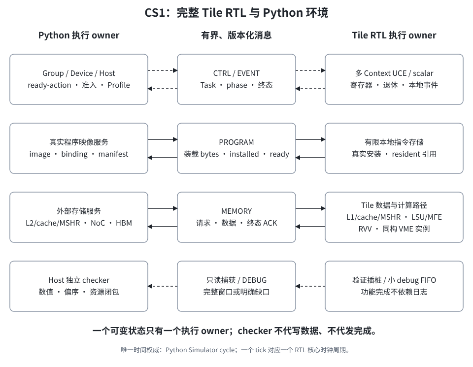
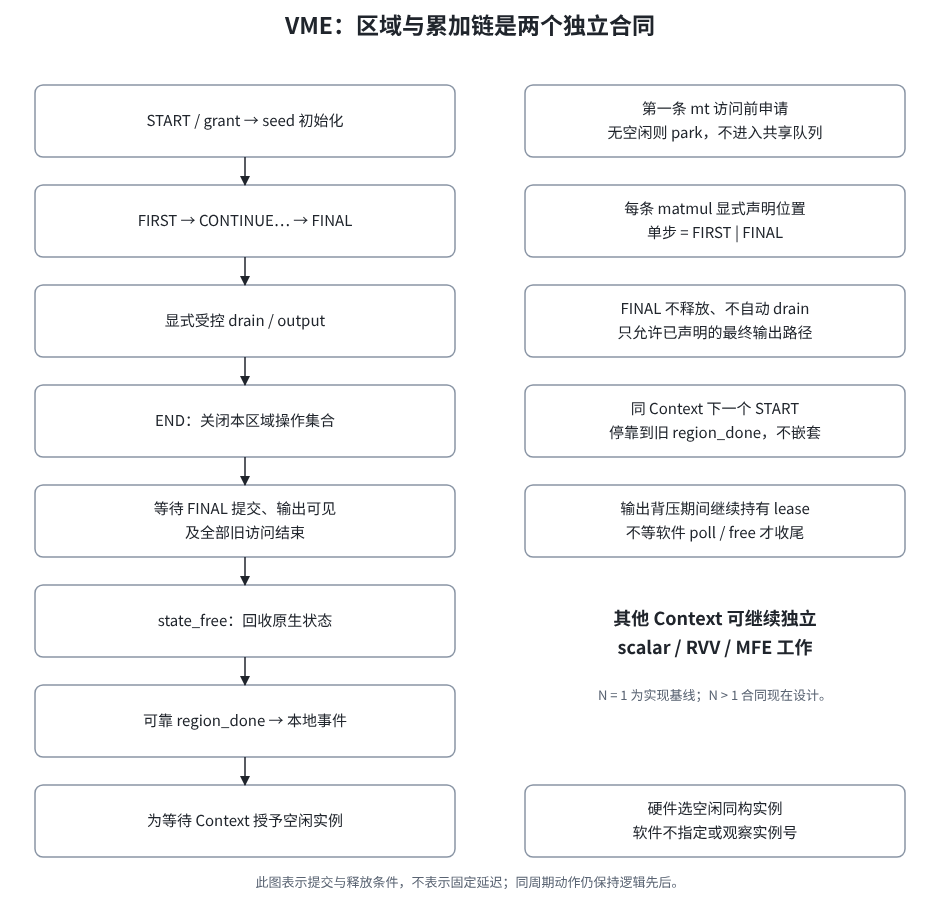
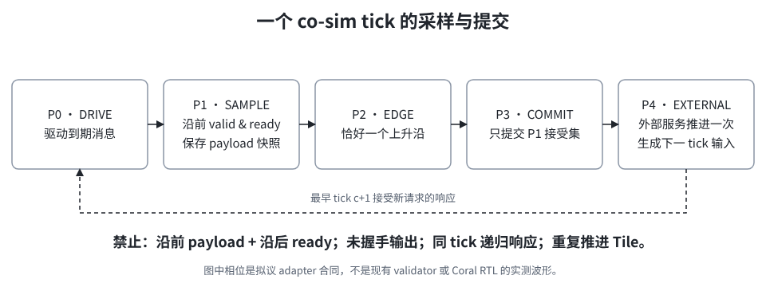

# Coral 派生 Nexus Tile：RTL 与 pipeline validator 联合仿真详细设计

> 状态：**设计 v0.1 已通过用户 review，推荐方案用于详细实施计划**。执行入口见 [plan.md](plan.md)；本轮只列计划与同步决策，不改 RTL／Python 实现，不建立代码脚手架。
> 输入：[prompt_temp.md](../../prompt_temp.md)、[prompt.md](../../prompt.md)、[Tile 需求规格 r5](../../Coral_NPU_to_Nexus_Tile_Requirements_v0.1.md)。
> 本轮用户确认：**Coral Tile RTL 联仿；BF16 张量输入／输出，内部 FP32 累加；保留 Coral BF16 VME 内部 ROD 舍入**。
> 阅读顺序：[实施总计划](plan.md)的已选决策与依赖 → 本文件及负责组件 → 分包任务与验收。设计获批不代表任何目标已实现或验证通过；本次不自动开始代码开发。

## 1. 定位、目标和 First Silicon cutline

### 1.1 本轮交付边界

目标是把 Coral scalar 前端真正改成多 Context UCE，RVV 承担向量计算，VME 承担原 BOA 的矩阵职责，并把**完整 Tile 内部**替换为 RTL。不是外加一个 Python／硬件调度壳，让原单 Context Coral 黑盒轮流跑任务。

当前没有 FPGA。RTL 仿真与 Python 环境组成 CS1：Host／CPU、Device、Group、L2 SRAM／cache／MSHR、NoC 和 HBM／外部服务仍由 Python 实现；Tile 内 UCE、寄存器、退休、RVV／VME、LSU／MFE、L1 SRAM／cache／MSHR、Frame、事件与程序安装均由 RTL 执行。

| 项目         | 本次裁定                                                              | 不可误读为                                            |
| ------------ | --------------------------------------------------------------------- | ----------------------------------------------------- |
| 技术路线     | Coral 派生 Tile，按 r5 设计                                           | Gemmini 阵列或 Rocket＋RoCC BOA 项目                  |
| 工程方式     | 当前仓库内独立子项目，目标路径 `hardware/coral_nexus/`；沿用 monorepo | 本轮已创建 RTL／容器脚手架                            |
| 精度         | BF16 张量输入／输出；FP32 partial、累加及必要内部暂存                 | FP32／INT8 张量模式；把 BF16 偷换成 FP16              |
| 内部数值语义 | 保留固定 Coral BF16 VME 的 ROD（round-to-odd）及实际归约／累加路径    | 普通 FP32 RNE FMA oracle；额外改造为内部 RNE          |
| 标量／索引   | 整数地址、i32 索引、控制与配置保留                                    | “只做 BF16”意味着删除整数 ISA                         |
| Context      | 支持至少两个驻留 Context；单 Context 基线保留                         | 每个 Context 一个完整 Coral 核，或软件全状态保存恢复  |
| VME          | 每实例一个原生区域 lease；N=1 为首个实现基线，接口按 N≥1 设计         | 共享 AM、动态槽配额、多 mt bank 或同 Context 区域并行 |
| 环境         | Docker 为默认运行载体；dev container 引用同一锁定镜像                 | 宿主 apt／sudo／全局 pip／系统配置修改                |
| 验证         | 真实映像、真实端口激励、独立数值参考、偏序和资源闭包                  | Python 算出结果塞回 RTL；周期估算当真实执行           |

`prompt_temp.md` 的需求章节为空；经用户确认，目标采用 `prompt.md` 与 r5。其 Gemmini／BOA 分目录条款视为旧模板，**不**引入另一套实现。计划编制时仓库已无 `hardware/`；新建 `hardware/coral_nexus/`，不恢复或依赖旧 Gemmini／BOA 路线。

r5 §9.3 的参考负载原要求 FP32 输出；本轮明确改为 BF16 对外输出。内部 FP32 seed／drain／scratch 合法，但不能作为新增的对外 FP32 运算模式。原 FP32 fixture 保持原样，另建 BF16 派生语料并重算 output shape／dtype／字节数、绑定、资源和 oracle；不能改输出 buffer 的标签后继续声称同一程序已覆盖。

### 1.2 不延期的正确性与已允许延期的项目

| 必须在 CS1 闭合                                                         | 明确不作为本轮实现目标                                       |
| ----------------------------------------------------------------------- | ------------------------------------------------------------ |
| 全路径 Context／代际身份，等待补位、配置快照、独立逻辑退休              | 通用抢占、上下文迁移、操作系统多 hart 接口                   |
| VME 显式 START／END、每条 matmul FIRST／CONTINUE／FINAL，输出后安全释放 | 共享 AM、阵列组；N>1 VME RTL 实现时机另审，但设计不可排除    |
| L1 bank／SPM／cache／MSHR、真实 indexed gather／scatter、scope 页授权   | 全系统 coherence、IOMMU、ScatterReduce／原子操作等未承诺能力 |
| 真实 kernel／显式 binding／资源 manifest／机器映像、冷／热装载          | 完整 RVV 程序 dialect、通用 LLVM／IREE 后端作为 CS1 前置     |
| Profile、逐 Task 准入、事件、取消／fail-stop／排空、零泄漏              | Context 局部故障恢复；依靠 generation 撤销外部写             |
| 小 FIFO debug、可靠功能完成、Host 完整窗口捕获与重放                    | 大型片上历史日志、正常模式 HBM 日志                          |
| CS1 功能、协议、数值、可解释 RTL 周期结果                               | FPGA、流片、PPA 达标；CS2／CS3 自动开工                      |

完整强制范围来自 r5，不以“先跑一个 matmul”替代。CS2 的 RTL Group／L2 与 CS3 整芯片范围只保留进入门：分别等待 D-24、D-25 的后续评审，不纳入当前 RTL 边界。

### 1.3 证据等级与当前基线

**用户决策优先于旧设计；实现事实以当前源码为准。** 需求规定目标，不代表能力已存在。旧 `design/` 仅作参考；另一个 Nexus 工作树的数值 BOA／共享 AM 不属于本仓库事实。

| 本轮核对事实                                                        | 源码／固定来源                                                                                                                                      | 设计影响                                                                              |
| ------------------------------------------------------------------- | --------------------------------------------------------------------------------------------------------------------------------------------------- | ------------------------------------------------------------------------------------- |
| 抽象产物仍是 schema 3／ABI v3                                       | [compiled_program.py](../../pipeline_validator/compiled_program.py) `894`、`1089`                                                                   | 新 Tile package 独立版本域；不能继承其他工作树 v5，也不能信旧 README 的 v2            |
| BOA／EVU 为 ops 驱动时序模型                                        | [engines.py](../../pipeline_validator/engines.py) `BOAEngine.latency`、`EVUEngine.latency`                                                          | 不提供 RVV／VME 数值真值                                                              |
| 计算 descriptor 无 A／B／C view                                     | [lowering.py](../../pipeline_validator/compiler/lowering.py) `799–854`                                                                              | 真实 kernel 必须显式 binding，禁止从相邻 DMA／buffer 顺序猜参数                       |
| Tile 直接持有 Python transfer／L2 cache／MSHR 对象                  | [tile.py](../../pipeline_validator/tile.py) `1462–1515`；[tile_group.py](../../pipeline_validator/tile_group.py) `247–274`                          | 需要切开消息边界；不能简单包一层 `ComputeTile.step()` 就称 RTL 联仿                   |
| 每 Tile 每 Tick 至多一个 Task 独立提交                              | [tile_group.py](../../pipeline_validator/tile_group.py) `1229–1282`                                                                                 | 不设跨 Tile activation 屏障，不回滚已执行的其他 Tile                                  |
| L1 issue gate 被提交／Route 路径检查，但不在 `admission_version` 内 | 同文件 `1191`、`1231`、`2070–2078`                                                                                                                  | gate 打开需要显式唤醒两条等待路径，不能复制逐 Tick 轮询                               |
| 驻留为同步计时模型，未传真实程序字节                                | [program_table.py](../../pipeline_validator/runtime/program_table.py) `79–111`；[compiler/api.py](../../pipeline_validator/compiler/api.py) `58–90` | 新增 pending install、真实映像、累计容量与安装 ACK，不复用估算 footprint 当机器码长度 |
| Coral store 完成／非 RVV fault 有 PC-only 匹配                      | [固定 RetirementBuffer.scala][coral-retire]，见 W2 直接源码核对                                                                                     | 同映像同 PC 并发会混淆；必须重构匹配键                                                |
| Coral 主构建是 Bazel＋Bzlmod                                        | [固定 .bazelversion][coral-bazel] 为 `9.1.0`，W0 记录其余工具链                                                                                     | 不采用 Gemmini 的 sbt 构建假设                                                        |
| compiler 内嵌的 Coral pin 与目标 RTL 不同                           | [compiler 子模块 pin][compiler-coral-pin] 为 `782675ac…`，目标 RTL 为 `f795221…`                                                                    | 分别锁定并运行兼容性 gate；不能静默改 pin 或宣称已兼容                                |

本轮实际 Python smoke 与证据限制见 §8.4；未构建／运行 Coral RTL。

## 2. 职责、非职责和 ownership

### 2.1 系统分界



源图可编辑于 [cs1_boundary.svg](figures/cs1_boundary.svg)。文档使用 PNG，避免透明 SVG 在外部 Markdown 图片中丢失主题而不可读。

**唯一执行 owner 是状态提交规则，不是“另一侧不许有任何记录”。** Host 可以保存期望值、统计和不可变身份映射；不能用影子数据或计数驱动被替换 Tile 的完成、回填或信用。每个信号都须能说明来自哪个真实状态提交点。

| 可变状态                                                              | CS1 唯一执行 owner           | 其他组件的权限                                                    |
| --------------------------------------------------------------------- | ---------------------------- | ----------------------------------------------------------------- |
| Context PC／GPR／FPR／CSR／scalar ROB／scoreboard                     | RTL W2                       | W6 发停发／唤醒；W7 只读                                          |
| VRF／RVV uop 与退休、VME mt／区域 lease／实例路由                     | RTL W3                       | W2 发带身份指令；W4 提供访存                                      |
| L1 bytes／SPM／cache／MSHR、LSU／MFE 在途、L1 Arena／view／Frame      | RTL W4                       | Group 提供静态计划、协调授权与退休；不保留可执行的 Python L1 副本 |
| 本地事件状态／event wait 记录、first-fault、可靠终态、小 debug FIFO   | RTL W6                       | W2 只持 WAIT 状态／只读 eligibility 摘要；W7 不改功能状态         |
| region 等待记录                                                       | RTL W3                       | 每 Context 至多一项；W2 接受 park／grant 结果，不重复申请         |
| 本地程序 slot／安装事务／指令 SRAM 有效状态                           | RTL W5 安装控制＋W4 物理端口 | Group 保存供应及已确认驻留镜像；不能在等待时间到后代发 installed  |
| Group root／Route／父 L2 pin／R 账本、L2 bytes／cache／MSHR、NoC／HBM | Python Group／外部存储服务   | RTL 仅经消息请求并消费真实响应                                    |
| Profile、scope 页授权的全局协调状态                                   | Python 控制服务              | RTL 为有状态成员／访问检查点，提交自身状态并 ACK                  |
| cycle、激励、oracle、日志／重放／验收报告                             | Python 仿真 Host             | checker 不成为功能返回路径                                        |

### 2.2 当前模型的切换原则

纯 Python 模式仍是独立回归基线；选择某 Tile 的 RTL backend 后，该 Tile 的 Python UCE、engine、L1、MFE、Frame 与本地事件执行路径必须全部关闭。混合运行只允许**不同 Tile**分别使用 Python 或 RTL，不允许同一 Task 一半靠 RTL、一半靠 Python 偷补完成。

`TransferManager` 当前覆盖 L1 与外层多条腿。CS1 必须把被替换 Tile 的 L1 服务／copy／cache 更新切出；Python 只执行外层 L2／NoC／HBM 服务。可以重构内部 API，不能为了“保持代码不动”留下第二个执行 owner。未替换 Python Tile 仍使用其自己的完整路径，必须与 RTL Tile 共享一次外部 memory tick。

### 2.3 工作包设计 owner

八个工作包先由主流程确定边界，再分别调用 subagent 完成细化；本文件负责跨包合同与裁决，不把组件之间的分歧留给低级实现模型自行猜测。

| 包  | 详细设计                                                       | 拥有的设计边界                                           |
| --- | -------------------------------------------------------------- | -------------------------------------------------------- |
| W0  | [基线与环境](components/W0_Baseline_Environment.md)            | 源码／依赖／容器锁，原始与改造基线，统一 target manifest |
| W1  | [消息边界与联仿](components/W1_Boundary_Cosimulation.md)       | 传输、握手、cycle 相位、Task 准入／退休协调              |
| W2  | [Context／UCE](components/W2_Context_UCE.md)                   | 取指、调度、scalar 状态、依赖与退休                      |
| W3  | [RVV／VME](components/W3_RVV_VME.md)                           | 向量与矩阵数值、区域声明／lease、实例路由                |
| W4  | [存储子系统](components/W4_Memory_Subsystem.md)                | L1、LSU／MFE、cache／MSHR、Profile 成员、页授权检查      |
| W5  | [kernel／映像／runtime](components/W5_Kernel_Image_Runtime.md) | 显式计算绑定、真实映像／资源封印、程序驻留与安装         |
| W6  | [事件／故障／复位](components/W6_Events_Fault_Reset.md)        | 可靠事件、等待／唤醒、终态、fail-stop、门控与诊断出口    |
| W7  | [验证／trace／重放](components/W7_Verification_Trace.md)       | 68 场景追踪、独立 oracle、偏序／守恒 checker、证据闭包   |

## 3. 微架构和状态机

### 3.1 身份分域

以下是逻辑字段名，不是已冻结位宽或二进制布局。总线可以携带紧凑索引，但在事务结束前必须能无歧义恢复完整身份。

| 对象      | 最小逻辑身份                                                                                                          | 不得混用                                                                    |
| --------- | --------------------------------------------------------------------------------------------------------------------- | --------------------------------------------------------------------------- |
| Task      | `root_launch_generation + GridInstanceId + logical_task_id`；路由另外携带 physical Tile                               | Task ID 不是 Context slot，不把物理 Tile 混入 Group phase 聚合键            |
| Context   | `ContextKey=(tile_id, context_slot, context_generation)`                                                              | slot 重用必须换 generation；不等于 Arena allocation generation              |
| 指令／uop | `ContextKey + op_seq + subop_id`，或等价 ROB slot＋slot generation                                                    | PC、寄存器编号不能作为完成匹配键                                            |
| 取指      | `ContextKey + fetch_epoch + fetch_request_id`                                                                         | branch redirect 只变 fetch epoch，不作旧 Task 全局取消                      |
| 访存事务  | `txn_id + ContextKey + op_seq`，另有 allocation／Profile／scope epoch                                                 | generation 标签不能撤销已经发出的 store                                     |
| 矩阵区域  | `ContextKey + region_id + state_generation`；内部带 instance                                                          | instance 不进入软件选择接口；新区域不读旧 mt 残留                           |
| 程序      | `program_id + version + package_hash + program_epoch`；package hash 覆盖 image hash、binding／资源 manifest 与 target | 映像字节不变但执行合同改变也要失去旧热命中；run、程序、Profile 代际各自更新 |
| 事件      | 完整 owner／event generation／sequence／kind／scope                                                                   | `ctxN:name` 只是 Python 命名习惯，不是防复用硬件身份                        |

### 3.2 Context 生命周期与独立退休

`FREE → HELD → ACCEPTED/INIT → READY → WAIT_EVENT/WAIT_RESOURCE → READY → DRAINING → RETIRE_READY → TERMINAL → FREE` 为本稿的逻辑状态；`HELD` 只属有界提交事务，不执行用户指令。

- 每 Context 独立 PC、配置、寄存器语义与逻辑退休头。已选 GPR／FPR／VRF 按 Context 复制存储 bank，scalar／RVV ROB 静态私有分区＋独立 head/free/credit；共享 free-list 与全局回收 tail 不在本轮实现，不能只给全局 FIFO 加多个 head 就声称无 HOL。
- 每次发射 bundle 来自一个 Context，只接受程序序的连续前缀。部分接受后只推进已接受指令；PC 按各指令实际长度推进，不假定“接受两条就加 2 字节”。
- wait／region park 不能被该 Context 的年轻指令越过；其他 eligible Context、等待者已接受在途操作、返回与故障路径继续运行。
- `RET` 停止新发射，不立即释放资源。W2 的 `EXEC_DRAINED` 是内部进度，非外部成功终态；还要走 §4.4 的 Group 驱动退休。
- 正常切换不全核 flush／drain／reset；fail-stop 的全 run 排空是故障路径，不混为正常调度成本。

### 3.3 RVV／VME 区域



[可编辑源图](figures/vme_region.svg)。FIRST 是累加链首声明，不是隐含清零；固定 Zvt 的 matmul 为累加形式，先由本区域 seed 初始化。区域可包含受控多条累加链，其数量与目的 mt 集合由封印 manifest 明确界定。

成功必须满足 `compute_done ≤ state_committed ≤ output_visible ≤ state_free ≤ region_done ≤ local_event`。这里 `compute_done` 取所有相关 FINAL 累加实际完成，不取“被接受”；输出是授予时绑定的 L1 view。END 关闭已接受操作集合，后端自行完成排空，不依赖原 Context 再执行 poll／free。

实例选择只由硬件进行：空闲实例轮转选择，无空闲时按有界申请记录停靠；等待记录不占共享 RVV 队首。region 绑定保持到 `region_done`，同 Context 至多一个区域，END 后的下一 START 等旧 `region_done`，不是嵌套错误。N>1 设计包含入口队列、返回／flags／LSU 路由与取消身份；N=1 通过不代表 N≥2 通过。

MAT-10 的合法配置转移是有限模式枚举＋转移表＋字段范围比较：`mset*` 值来自 GPR 不妨碍运行期检查。检查在新配置结算点生效，已接受操作使用原快照。不能以 assertion-only 替代目标硬件检查。

### 3.4 数据存储与授权

L1 是新增子系统，不把 Coral ITCM／DTCM 当成已具备 bank、SPM／cache 分区与 MSHR。

- 同层各 bank 使用一致 SPM／cache 比例；每 bank 的 system reserved、SPM 用户容量、cache、tag／MSHR／控制状态分别计账。L1 与 L2 模式可不同。
- L1 MSHR 在 RTL，L2 MSHR 在 Python；请求、合并、回填、返回和引用结算逐级有唯一 owner。不把相同裸地址的不同 allocation／scope generation 合并。
- indexed gather／scatter 先真实读取索引，再求地址、检查整数溢出／范围／权限，并在目标访问前取得有效 scope 授权引用。授权检查与取引用对撤销原子化，不是把全部访问塞入一条全局队列。
- 撤销顺序是关新访问、结算或隔离旧引用／外写、失效旧缓存并收 ACK、换 epoch／owner。取消可能已有部分分片写出；隔离只保证隔离点后不再写，不能声称整操作从未写过。
- Scatter 在一个 job 内按 `(i,j)` 定义重叠段覆盖顺序；跨 Task 冲突仍要显式依赖／禁止 alias，不能凭硬件调度顺序赋予原子语义。

### 3.5 程序安装与事件

程序 slot 保留空间与 PROGRAM 队列不借用用户数据 Arena、data MSHR 或 data FIFO。程序和数据共享外部物理链路时计量争用并保证公平，逻辑隔离不等于无限带宽。

同程序 pending install 合并为一个真实完成点，所有等待 Task 在安装与 `PROGRAM_READY` 前不得取指。热命中允许控制消息、参数绑定与本地 instruction fetch，但外部 program-text bytes 为零、不重写 resident text。

事件完成持久保存。`WAIT` 匹配一个事件，`WAITALL` 匹配全部声明事件；本轮不新增 WAIT_ANY。原子 check-register 关闭事件先到／同周期／后到的丢唤醒窗口。完成记录与可丢 debug 日志分离，debug 满不能阻塞 state_free、唤醒、资源回收或可靠终态。

## 4. 接口、descriptor、寄存器和协议

### 4.1 逻辑消息与输入输出

| 接口族        | 主要输入                                                                   | 输出／线性化点                            | 背压／失败处理                                                              |
| ------------- | -------------------------------------------------------------------------- | ----------------------------------------- | --------------------------------------------------------------------------- |
| 能力／封印    | target、ISA、Profile registry、包版本、image／binding／资源 hash           | `QUERY_CAPS` 与只读验证结果               | 不支持在加载前拒绝，不运行时补合同                                          |
| Task 提交     | 完整 Task 身份、程序引用、L1 静态计划、参数、R／父资源 ticket              | 本地 hold、最终 COMMIT 授权、accepted ACK | 临时容量等待先补偿；永久超限失败；不残留隐藏预留                            |
| 程序服务      | INSTALL 头，program ID／epoch／长度／slot；Tile 发程序读请求               | 分段字节响应、INSTALLED、READY            | 独立 credit；错误不留半驻留；热路径仍允许元数据消息                         |
| 数据服务      | 身份、txn、地址／长度、权限、allocation／Profile／scope generation、写数据 | 读数据／写完成、错误／隔离终态、终态 ACK  | 保留到真实终态及引用结算；无对象／callback                                  |
| 授权／Profile | grant／revoke、PREPARE／COMMIT、scope 与 range                             | 成员 READY／COMMIT ACK、gate／资源变更    | 旧完成／maintenance／程序通路可继续；普通新发受 gate 约束                   |
| 事件／阶段    | owner／generation／sequence／scope、Task phase                             | 持久本地终态；Group all_tasks 聚合        | 重复 live phase 故障；旧代忽略计数；不重复归还 credit                       |
| 退休／终态    | RETIRE_READY、Group RETIRE 授权                                            | 本地回收完成、可靠 TASK_COMPLETION        | 终态预算预留，背压稳定；Group 结清剩余父资源，已早释放的输入 pin 不重复回收 |
| 故障／复位    | fault source、Context／op、错误地址、特权命令                              | first-fault、停止新发、排空／隔离 ACK     | fail-stop；隔离失败 poison；超时不当成功                                    |
| 观测／debug   | 特权开关、过滤／限额、Host 捕获配置                                        | 计数、诊断 FIFO、完整性标记               | 可丢诊断不承载功能完成；关闭时已接受写仍需结算                              |

逻辑分为 CTRL、EVENT、PROGRAM、MEMORY、DEBUG；前四者的进展预算不依赖 DEBUG。消息队列 credit、在途 transaction slot、终态记录、页访问引用是不同资源，分别列守恒式，不能每个 ACK 无条件把它们同时归还。

### 4.2 接受、可见性与重复

- `valid && ready` 是一次 beat 的接受；发送方被阻塞时保持 `valid/payload`，不推进发送游标。命令接受、事务完成、数据可见和信用归还不是同一时刻。
- CS1 已选进程内 C ABI、固定宽度 POD／显式长度、单线程调用；本地可靠握手不引入 ACK 超时自动重试。显式 status 查询可幂等；重复已接受命令须按事务身份识别，不再执行。未来若改为可能丢消息的传输，重传／去重窗口另行评审。
- 控制 transport 的去重与语义重复不同：传输重播不得重复副作用，两个不同事务重复发布同一活 Task phase 仍是协议错误。不得把当前 `GroupPortAdapter` 的重复 CPU request 异常改成静默成功。
- 不统一规定“收到 ACK 即全局可见”。MEMORY 响应必须声明 read／write／isolated／fault 及可见 scope；源读在真实服务点采样，目标写在对应 owner 的实际提交点发生。

### 4.3 准入：跨 owner 协调，不跨 Tile 成组

以下为已通过 review 的逻辑实现，遵守 IF-13／ADM-02；没有伪造 CSR 或 opcode：

1. Group 创建有界 ticket，执行无副作用 PLAN，记录资源／Profile 版本；未成功的排队请求只占有界元数据。
2. commit 事务内准备父 L2 pin／R 及控制预算，向 RTL 申请本地 Arena／Frame／Context slot hold。hold 排他占用容量（逐 bank `allocated=held+bound`），但不绑定可执行 UCE、不取指；终态／补偿记录同时预留，不能超卖给并发 ticket。
3. 任何准备失败先收齐补偿 ACK，再向等待者返回 WAIT 或失败；零持有要求针对返回等待后的状态，不否认多周期 commit 内的暂态持有。
4. 父／本地资源都就绪后，Group 发最终 COMMIT 授权，RTL 原子建立 Task 绑定并返回 accepted ACK。只有最终授权被接受的 Task 才可能执行；程序提前 READY 不绕过它。
5. executable 还要求程序已安装、READY 身份匹配、Frame／Context 初始化完成、Profile issue gate 允许且无 fault。此 Task 不等待同 Grid 的其他 Tile。
6. 最终授权前失败可以补偿；授权后故障或取消走 drain／隔离，不“回滚”已经发生的副作用。跨取消／授权竞争在唯一事务状态处线性化，并报告实际选择的路径。

ticket、控制 ACK 与父资源持有期间必须留出补偿／完成通路。等待冷装载不能持有一条只有被等待 Task 释放数据才能获得的程序资源链。L1 gate 关闭同时阻止 Route 登记与新 Task commit；打开或容量变化只唤醒受影响的候选，不周期忙轮询。

### 4.4 输入早释放与退休：本地及父资源分别关闭

#### 4.4.1 输入消费通知与 L2 物理回收

输入早释放独立于 Task 退休，完整合同见[总架构 §16.3.1](../ELENOR_Architecture_Design_v1.md#1631-输入消费通知与-l2-提前回收)及需求 ARN-04a／04b／09、EVT-13～15：

1. W4 的 L2 load 完成经 UCE 按事件身份 await，且后续不再有 L2 load，才由 W6 经 W1 的可靠 EVENT 通道发送 `PHASE_SIGNAL(input_released, TaskKey)`；不是 MFE last-source-read 自动发信号，也不等计算结束。
2. Python Group 收齐该 Grid 的全部期望 Task 信号后完成 `all_tasks` 聚合，解除尚存的纯读 L2 pin。读写 pin 不能仅凭输入阶段解除；Group 的 `nest.release %buffer` 另行核查该 buffer 的全部访问与依赖并撤销 owner view。
3. L2 仅在 producer 所有权、所有 claim/view、pin 与 in-flight 全部闭合后，物理归还整个 backing，推进容量版本并唤醒等待者。单个 Task signal、读 pin 解除、view release、物理 final-free 是不同的观察点；共享输入不能因一个消费者退出而被提前复用。

当前信号每 Task 每方向至多一次、针对该 Task 的全部 L2 输入；Group 虽按 buffer 执行 release，但没有同一 Task 按 buffer／范围分批报告、或单 backing 子范围回收能力。输入 backing 可在 Tile 继续计算时回收；L1 Arena、Frame、UCE 槽位、R lease 与程序驻留引用仍遵守各自退休条件。

#### 4.4.2 Task 退休与剩余资源关闭

1. W2 停止新发，收齐原生在途、区域及本地 launch 的结算，产生内部 `EXEC_DRAINED`。
2. RTL 资源／事件设施形成 `RETIRE_READY`：数据访问引用、VME lease、store／fetch 在途义务未闭合则等待；程序驻留引用和本地资源预留此时仍可持有，稍后沿退休链归还，不能要求它们先归零再允许退休。该消息不是外部成功。
3. Group 协调器授权 RETIRE；RTL 关闭自己的 view／Arena／Frame，保证无旧访问再触及被回收状态，并把结果保存在预留的可靠 `TASK_COMPLETION` 记录。
4. Group 接收 TASK_COMPLETION 后清理该 Task **剩余父 L2 pin**、归还 R lease 并结算对应 Route；已按 §4.4.1 或合法 publish/release 关闭的 pin 不重复释放。Grid 只聚合实际参与 Task。root 的 Route、Task、租约与 outstanding 关闭、其自身 L2 view 全 release、Arena 预留与 slack 退休后才发 root 成功完成；仍被其他 root 的共享 claim 持有的 backing 不阻止该 root 完成。
5. Context 复用不等于事件记录删除。保守方案等 completion 握手且旧义务闭合后再复用；如允许早复用，独立记录必须保存旧完整身份，接收迟到消息时不能更新新 occupant。

**禁止两个环**：Tile 等父 R 已 free 才发 TASK_COMPLETION，而 Group 等该完成才 free R；Group 又在 Python 执行一次 RTL 已完成的 L1 回收。L2 backing final-free 可早于或晚于 producer root 退休，不与 Task／root 完成混同。

### 4.5 计算绑定与版本域

简版 package 包含受检控制合同、真实 image、显式 kernel binding、最终资源 manifest 与完整 target identity。可以包裹当前 schema 3／v3 抽象控制产物，但 CS1 缺任一真实执行要件必须拒绝，不允许 adapter 临时猜 operand、codegen 或降回 timing 模型。

binding 至少包括 kernel ID／version、输入／输出 view、shape／dtype／连续布局、权限／alias、seed、scratch／stack／spill、clobber、配置转移表、区域／链声明、完成事件与允许 patch 字段。实际编译／链接后核验 text 长度及本地资源上界，再封印；动态测试的最高水位不能单独证明最坏 stack 上界。

package、abstract artifact、hardware YAML、command／event、日志各有版本域；改变 ISA／数值／资源可行性或身份规则要更新相应版本与指纹、重建产物，不留旧格式 shim。

## 5. 数据流、控制流和时序路径

### 5.1 唯一时间推进



[可编辑源图](figures/cosim_tick.svg)。Python 编排 P0／P4；C++ wrapper 只驱动／采样／求值 RTL，不回调 Python 执行 Group。

- P0 驱动本 Tick 到期输入及接收容量，时钟处于低电平并完成组合稳定。
- P1 对两个方向统一采样 `valid/ready/payload`，冻结接受集与身份快照。
- P2 恰好一个核心上升沿；P3 只把 P1 已握手的输出提交到 Python 队列，沿后新出现的 valid 只供下一 Tick 握手。
- P4 外部服务／Group 控制推进一次，产生下一 Tick 可驱动的消息；未替换 Python Tile 每 Tick 一次，被替换 Tile 不再执行 Python `_step_tiles`。结束时回低并求值，不新增上升沿。
- 新请求最早下一 Tick 返回，禁止同一调用内递归零时延响应。多 Tile 统一 drive／sample／edge，不能按 Tile 顺序让一个 Tile 多走一拍。

这是新 adapter 的相位合同，不是现有 Python 方法调用序的逐周期复制。偏序比较约束合同节点；原生指令与指令级参考对拍，不能要求 abstract validator 与 RTL 的每条 PC 一一相同。

### 5.2 冷启动完整路径

Host 在 Python HBM 服务提供封印 image／数据 → Group 独立完成 root／Task 准入 → PROGRAM_INSTALL 头及程序读请求／字节响应 → RTL 写 program SRAM 并确认 INSTALLED → Group READY → Context 本地取指 → RVV／VME 真实计算 → 输出写到所声明 scope → 显式 phase／外层 store → §4.4 退休闭包。

L2→L1 数据由 RTL MFE 发起请求，Python 只从自己的 L2 服务返回字节；L1 写由 RTL bank 完成。L1→L2 则 RTL 实际读取源、发送 bytes，Python L2 commit 后回报其 scope 完成。不能在命令提交时提前快照全部输入，绕过真实读服务与引用生命周期。

### 5.3 热启动、等待补位与 Profile

同映像驻留身份命中只跳过程序外部取装，不跳过参数校验／Context 初始化／Frame 绑定／Task 准入。本地 fetch 正常进行。

一个 Context 等待访存、事件或 VME lease 时，其他 eligible Context 可运行；同一 Context 的后续指令不能越过等待。Profile 切换是编译器生成的显式事务：关闭新数据 issue、排空、维护、Prepare／Commit 全员 ACK、开门；独立 PROGRAM 服务与旧完成／必要维护通路仍能前进。程序可安装不表示新 Task 可绕过 Profile gate 执行。

### 5.4 故障、取消与门控

first-fault 保存完整归属，本 Tile 停止新 issue，Python Group 启动 fail-stop 排空。已对外发布的合法输出／DONE 不撤销；仍未完成且受取消的 Task 不发布成功，所有已接受工作具有唯一终态。store 真实完成和隔离确认是不同结果，timeout 只是升级路径，不是外部写撤销证明。

Context park／WFI、单元 idle 与 Tile quiescence 分别定义。返回、事件、复位与必要唤醒设施不能随前端等待一起被关掉。CS1 没有 FPGA 不妨碍验证门控边界协议，但不提供真实时钟树或功耗证据。

## 6. 配置、PPA、性能模型和 PMU

### 6.1 单一 target manifest

| 类别       | 必须记录／联动的内容                                                                                           |
| ---------- | -------------------------------------------------------------------------------------------------------------- |
| 来源       | Coral／compiler SHA、补丁序列、传递依赖、许可证／NOTICE、工具链归档 URL／hash                                  |
| 环境       | 基础镜像 digest、包版本／不可变源、Bazel／JDK／Scala／Chisel／firtool／Verilator／C++／交叉编译器／Python 版本 |
| 硬件可行性 | Context 数、VME 实例数／同构几何、VLEN、RF／ROB、程序存储、bank／Profile、队列／事件／在途容量                 |
| 执行语义   | ISA／ABI、numeric profile、配置转移表、内存与事件 scope、取消／故障模型                                        |
| 产物       | RTL／library／image hash、实际 text 长度、binding／资源报告、编译命令、模板 ID                                 |
| 运行       | seed、背压／外部延迟、fidelity、替换 Tile 清单、日志模式、初始状态与 startup epoch                             |

物理值 `由后续规格冻结`；validator 默认 1 MiB L1、64 KiB program SRAM、4 Tile 等是模型配置，不直接冻结 Coral 派生硬件。CS1 合同比较保持 validator 支持的单 Group／4 Tile 路由范围，允许仅替换其中一个 Tile；N=1／N≥2 指 VME 实例数，不是物理 Tile 数或 Context 数。

### 6.2 数值 profile 的评审门

用户已确认**保留 Coral BF16 VME 内部 ROD（round-to-odd）**，不做内部 RNE 算术改造。[固定 `zvt_pe_block.sv`][coral-vme-block] 的乘积 tag 强制 ROD，累加级消费同一 tag；W3 同时核对了宏生成、BF16→FP32 路径、有限宽乘积归约、jam、溢出与 flags。均为源码证据，尚未 RTL 实跑。不能把这条路径简化成每个 K 的普通 RNE FMA。

profile 应记录上游实际归约／舍入／溢出／特殊值／mask 语义，独立参考先按该合同建立，不在不匹配之后改 oracle 迎合 DUT。源码疑似缺陷与 ISA 规范冲突要单独上报，不借“保留上游”免除验证。

最终 FP32→BF16 输出转换是另一处舍入边界：上游 RVV `vfncvtbf16.f.f.w` 的 rounding 由 `frm` 决定，W3 已核对真实解码路径。**输出转换已按用户选择的推荐方案确定为 RNE**；它不改变已确认的 VME 内部 ROD。NaN／Inf／subnormal／signed zero、无效 lane、flags、初值与 K 尾的精确合同、profile ID 与执行证据仍须在实现前闭合。

不能用 BLAS／Python binary64 的“数值差不多”替代指令语义。独立 oracle 读取原始 BF16 bits，按受检 profile 执行并比较真实输出 bytes；profile 不匹配属于阻断项，不能放宽容差迎合 DUT。上游某 dtype 可译码不等于该构建配置已经数值验证。

### 6.3 性能口径

P0 原 Coral、P1 改造硬件单 Context、PN 同硬件多 Context、PS 另行评审的扩大配置分开。对比需同总工作量／精度／外存条件；记录启动、装载、计算、输出可见、终态与资源回收统计边界。

RTL cycle 给出被测 Tile 的周期证据；Python HBM／L2 延迟仍是环境模型。`clock_mhz` 不是 Fmax，模拟 cycle 数不是板卡实测。暂不做多 VME 利用率估算，不输出面积／mW 或固定加速比承诺。debug 扰动、正常 PMU 与 Host 被动捕获分开报告。

## 7. RTL/软件实现建议

### 7.1 Monorepo 结构建议

下列为已选目标布局；计划编制时仅设计文档存在，代码和环境目录由 [W0 实施计划](implementation/W0_Baseline_Environment_Plan.md)创建，本轮不建立脚手架。

```text
hardware/coral_nexus/
  upstream/                 固定 Coral 来源；独立工作树或受控补丁输入
  patches/                  可追踪的上游差异与顺序
  rtl/                      Nexus Context、接口与存储集成
  kernels/                  固定 C／汇编模板、binding、linker 资源约束
  protocol/                 版本化逻辑协议与生成产物权威
  sim/                      Verilator C ABI wrapper；无 Python 功能回调
  verification/             单元激励、断言、独立参考及场景定义
  configs/                  支持配置与 target manifest
  env/                      Dockerfile、依赖锁、离线复现清单
  scripts/                  经验证的构建／运行／复现命令入口
pipeline_validator/         既有 Python 子项目；未来只改消息适配与目标合同
examples/                   保留原语料；新增显式 BF16 派生场景
out/coral_nexus/             未来运行产物，不混入源码
.devcontainer/              引用同一环境，不维护第二套工具链
```

已选 **pristine submodule＋可审补丁序列**；在 `out/` 的派生工作树应用补丁，不直接修改来源 submodule。固定 fork 为以后单独评审的迁移路径，不自动切换。不能用未锁定分支名／latest 代替源码身份；许可与传递依赖声明随产物保留。

### 7.2 可复现环境合同

W0 已核对 Coral 的 Bazel／Bzlmod 与上游容器路径。正式环境在容器内解析依赖，宿主只需已有 Docker，禁止宿主 apt／sudo／全局 pip，禁止挂 Docker socket／privileged 或修改 daemon／shell profile。

复现分两项验收：

1. **执行复现**：封存镜像 digest／必要工具归档、源／配置／输入／seed，断网重跑得到同输出 bits、同确定性 cycle 和相同合同 verdict。
2. **构建复现**：基础镜像、包版本及不可变软件包源／缓存齐全；清构建缓存可重建相同语义产物。OCI metadata／时间戳造成 digest 差异须解释，不能把网络包漂移登记一下就算通过，也不能只比镜像 digest 证明 RTL 一致。

构建期可联网获取被锁定的依赖，运行与重放默认断网。dev container 同样使用非 root UID／GID、独立可丢缓存与输出目录；不在源码工作树散落 root-owned 文件。完整 Coral compiler 构建不是首个固定汇编 kernel／CS1 的前置。

### 7.3 任务概览与依赖排序

此表保留设计工作包概览；文件级任务、优先级、依赖、命令与独立验证见 [plan.md](plan.md)及其 W0–W7 分包计划。用户已批准按推荐方案列计划，本轮不执行实现。

| 包／优先级 | 输入与前置合同                              | 输出                                         | 独立验证出口                                           |
| ---------- | ------------------------------------------- | -------------------------------------------- | ------------------------------------------------------ |
| W0／P0     | 固定来源与本轮范围                          | 可锁环境、合法配置、基线 manifest            | 容器原始核 smoke、离线复跑、依赖／配置负例             |
| W1／P0     | W0 来源；本稿身份／owner／生命周期          | 可序列化消息、单 Tick driver、准入／退休协议 | 随机握手、重复／旧代、补偿、无双 owner                 |
| W2／P0     | W1 身份／事件／存储接口定义                 | 多 Context fetch／issue／状态／retire        | 同 PC／同寄存器、部分接受、A 等待 B 退休               |
| W3／P0     | W1 身份，W2 配置／退休接口，数值裁决        | RVV／VME、区域／链、N 维实例接口             | 原始 bits、合法／非法声明、输出背压与释放              |
| W4／P0     | W1 外层服务，W2 原生访存，Profile／授权合同 | RTL L1／LSU／MFE／Frame 与页检查             | 真实字节、ordered scatter、取消、Profile、逐 bank 守恒 |
| W5／P0     | W0 工具链，W1 装载，W2／W3 指令合同         | 真实 image＋binding＋最终资源包、冷／热驻留  | tamper／资源超限拒绝、同映像重入、真实取装             |
| W6／P0     | W1 控制；W2–W4 在途／释放接口               | 持久事件、终态、fault／reset、门控／debug    | 丢唤醒竞争、已接受取消、first-fault、背压              |
| W7／P0     | W1 日志与 W3 oracle；W5 sealed package      | 适用性矩阵、checker、trace／重放、出口报告   | checker 负例有检出、适用场景全过、零泄漏               |

接口定义先共审，组件单元可用有界协议驱动器独立验证；驱动器只用于单元测试，不冒充最终 CS1。实现依赖不存在“先有完整 LLVM 才能造 image”或“W7 全部完成才能写 W2”的环：W7 checker 设计可先行，集成验收要等真实组件。

### 7.4 给低级实现模型的统一 guide

这里“低级模型”指后续执行开发任务的模型，不是降低硬件／验证保真度。

1. 先读本稿、负责包与关联 r5 条款；检查来源 pin、支持配置、共享字段。旧 proposal 与其他工作树不能补写未批准决策。
2. 列出该包读写的全部状态和入／出通道；每个状态只有一个 writer，每个 accepted 工作都有终态／引用归还路径。
3. 从最小受支持配置贯通真实链路。错误／背压／取消／旧代处理与正常路径同时实现，不留 dummy done、固定延迟成功或 Python 代算 fallback。
4. 同时完成调用方、manifest／版本、独立检查器与有意义的负例；任何字段必须从生产者一路到消费者被实际使用，不能只序列化但不执行。
5. 用所负责组件 §8 的实际输出／握手／状态验证，不以“编译成功／没有抛异常／trace 变长”作正确性证据。
6. 合同冲突、缺数值证据或必需参数未获批时停在明确边界，提交最小证据和待决方案；不暗自改精度、删功能、降验收标准。设计／计划的待决表不是允许实现占位符的清单。
7. 交付需包含精确运行命令、source／image／config hash、输入／期望／实际 bytes、trace／断言报告与未覆盖项；只有适用强制项全通过才声称完成。

## 8. 验证、bring-up 和验收标准

### 8.1 独立证据层

| 层                 | 证明                                                         | 不证明                                  |
| ------------------ | ------------------------------------------------------------ | --------------------------------------- |
| 当前 Python 基线   | 调度、准入、生命周期；ByteStore 下真实 indexed 搬运          | RVV／VME 算术、Tile RTL                 |
| 独立 ISA／数值参考 | 命名 numeric profile 与受控 kernel 语义                      | RTL 时序、外存延迟隐藏                  |
| RTL 单元           | 身份、握手、配置、backpressure、局部状态机                   | 完整 CS1 资源闭包                       |
| CS1                | 真实 Tile＋Python 外层，数值／协议／偏序／资源守恒、真实装载 | RTL Group／HBM controller、整芯片或 PPA |
| 综合／物理／板卡   | 对应配置／库／板卡上的实现指标                               | 未测试配置及其他证据层                  |

### 8.2 强制验收与追踪

[W7 §8](components/W7_Verification_Trace.md) 为 T-01～T-68 逐项主责、输入与 oracle。CS1 必须覆盖本地状态及外部 Python 协作的强制子项，包括逐 Tile 准入、L1 Profile／维护、取消旧代回包、L2 引用闭包；不能把有关 L2 的整条用例都推迟到 CS2。

- 适用 mandatory 条目：PASS 才满足出口；BLOCKED／FAIL 都不能当完成。
- T-59／T-60 分别标为 CS2／CS3 后续评审阶段，不消失、不伪造本轮 PASS。
- T-68 的 N=1 区域／链声明／释放必验；N≥2 路由／并发子项在实现 N>1 后验收，当前标设计覆盖／实现延期，不以 N=1 代过。
- 对已接受工作逐一检查终态唯一、credit／view／pin／Arena／R／MSHR／program 引用闭合；Task、Grid、root 终态不是一个 done 位。
- 偏序检查使用显式节点映射与原始 `cycle/phase/seq`。不同 Context 的合法全局 interleave 可以不同；不要求 RTL 与 roofline 模型周期相等。
- 负例必须能检出早完成、双回收、旧代写新代、无绑定猜 operand、gate 丢唤醒、缺 FINAL、program 半驻留、checker 缺口仍宣称可重放。

### 8.3 Trace／重放可信度

Host 原始日志保存完整输入、实际握手、数据 bytes 或可取回 blob、初始状态／内存、image／manifest hash、seed 与背压设置，保留整数 cycle／phase／严格 seq。只对完整无缺口窗口保证单侧重放；缺 payload、缺初态、捕获截断时明确拒绝完整重放宣称。

Perfetto 是派生展示与 SQL 分析表面，不是唯一真值。当前 [trace.py](../../pipeline_validator/trace.py) 把 cycle 换算为 µs 并保留三位小数，Perfetto 使用 ns；只有在 1000 MHz 等特定配置下数值才与 cycle 对应，不能把 ns 无条件当 cycle。原始 seq 负责同 Tick 逻辑先后，展示 lane／最小 duration 不承担生命周期证明。

正常硬件不留历史、不写 HBM 日志；Host 被动捕获不改变这一约束。debug FIFO 溢出只影响诊断完整性，不影响功能事件。Host 文件也有明确容量／窗口策略，超限标缺口，不把无限内存当设计前提。

### 8.4 本轮已运行证据（仅当前模型）

本轮未运行 pytest，也未构建／运行 Coral RTL。实际做了以下 smoke：

| 检查                                                         | 观测结果                                                                                                                       | 证据边界                                                                         |
| ------------------------------------------------------------ | ------------------------------------------------------------------------------------------------------------------------------ | -------------------------------------------------------------------------------- |
| Docker CLI／daemon                                           | `28.3.0 / 28.3.0`                                                                                                              | 没有 pull／build／run 硬件镜像                                                   |
| 原生 CLI `pow`，`full_memory`，Context 容量 2                | 9853 cycles；7 项报告检查全通过，Arena 零泄漏                                                                                  | 未注入 ByteStore；pow 仍是 EVU 时序，不证明平方数值                              |
| indexed gather／scatter，serialize→parse→load→run，ByteStore | 1710 cycles；OUT row 1=`[10,11,12,13]`，row 2=`[40,41,42,43]`；row 0／3 未初始化；gather／scatter 各 48 bytes；L1／L2 引用闭合 | i32 是既有索引／搬运回归，不扩张张量数值范围；不是 RTL                           |
| Perfetto 导入 pow／indexed                                   | slice 为 775／513，counter 为 4770／1470，与 raw JSON 对账一致                                                                 | 分别出现 2／3 个 overlap-spill 提示；不可据此声称 trace 完全无警告或完整边界重放 |

CLI 首次因缺少实际 `Y` binding 被 Loader 拒绝，补齐声明后完成；没有绕过加载检查。可在已安装的 validator 环境中复现成功命令：

```bash
python -m pipeline_validator --workload pow --context-mode 2 \
  --input-binding Y=0x100000:524288:rw \
  --sim-override fidelity=full_memory --memory-trace \
  --compiled-output /tmp/coral-cs1-design-smoke/pow.compiled.json \
  --trace-json /tmp/coral-cs1-design-smoke/pow.trace.json \
  --json --report /tmp/coral-cs1-design-smoke/pow.report.json
```

运行产物在 `/tmp/coral-cs1-design-20261105/`，为临时检查结果，不作为交付依赖；可复现输入、观测与源码指纹记录在 [设计验证记录](Design_Validation.md)。该记录同时列文档／图示检查，不将其标成 T-39／T-58 等 RTL 场景通过。

## 9. 风险、取舍和后续细化方向

### 9.1 已选方案与实施证据门

| 项                                          | 已选方案／范围                                                                 | 仍须完成的实施证据                                                    |
| ------------------------------------------- | ------------------------------------------------------------------------------ | --------------------------------------------------------------------- |
| Coral 路线、BF16 I/O＋FP32 内部             | **用户已确认**                                                                 | 本稿 §1；不再继承 Gemmini／对外 FP32／INT8                            |
| 完整 Tile 替换、唯一 owner、无跨 Tile gang  | 继承 r5 硬合同                                                                 | W1／W4 的消息与状态清单、T-20／T-64                                   |
| VME 单区域 lease／显式链声明／同构 N 维接口 | 继承 r5；N>1 RTL 时机未定                                                      | W3 合法／非法序列与 T-62／T-68                                        |
| VME 内部 ROD                                | **用户已确认保留固定 Coral 数值路径**，不改内部 RNE                            | 实际有限宽／归约／舍入／溢出／flags 合同与独立 oracle、RTL 实跑       |
| 最终 BF16 输出转换                          | **已选 RVV `frm=RNE`**，与 VME 内部 ROD 分列                                   | 真实转换指令、特殊值及逐比特用例；选择已定不等于测试通过              |
| C ABI／单线程相位 driver                    | **采用推荐方案**；Python 为唯一时间权威                                        | W1 握手与跨边界闭包；不新增丢包重试                                   |
| Group 驱动本地退休、可靠完成再关剩余父资源  | **采用 §4.4.2**；输入早释放独立按 §4.4.1                                       | 无循环等待、无双回收、独立终态记录容量与取消竞争                      |
| RF／ROB／程序 slot、调度                    | Context 独立 RF、静态私有 ROB、多固定预链接 slot、四 lane 单 Context 前缀与 RR | 深度／容量／端口由 plan.md 冻结任务产生；公平界、并存与回绕证据不省略 |
| 固定 C／汇编 kernel 首行、完整后端后审      | 继承简版交付方向                                                               | W5 真实 image、stack／scratch／spill 上界、可重入与配置检查           |
| compiler 自带 Coral pin 与目标 RTL 不同     | 保留原来源并设兼容性 gate                                                      | 不同 pin 产物在目标 ISA／数值上的实跑证据，未过不标 supported         |
| L1／cache／MSHR 与页授权不是 Coral 既有能力 | 新增必要实现，不能省略                                                         | W4 单元＋CS1；不用 Host 页池测试冒充设备授权                          |
| 容器包源与镜像锁                            | 已选 Debian trixie digest＋不可变 apt snapshot＋可校验离线种子                 | W0 清缓存重建与断网执行两类证据                                       |
| ISA 声明载体、CSR／地址位宽                 | 已选受控 helper＋每 Context 伴随 CSR 声明；具体编码／位宽由计划前置任务冻结    | 解码空间无冲突、声明一次原子消费、返回身份与回绕证明；不臆造 opcode   |
| NEST N05 与现行逐 Tile 提交冲突             | 继承 r5 的 T-20 裁决，测试 manifest 必须显式覆盖旧期望                         | W7 的 N05→T-20 映射；实现时同步原规范，本轮不改旧文档                 |
| CS2／CS3、PPA／FPGA                         | 后续独立评审                                                                   | CS1 出口之后才讨论下一层，不能由本文自动授权                          |

### 9.2 禁止“看起来能跑”的替代方案

- 只切 PC，保留共享 GPR／VRF／CSR 或 PC-keyed store completion。
- 保留全局退休／共享 RVV 队首，让等 VME 的新 Context 挡住 owner 的最终输出。
- FINAL 自动触发 drain 或把 END／最后指令 accepted 当 region_done。
- 以高精度软件结果写回、预测 finish cycle 发完成、testbench 后门预载替代真实执行路径。
- 双份 L1／MSHR／MFE／credit 执行账本，或用解析式驻留状态代替 installed ACK。
- 在 completion、取消、日志满、Profile gate 关闭时提前释放身份／地址／引用。
- 用旧 proposal、历史版本号、未被消费参数、没有 output bytes 的 trace 宣称支持。

### 9.3 设计批准后的执行边界

用户已 review 通过设计并要求可选项采用推荐方案，详细中文实施计划见 [plan.md](plan.md)。本次交付文件级任务、输入／输出、实现 guide、命令、负例与退出条件，不自动开始代码或环境建设；批准方案不替代参数冻结、能力验证和实际验收。

本次按用户 review 同步输入早释放勘误到总架构与根需求规格，不新增细粒度释放能力；不修改旧 proposal、现有用例、实现代码、系统文件或运行环境。其他范围差异与已知漂移仍按本稿显式记录；批准后的实现必须同步受影响合同与调用方，不能依赖两份互相矛盾的规范。

[coral-retire]: https://github.com/google-coral/coralnpu/blob/f79522157fc0f1d7311f44e209fc36c9c8b7a039/hdl/chisel/src/coralnpu/RetirementBuffer.scala
[coral-bazel]: https://github.com/google-coral/coralnpu/blob/f79522157fc0f1d7311f44e209fc36c9c8b7a039/.bazelversion
[compiler-coral-pin]: https://api.github.com/repos/google-coral/coralnpu-compiler/contents/third_party/coralnpu?ref=d715556c3853719e414182c0bf5f4a10f248f1d9
[coral-vme-block]: https://github.com/google-coral/coralnpu/blob/f79522157fc0f1d7311f44e209fc36c9c8b7a039/hdl/verilog/rvv/design/Zvt/zvt_pe_block.sv#L90-L91
